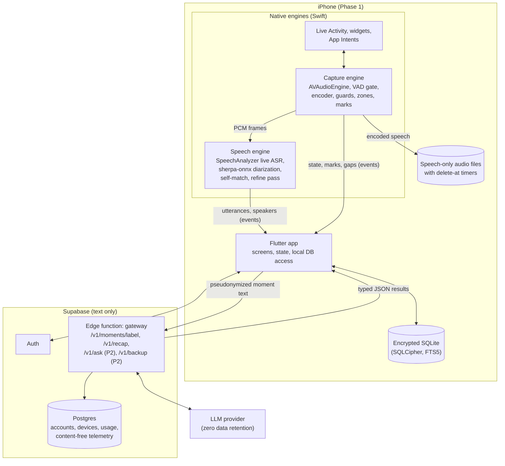
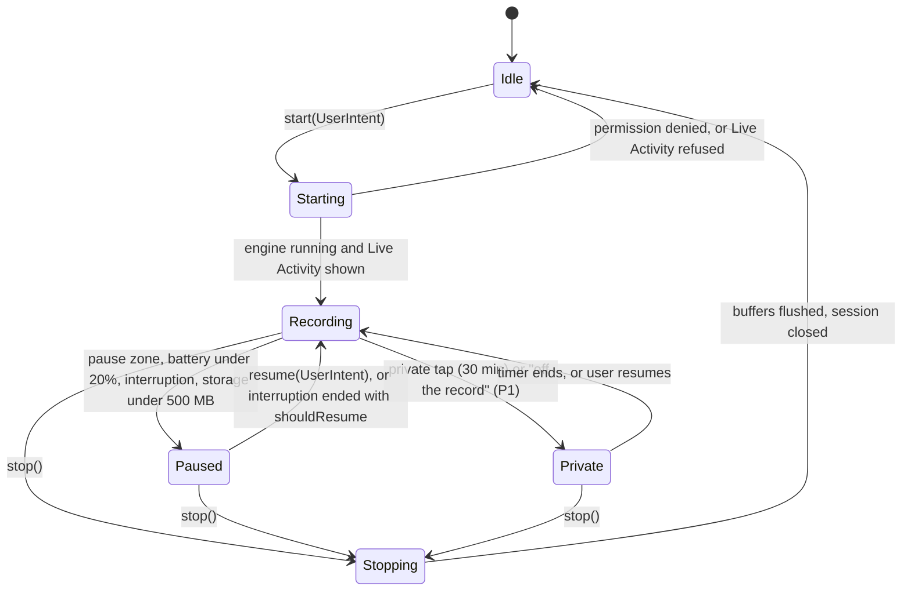

# Implementation Specification: Day Recap App (codename `mona`)

| | |
| --- | --- |
| Status | Draft v0.1, for review |
| Date | 2026-10-25 |
| Covers | Phase 0 (feasibility) and Phase 1 (MVP alpha, iOS) in build detail; Phases 2 and 3 in outline |
| Inputs | [PRD](product/prd.md) (2026-10-24), [Feature deep dive and dev plan](product/feature-deep-dive-and-dev-plan.md) (2026-10-20), [How it works and user value](product/how-it-works-and-user-value.md) (2026-10-24) |

This document turns the PRD into something engineers can build from. It fixes the repository layout, the module boundaries, the on-device and cloud data contracts, the privacy rules as testable invariants, and the work plan for the first 11 weeks. Where it makes a choice the PRD leaves open, the choice is listed in [§21 Decisions](#21-decisions) so it can be challenged.

---

## Contents

1. [Scope and sources](#1-scope-and-sources)
2. [Invariants](#2-invariants)
3. [System overview](#3-system-overview)
4. [Repository layout](#4-repository-layout)
5. [Mobile app architecture](#5-mobile-app-architecture)
6. [Capture engine](#6-capture-engine)
7. [Speech engine](#7-speech-engine)
8. [Understanding pipeline](#8-understanding-pipeline)
9. [Recap and morning nudge](#9-recap-and-morning-nudge)
10. [Local data layer](#10-local-data-layer)
11. [Backend](#11-backend)
12. [Cloud API contracts](#12-cloud-api-contracts)
13. [Privacy and consent implementation](#13-privacy-and-consent-implementation)
14. [Background execution and notifications](#14-background-execution-and-notifications)
15. [Telemetry and metrics](#15-telemetry-and-metrics)
16. [Evaluation harness](#16-evaluation-harness)
17. [Testing and CI](#17-testing-and-ci)
18. [Security](#18-security)
19. [Phase 0 plan](#19-phase-0-plan)
20. [Phase 1 plan](#20-phase-1-plan)
21. [Decisions](#21-decisions)
22. [Open questions](#22-open-questions)
23. [Appendix: P0 traceability](#23-appendix-p0-traceability)

---

## 1. Scope and sources

### 1.1 What this spec covers

- **Phase 0, weeks 1 to 3:** the spikes that decide Gate A (8-hour capture, battery, speaker accuracy, Mandarin-English transcription, cost), plus the evaluation set.
- **Phase 1, weeks 4 to 11, iOS only:** Day mode, Meeting Scene, speaker separation with "You", naming and fixes, item extraction, evening recap, morning nudge, consent card, privacy center, retention, export. Ends at Gate B with 30 alpha users.
- **Phases 2 and 3** (Trip, Show, reels, Ask, Android, Lecture, launch) are outlined only far enough that Phase 1 does not paint them into a corner: data model fields, interfaces and extension points exist from day one.

### 1.2 How conflicts between the source docs were resolved

The PRD (Oct 24) is newer than the dev plan (Oct 20) and wins wherever they differ.

| Topic | Dev plan said | PRD says | This spec |
| --- | --- | --- | --- |
| App stack | Swift and SwiftUI, native iOS | Flutter with native modules for capture, speech and video | Flutter UI; capture, speech and media as native engines behind typed channels (D1, D2) |
| Android timing | From Phase 3 | Android capture service in Phase 2 | Phase 2; Phase 1 keeps the Dart engine API platform-neutral |
| Timeline | About 30 weeks, five phases | 34 weeks: Phases 0 to 3 plus v1.1, launch in week 26 | PRD timeline |
| Team | Two engineers | Flutter, native, backend/ML engineers, part-time designer, product lead | PRD team; owners in §20 use these roles |
| Backend | Postgres, object storage, queue, Python worker | Supabase auth, Postgres, edge functions as the gateway | Supabase; no queue or worker in Phase 1 (gateway is synchronous) |

### 1.3 Out of scope for Phases 0 and 1

Camera capture and reels, live translation, Trip and Show Scenes, Ask your day, Android, encrypted backup, remembered voices, Watch app, Lecture and Appointment Scenes, pricing and billing UI. Each still gets schema fields or an interface where noted.

---

## 2. Invariants

These are the rules every module must keep. Each has an automated check (§17); a failing check blocks release.

| ID | Invariant | Enforced by | Check |
| --- | --- | --- | --- |
| I1 | Nothing is recorded unless the user started a session or accepted a prompt in the foreground. No automatic or hidden start. | Capture engine state machine (§6.2) | Unit test: every `start` path requires a `UserIntent` token; static check that no background task calls `start` |
| I2 | While audio is captured, the recording state is visible: Live Activity on iOS, in-app pill, system mic indicator. | Capture engine, Live Activity (§6.6) | UI test; capture refuses to start if the Live Activity request fails |
| I3 | Raw audio, video and voice signatures never leave the phone. | Network layer only accepts typed text DTOs (§12) | Contract test: request bodies are schema-validated; no binary fields except `/v1/backup` ciphertext |
| I4 | Only text from flagged moments goes to the cloud, with speaker names and known person names replaced by tokens. | Pseudonymizer (§8.4) | Property test: no `person.display_name` or `speaker.display_name` string survives in any outgoing payload |
| I5 | Other people's voice signatures exist only for the life of a session and are deleted at session close. | Speech engine (§7.5) | Integration test: after `closeSession`, no non-self embedding exists on disk or in the DB |
| I6 | The user's own voice signature is created only after an explicit consent record. | Enrollment flow (§13.3) | DB constraint: `voice_signature.consent_record_id NOT NULL`, foreign key to a granted record |
| I7 | Silence and background noise are never stored. | VAD gate before the encoder (§6.4) | Test: a 10-minute silence fixture produces zero audio media rows |
| I8 | Raw audio is deleted at `delete_at` (default 7 days, user range 1 to 30). | Retention job (§10.5) | Automated deletion test with a fake clock (PRD acceptance) |
| I9 | Every item and every recap entry links to at least one source utterance. | Gateway citation check plus client check (§8.5) | Items with no valid citation are dropped, never shown |
| I10 | Meeting and Appointment sessions always show the consent card before capture starts. | Session start flow (§13.1) | `session.consent_shown_at NOT NULL` for those Scenes; telemetry metric must read 100% |
| I11 | The server never stores transcripts, item text or recap text, and never logs request bodies. | Gateway (§11.4) | Code review rule plus a log-scrape test in staging |
| I12 | Low-confidence speaker attributions and items are shown with "?" and are never pushed as reminders. | Speech engine thresholds (§7.6), nudge filter (§9.4) | Unit tests on threshold gates |

---

## 3. System overview



**Runtime split.** Anything that touches raw audio runs in Swift, inside the app process, kept alive in the background by the active audio session. Flutter owns the UI, the database and the network. The two talk through generated, typed channels (Pigeon): commands go down, events come up as a stream. If the Flutter engine is suspended or slow, the native engines keep capturing and buffer events in a small native journal (§6.8) that Dart drains on resume.

**Processing passes** (from the PRD) map to code as follows.

| Pass | Trigger | Runs in | Does | Budget |
| --- | --- | --- | --- | --- |
| 1. Live | Continuous while recording | Swift engines | VAD, streaming ASR, provisional speaker lanes, self-match | Text within 1.5 s of speech |
| 2. Session close | Meeting ends; or a Day-mode moment boundary | Swift (re-cluster) then Dart (pseudonymize, call gateway) | Re-cluster speakers, drop other-person embeddings, label moment, extract items, write minutes | Minutes within 2 min of the end |
| 3. Evening recap | User's recap time | Dart, gateway | Rank the day's items into at most 10 entries plus a fun line | Under 30 s |
| 4. Overnight refine | Charging, idle (BGProcessingTask) | Swift, then Dart | Second ASR pass (Breeze-ASR-25 if Phase 0 shows it fits), re-run items for changed text, update morning nudge | Done before the nudge time |

---

## 4. Repository layout

One monorepo. Each top-level folder builds and tests on its own. Only `docs/` exists today; the rest is the target layout that Phase 0 and Phase 1 fill in.

```
mona/
├── README.md
├── docs/
│   ├── implementation-spec.md        ← this file
│   └── product/                      ← PRD and research snapshots
├── app/                              ← Flutter application (Phase 1)
│   ├── lib/
│   │   ├── main.dart
│   │   ├── core/                     ← config, flags, logging, clock, result types
│   │   ├── data/                     ← drift database, DAOs, migrations, repositories
│   │   ├── domain/                   ← entities, services (moments, items, recap, retention)
│   │   ├── engines/                  ← Dart facades over the native engines (Pigeon clients)
│   │   ├── cloud/                    ← gateway client, pseudonymizer, DTOs
│   │   └── features/                 ← one folder per screen: today, live_session, recap,
│   │                                   timeline, moment, people, privacy, onboarding, settings
│   ├── ios/                          ← Runner, Live Activity + widget extension, App Intents
│   ├── test/                         ← unit and widget tests
│   └── integration_test/             ← on-device flows
├── packages/
│   ├── engine_api/                   ← Pigeon definitions (single source of the channel contract)
│   ├── capture_engine/               ← Flutter plugin: Dart API + ios/ (Swift); android/ in Phase 2
│   ├── speech_engine/                ← Flutter plugin: Dart API + ios/ (Swift, sherpa-onnx, SpeechAnalyzer)
│   ├── media_engine/                 ← Phase 2: camera, reels (placeholder only)
│   └── cloud_contracts/              ← JSON Schemas for the gateway; generates Dart and TypeScript types
├── backend/
│   └── supabase/
│       ├── config.toml
│       ├── migrations/               ← SQL, RLS policies
│       ├── functions/gateway/        ← Deno/TypeScript edge function
│       └── tests/
├── eval/                             ← Python evaluation harness (§16); manifests only, no audio
└── .github/workflows/                ← CI (§17)
```

`packages/cloud_contracts` holds the JSON Schemas in §12. Both the Dart client and the TypeScript gateway are generated from it, so the contract cannot drift between them.

---

## 5. Mobile app architecture

### 5.1 Platform targets

- **iOS 26 minimum** for Phase 1 (D4). SpeechAnalyzer requires it; alpha testers are recruited on supported phones. The launch minimum is an open question (§22).
- Phase 1 test devices: iPhone 15 Pro (lowest Apple Intelligence device), iPhone 16, iPhone 17. All Gate A numbers are measured on the 15 Pro as the floor.
- Flutter stable, pinned per repo with FVM (`.fvmrc`); Xcode version pinned in CI.

### 5.2 Layers

| Layer | Responsibility | Depends on |
| --- | --- | --- |
| `features/*` | Widgets, view models (Riverpod notifiers), navigation | `domain`, `engines` |
| `domain` | Session lifecycle, moment splitting, item rules, recap assembly, retention, export | `data`, `cloud`, `engines` |
| `data` | drift database, DAOs, migrations, file paths | SQLCipher |
| `cloud` | Supabase auth, gateway client, pseudonymizer, retry and offline queue | `cloud_contracts` |
| `engines` | Dart facades for capture and speech; turns Pigeon events into typed streams | `engine_api` |

- State management: Riverpod (D10). Navigation: go_router. Models: freezed + json_serializable.
- Every time-dependent rule takes a `Clock` from `core` so retention, recap timing and due dates are testable with a fake clock.
- Feature flags live in a local `flags` table, seeded per build flavor (`dev`, `alpha`, `beta`), overridable from a hidden debug screen. Flags gate unfinished Phase 2 work and A/B variants (for example on-device vs cloud item extraction, §8.3).

### 5.3 Native boundary (Pigeon)

`packages/engine_api/pigeons/engine.dart` defines the contract. Sketch:

```dart
@HostApi()
abstract class CaptureHostApi {
  StartResult start(StartRequest req);      // req.intentToken proves a user action (I1)
  void pause(PauseReason reason, int? minutes);
  void resume(UserIntentToken token);
  void mark(MarkSource source);
  CloseResult stop();
  CaptureStatus status();
}

@HostApi()
abstract class SpeechHostApi {
  EnrollResult enrollSelf(String consentRecordId, String audioPath);
  void setSessionHints(String sessionId, int? attendeeCount, List<String> locales);
  ReclusterResult recluster(String sessionId, int fromMs, int toMs, int? numSpeakers);
  void deleteSessionSignatures(String sessionId);
  void splitSpeaker(String sessionId, String speakerId, List<String> utteranceIds);
}

@FlutterApi()
abstract class EngineEvents {
  void onCaptureState(CaptureStateEvent e);   // recording, paused(reason), private, stopped
  void onUtterance(UtteranceEvent e);         // volatile or final, with speaker guess
  void onSpeakerLane(SpeakerLaneEvent e);     // new provisional speaker, self match
  void onMark(MarkEvent e);
  void onGap(GapEvent e);                     // interruption, zone, battery, crash recovery
  void onMedia(MediaEvent e);                 // speech file written, with start/end
}
```

All events carry a monotonically increasing `seq`. Dart acknowledges `seq` after committing to the DB; the native journal (§6.8) replays anything unacknowledged after a restart, so events survive a Flutter engine stall or an app kill.

### 5.4 Screens in Phase 1

| Screen | Phase 1 content | Notes |
| --- | --- | --- |
| Onboarding | Scenes picker, plain-language "what is recorded" screen, mic permission, "This is me" enrollment with consent, home pause zone, recap time, one-minute demo | J1 in the PRD |
| Today | Capture button, state pill (recording / paused / private, three colors), today's moments | Privacy center two taps away (I2, PRD acceptance) |
| Live session | Speaker lanes with colors, "?" for uncertain lines, mark button, stop-and-make-minutes | One layout for all Scenes |
| Name speakers | "Who is Speaker B?" sheet with calendar attendees and contacts | Shown after Meeting close |
| Recap | Sections in value order, three feedback buttons per item, tap to open source | §9 |
| Timeline | Moment cards for a day | |
| Moment | Transcript by speaker, items, audio playback, fix tools (merge, split, reassign, relabel Scene) | Where corrections happen |
| People | Named people for this device; no remembered voices in Phase 1 | v1.1 adds voices |
| Privacy center | Storage summary by kind, timers, zones, permissions, export, delete moment, delete account | §13.5 |

---

## 6. Capture engine

Swift package inside `packages/capture_engine/ios`. Owns the microphone, the audio session, the VAD gate, encoding, guards, pause zones, marks and the Live Activity state.

### 6.1 Audio session

- `AVAudioSession` category `.playAndRecord`, mode `.default`, options `[.allowBluetoothHFP, .mixWithOthers, .defaultToSpeaker]`. Bluetooth HFP lets earbuds act as the mic (P1 external mics, but the session options are set from day one).
- `UIBackgroundModes` includes `audio`. Capture only ever begins while the app is in the foreground or through an `AudioRecordingIntent` (iOS 18+), which requires a Live Activity. This is the PRD's App Store posture: background audio only continues a session the user started.
- Input via `AVAudioEngine.inputNode` tap at the hardware rate, converted with `AVAudioConverter` to **16 kHz mono Float32** for VAD, ASR and diarization.
- Interruptions (`AVAudioSession.interruptionNotification`): on `.began`, emit a `GapEvent(reason: interruption)` and keep the session object; on `.ended` with `.shouldResume`, restart the engine automatically. Without `.shouldResume` (for example after a phone call), post a local notification "Recording paused by a call. Tap to resume." Resuming requires the user (I1).
- Route changes (earbuds in or out): rebuild the tap at the new format; no gap event unless the restart takes over 1 s.
- Media services reset: tear down and rebuild the engine; emit a gap.

### 6.2 State machine



- `Paused` and `Private` release nothing but the tap: the audio session stays active so the app keeps background runtime and can resume within 1 s. Leaving a pause zone does **not** auto-resume; the user gets a one-tap notification (I1, and the PRD's "never records unless the user started a session or accepted a prompt").
- Private mode drops frames before the VAD, so nothing from private time reaches ASR, diarization or disk.
- Every transition writes a `capture_gap` row (start, end, reason) so the timeline can show "paused 18:30 to 21:10, home".

### 6.3 Start paths and the 1-second budget

| Start path | Mechanism | Phase |
| --- | --- | --- |
| In-app capture button | `CaptureHostApi.start` with a token minted by the button handler | 1 |
| Lock Screen widget and Control Center control | `AudioRecordingIntent` App Intent | 1 |
| Action Button | Same App Intent | 1 |
| Notification action ("Meeting starting: take notes?") | Notification response handled in foreground | 1 |
| Apple Watch | Watch App Intent | 3 |

Budget: tap to first frame captured under 1 s on the 15 Pro. The engine pre-warms (`AVAudioEngine.prepare()`) when the app comes to the foreground; ASR model assets are loaded lazily on a background queue, with audio buffered in memory until the transcriber is ready, so the start is never blocked by model load.

### 6.4 VAD gate and storage

1. Frames go through **Silero VAD** (sherpa-onnx), 512-sample windows at 16 kHz, threshold tuned in Phase 0 (start at 0.5), 300 ms pre-roll and 500 ms hangover.
2. Speech regions feed ASR and diarization. Non-speech frames are discarded in memory (I7).
3. Speech regions are merged when the gap is under 2 s and cut at 120 s, then encoded as **AAC-LC, 24 kbps, mono, 16 kHz, `.m4a`** (D8). One `media` row per file with session-relative `start_ms` and `end_ms`, and `delete_at = now + retention_days`.
4. Files live in `Application Support/media/<session_id>/`, with `NSFileProtectionCompleteUntilFirstUserAuthentication` (capture must write while the phone is locked) and excluded from iCloud backup.

Sizing check: 2 hours of speech a day at 24 kbps is about 21.6 MB a day, about 150 MB for the default 7-day window.

### 6.5 Guards

| Guard | Rule | Source |
| --- | --- | --- |
| Battery | Poll `UIDevice.batteryLevel` every 60 s and on change. Under 20% and not charging: pause with reason `battery`. Resume prompt when charging starts. | PRD: pause under 20%, never below 15% |
| Storage | Check `volumeAvailableCapacityForImportantUsage` every 5 min. Under 2 GB: warning banner and notification. Under 500 MB: pause with reason `storage` (proposed, not in PRD). | PRD: warn under 2 GB |
| Thermal | `ProcessInfo.thermalState` `.serious` or worse: pause the refine pass, drop live diarization to every second segment; `.critical`: pause capture with reason `thermal` (proposed). | Battery and reliability risk |
| Dead-man's switch | While recording, keep one pending local notification 120 s in the future, rescheduled every 60 s. If iOS kills the app, it fires: "Recording stopped. Tap to resume." | Dev plan "restart nudge" |

### 6.6 Live Activity

- ActivityKit activity started in `Starting`; capture refuses to enter `Recording` if the request fails (I2).
- Content state: `{state, scene, startedAt, pausedReason?, privateUntil?}`. Colors match the in-app pill.
- Interactive buttons (App Intents): Pause, Private 30 min, Mark. Activities have an 8-hour system limit; the engine ends and restarts the activity before the limit while recording continues.

### 6.7 Pause zones and marks

- **Zones:** `CLMonitor` circular conditions (radius 100 to 300 m) for up to 20 zones, plus, only while recording, low-power location updates (`kCLLocationAccuracyHundredMeters`, 50 m distance filter) so entry is detected within the PRD's 1-minute target. Phase 0 measures both latency and battery cost (S1). Requires Always location permission, asked only when the user adds a zone.
- **Marks:** timestamped with `mach_continuous_time` converted to session milliseconds at the moment of the tap, before any UI work, to meet the 0.2 s target. Stored as `mark` rows; in Phase 1 they appear as stars on the timeline and become highlight candidates in the recap. Phase 2 attaches them to video.

### 6.8 Crash safety and the native journal

- Engine events go to an append-only native journal file (length-prefixed records, fsync every 2 s) before they are sent to Dart. Dart acknowledges by `seq`; the journal is truncated up to the acknowledged point.
- A heartbeat row is written every 30 s. On launch, any session in `recording` with a stale heartbeat is closed as `failed` at the last heartbeat, a `capture_gap(reason: crash)` is recorded, the journal is replayed, and the session-close pass runs on what was captured.

---

## 7. Speech engine

Swift package inside `packages/speech_engine/ios`. Consumes 16 kHz speech frames from the capture engine; emits utterances and speaker lanes.

### 7.1 Live transcription

- **Primary:** `SpeechAnalyzer` with `SpeechTranscriber` (iOS 26), streaming volatile and final results with audio time ranges. Locale from the user's language settings: `zh-TW` and `en-US` for the Taiwan alpha.
- **Code-switching:** how SpeechTranscriber handles Mandarin-English in one utterance is the first question for spike S3. Candidates, in order of preference: (a) one `zh-TW` transcriber if it keeps English words acceptably; (b) per-segment language ID (Whisper-tiny LID via sherpa-onnx) choosing the transcriber per VAD segment; (c) a Whisper-family model via sherpa-onnx for mixed segments.
- **Model assets:** installed through `AssetInventory` during onboarding on Wi-Fi; capture works without them (audio is kept and transcribed later), and the UI says so.
- Emits `UtteranceEvent{id, sessionId, startMs, endMs, text, lang, asrConfidence, isFinal, words[]}`. Volatile results update the same `id` until final. Word timings are kept in memory for speaker alignment and stored only as utterance boundaries.
- Budget: final text within 1.5 s of the end of speech (PRD). Measured as `final_emitted_at - vad_speech_end`.

### 7.2 Mandarin-English refine pass

- **Breeze-ASR-25** (Whisper-large-v2 derived, 1.55B parameters) via whisper.cpp with Core ML encoder, run only in pass 4 (charging, idle).
- Spike S3 decides feasibility: quantized size on disk, real-time factor on the 15 Pro while charging, thermal behavior. Pass condition: 1 hour of speech refined within 3 hours overnight without thermal throttling, and mixed error rate at least 15% lower than the live pass on the eval set (PRD acceptance).
- If it fails on device, fall back to Breeze-ASR-25's smaller distilled variant if one exists, or to Whisper-small with custom vocabulary, and record the gap against the PRD target. Cloud ASR is not an option: raw audio never leaves the phone (I3).
- Refined text replaces live text in place: the new utterance row gets `pass = 4` and the old one `superseded_by`. Items whose source text changed are re-extracted (§8.6).

### 7.3 Diarization: live lanes

1. Each VAD speech region over 0.8 s goes to the **speaker embedding extractor** (sherpa-onnx, 3D-Speaker ERes2Net or NeMo TitaNet-small, chosen in S2). Regions longer than 6 s are split into 3-second windows with 1.5 s hop.
2. **Self match first:** cosine similarity to the enrolled self signature. Above `τ_self` → speaker "You".
3. **Online clustering** for the rest: compare to the running centroids of this session's provisional speakers; above `τ_join` joins the closest, otherwise a new provisional speaker (B, C, D...). If the calendar attendee count is known, cap new speakers at that count plus one.
4. Words are attached to speakers by overlap between word time ranges and embedding windows; an utterance that spans a speaker change is split at the word boundary.

Thresholds `τ_self` and `τ_join` start from model defaults and are tuned on the eval set in S2.

### 7.4 Diarization: session-close re-cluster

- Runs `OfflineSpeakerDiarization` (sherpa-onnx: pyannote segmentation-3.0 + the chosen embedding model, agglomerative clustering) over the speech audio of the window being closed. `num_clusters` = attendee count when known, else a distance threshold.
- **Window:** a whole Meeting session, or one Day-mode moment (§8.1). Windows longer than 90 minutes are processed in 30-minute chunks with 2-minute overlap and stitched by centroid similarity. S2 measures runtime; target is under 60 s for a 60-minute meeting on the 15 Pro so minutes still land within 2 minutes.
- **Mapping to live speakers:** clusters are matched to provisional speakers by maximum time overlap (Hungarian assignment). Names the user already gave move with their cluster. The self signature re-labels the matching cluster "You".
- Output updates `utterance.speaker_id` and `speaker_confidence` in one transaction, then emits a `ReclusterResult` so the UI refreshes.

### 7.5 Signature lifecycle (biometric data)

| Signature | Created | Stored | Deleted |
| --- | --- | --- | --- |
| Self | Onboarding enrollment after a consent record (I6) | `voice_signature` row, embedding BLOB inside the encrypted DB | On user request, account deletion, or consent withdrawal |
| Other people, live | Each provisional speaker during a session | Memory, plus an encrypted temp file for crash recovery (`tmp/sig/<session>.bin`, file protection complete) | At session close, after the re-cluster (I5) |
| Remembered voices | v1.1 only, after that person's consent | `voice_signature` with `person_id` and `consent_record_id` | On withdrawal or "forget a person" |

"Split speaker" after a session has closed recomputes embeddings on demand from the retained audio, uses them for that one operation, and discards them; it never writes them to disk. After audio expires (I8), splitting falls back to manual line selection.

### 7.6 Confidence and the "?" marker

- `speaker_confidence` per utterance = margin between the best and second-best cluster similarity, scaled to 0..1.
- Utterances under 0.8 s, utterances overlapping another speaker by more than 30%, and utterances with `speaker_confidence < τ_uncertain` render with "?" next to the speaker and are excluded from owner attribution of items unless the user confirms them (I12).

### 7.7 Enrollment ("This is me")

- The user reads two short sentences (about 15 s) in their main language; the app records to a temp file, VAD-trims it, extracts embeddings from 3-second windows and stores the L2-normalized mean.
- Quality check: at least 8 s of speech and consistent windows (mean pairwise cosine above a floor); otherwise ask to retry in a quieter place.
- The temp audio is deleted right after extraction.
- Self-labeling improves over time: utterances the user confirms as theirs (or does not correct within 7 days) can refresh the self centroid with a slow moving average. Behind a flag in Phase 1 until S2 shows it helps.

---

## 8. Understanding pipeline

Dart code in `domain/` and `cloud/`, triggered at session close and at Day-mode moment boundaries.

### 8.1 Splitting the day into moments

A Meeting session is one moment. Day-mode sessions are split when any of these holds:

| Boundary signal | Rule (starting values, tuned in alpha) |
| --- | --- |
| Silence | No speech for 5 minutes |
| Place change | Significant location change of more than 300 m (only if location permission is granted) |
| Speaker set change | The set of non-self speakers in the last 5 minutes shares no one with the previous 5 minutes |
| Calendar | A calendar event starts or ends |
| Explicit | The user starts or stops a Meeting session, or pauses |
| Length cap | 90 minutes |

A moment closes when its boundary is passed and 2 minutes have elapsed without a merge-back. Closing triggers the re-cluster (§7.4) for its window, then analysis.

### 8.2 Which moments go to the cloud

A moment is **flagged** for cloud analysis only if all hold:

- At least 40 words or 30 seconds of speech, of which at least one line is not from the user (or the Scene is Meeting).
- No part falls inside private mode (already guaranteed: private frames are never transcribed).
- Its Scene is not one the user excluded in settings (for example "social: keep summary only", as Mia does in the user-value doc; "commute: skip").

Unflagged moments keep their transcript locally and get a local title from the first final utterance; they still appear on the timeline.

### 8.3 MomentAnalyzer

```dart
abstract interface class MomentAnalyzer {
  Future<MomentAnalysis> analyze(MomentPayload payload); // payload is already pseudonymized
}
```

- **Phase 1 default: `CloudMomentAnalyzer`** calling `POST /v1/moments/label` (D5). Reason: one model for every alpha user makes Gate B accuracy numbers comparable, and it keeps the on-device LLM bridge out of the critical path.
- **`OnDeviceMomentAnalyzer`** (Apple Foundation Models through a native `@Generable` bridge, 4,096-token context) is built behind a flag after spike S4 compares it with the cloud on the eval set. If quality is close, Phase 2 moves routine labeling on device and keeps the cloud for minutes and recaps, which also lowers unit cost.

### 8.4 Pseudonymizer

Runs on the phone before anything leaves it (I4).

1. **Speakers:** the user becomes `ME`; other session speakers become `S1`, `S2`... in order of first appearance. The mapping is held in memory for the request.
2. **Known names in text:** display names and aliases of `person` rows, calendar attendees for the session, and the user's own name are replaced with `P1`, `P2`... by whole-word match (and exact substring for CJK names, which have no spaces). The same person maps to the same token as their speaker token when they are a named speaker.
3. **Patterns:** emails, phone numbers and Taiwan national ID numbers (`[A-Z][12]\d{8}`) become `<EMAIL>`, `<PHONE>`, `<ID>`.
4. The gateway response comes back with tokens. Item text and minutes are stored **with tokens resolved to speaker ids**, as `{{spk:<speaker_id>}}` placeholders, and rendered with current names at display time. Renaming or fixing a speaker therefore updates every transcript line, item and recap entry without re-calling the cloud (PRD: "a fix updates the transcript and the recap").

Unknown names spoken in conversation (people never named in the app) can remain in the text. The gateway still neither stores nor logs bodies (I11), and the provider must be zero-retention. This limit is documented in the privacy center.

### 8.5 Items

Item types follow the PRD: `promise`, `decision`, `fact` (shown as "things to remember"), `question`.

| Field | Meaning |
| --- | --- |
| `owner_speaker_id` | Who made the promise or decision |
| `counterpart_speaker_id` | To whom; null for decisions of the group |
| `direction` | `by_user`, `to_user` or `other`, derived from owner and counterpart |
| `due_date`, `due_phrase` | ISO date resolved by the model against the moment's local date and time zone, plus the original phrase ("by Thursday"). The client re-resolves the phrase with its own date parser and flags a mismatch as low confidence. |
| `sources` | One or more utterance ids (I9) |
| `confidence` | Composite: model confidence × min(speaker confidence of sources) × mean ASR confidence of sources |
| `status` | `open`, `done`, `dismissed`, `wrong` |
| `origin` | `model` or `user` (manually added promises feed the "promise coverage" metric) |

**Citation check (I9).** The gateway rejects any item whose `sources` are not ids present in the request, then the client checks again against its DB. Items failing either check are dropped and counted in telemetry (`item_dropped_no_source`).

**Owner rule.** `owner` comes from the model as a token, mapped back to a speaker. If the owner's source utterance is later reassigned to another speaker, the item's owner follows the utterance (`owner_from_utterance_id` is stored), so a speaker fix updates ownership without a new cloud call.

### 8.6 Meeting minutes

`/v1/moments/label` with `options.want_minutes = true` also returns `minutes {decisions[], promises[], open_questions[], follow_up_draft}` referencing item ids. Minutes are rendered from items plus the draft, so they also follow speaker fixes. Sharing exports Markdown or plain text through the share sheet (PRD J2 step 6).

### 8.7 Re-analysis

A moment is re-analyzed when: its text changes in the refine pass, a user merges or splits speakers inside it, or the user relabels its Scene. Re-analysis replaces model items but keeps any item the user edited, marked done, or gave feedback on, and keeps their ids so feedback history survives.

---

## 9. Recap and morning nudge

### 9.1 What a recap covers

The recap for a given evening covers moments that ended after the previous recap's cutoff and before the current one. Moments after the cutoff (a late concert, a late call) roll into the next recap. The day key is the local date of the cutoff.

### 9.2 When it is generated

iOS gives no guaranteed background start at a fixed time, so generation uses three paths, first one wins:

1. **Capture is running at recap time** (the app is alive): generate in-process at the cutoff.
2. **Background refresh:** a `BGAppRefreshTask` requested for 30 minutes before the cutoff; if it runs, generate early with the cutoff set to recap time, and top up with anything after.
3. **On open:** a local notification fires at recap time regardless ("Your day is ready"). If no recap exists when the user opens it, generate on the spot with a skeleton UI; the budget is under 30 s end to end (PRD).

### 9.3 Ranking

- **Input to `/v1/recap`:** pseudonymized moment titles and summaries, candidate items (id, type, text, direction, due date, confidence, Scene), and a compact preference profile derived from feedback.
- **Preference profile (Phase 1, deterministic):** counts of `right`, `wrong` and `not_important` per item type, per Scene and per counterpart token over the last 30 days. Sent as hints, and also applied after the model responds: any item type + Scene pair with three or more `not_important` and no `right` in 30 days is demoted below the cut. This guarantees the PRD acceptance "feedback changes the next day's ranking" even if the model ignores the hint.
- **Output:** at most 10 entries in sections, in this order: promises (by you, then to you), decisions, things to remember, open questions, highlight (a marked moment), fun line. Each entry references item ids or a moment id; the client validates every id and drops the rest.
- **Rules carried into the prompt and checked by the client:** a quiet day returns `quiet_day: true` with fewer entries rather than padding; arguments and emotionally negative moments are left out unless the user opted in (user-value doc, rumination research).

### 9.4 Morning nudge

- Scheduled as a local notification right after the recap is generated, at the user's nudge time (default 08:30, proposed), listing promises with `due_date = today`, `status = open` and `confidence ≥ τ_nudge` (I12).
- The overnight refine pass reschedules it if items changed. If nothing is due, no notification.

### 9.5 Feedback

Each recap entry has right, wrong, not important. Feedback writes a `feedback` row, updates the item (`wrong` hides it everywhere and sets `status = wrong`), and emits a content-free telemetry event (§15). "Wrong" also offers "wrong speaker" as a shortcut into the speaker fix tools.

---

## 10. Local data layer

### 10.1 Engine

- SQLite through **drift**, with **SQLCipher** (`sqlcipher_flutter_libs`) (D7). Database key: 256-bit random, generated on first launch, stored in the iOS Keychain with `kSecAttrAccessibleAfterFirstUnlockThisDeviceOnly`, so capture can write while the phone is locked and the key never syncs to other devices.
- WAL mode; the native engines never open the DB directly. They write to their journal; Dart is the single writer.
- Full-text search: FTS5 with the **trigram** tokenizer, because unicode61 does not segment Chinese. Used for the Moment screen's find and as the base for Ask (Phase 2 adds a vector index, likely sqlite-vec).

### 10.2 Schema (Phase 1)

Ids are UUIDv7 strings. Times are UTC epoch milliseconds unless the column name ends in `_ms` (session-relative milliseconds).

```sql
CREATE TABLE session (
  id                  TEXT PRIMARY KEY,
  scene               TEXT NOT NULL CHECK (scene IN ('day','meeting','trip','show','lecture','appointment')),
  start_trigger       TEXT NOT NULL,          -- in_app | widget | action_button | control | notification | watch
  started_at          INTEGER NOT NULL,
  ended_at            INTEGER,
  tz                  TEXT NOT NULL,          -- IANA zone at start
  status              TEXT NOT NULL CHECK (status IN ('recording','paused','closing','closed','failed')),
  place_label         TEXT,
  lat_coarse          REAL,                   -- rounded to about 100 m; null without permission
  lng_coarse          REAL,
  calendar_event_id   TEXT,
  attendee_count_hint INTEGER,
  consent_shown_at    INTEGER,
  consent_mode        TEXT CHECK (consent_mode IN ('card','card_and_chime')),
  CHECK (scene NOT IN ('meeting','appointment') OR consent_shown_at IS NOT NULL)   -- I10
);

CREATE TABLE capture_gap (
  id         TEXT PRIMARY KEY,
  session_id TEXT NOT NULL REFERENCES session(id) ON DELETE CASCADE,
  start_ms   INTEGER NOT NULL,
  end_ms     INTEGER,
  reason     TEXT NOT NULL CHECK (reason IN ('zone','private','battery','storage','thermal','interruption','crash','user'))
);

CREATE TABLE person (
  id           TEXT PRIMARY KEY,
  display_name TEXT NOT NULL,
  aliases      TEXT,                          -- JSON array, used by the pseudonymizer
  contact_ref  TEXT,
  created_at   INTEGER NOT NULL
);

CREATE TABLE speaker (
  id           TEXT PRIMARY KEY,
  session_id   TEXT NOT NULL REFERENCES session(id) ON DELETE CASCADE,
  label        TEXT NOT NULL,                 -- 'You', 'B', 'C' ...
  is_self      INTEGER NOT NULL DEFAULT 0,
  person_id    TEXT REFERENCES person(id) ON DELETE SET NULL,
  color_index  INTEGER NOT NULL
);

CREATE TABLE consent_record (
  id              TEXT PRIMARY KEY,
  kind            TEXT NOT NULL CHECK (kind IN ('self_voice','remembered_voice','analytics')),
  subject_person  TEXT REFERENCES person(id),
  text_version    TEXT NOT NULL,              -- which consent wording was shown
  granted_at      INTEGER NOT NULL,
  withdrawn_at    INTEGER
);

CREATE TABLE voice_signature (
  id                TEXT PRIMARY KEY,
  is_self           INTEGER NOT NULL,
  person_id         TEXT REFERENCES person(id) ON DELETE CASCADE,
  model_id          TEXT NOT NULL,            -- embedding model and version
  embedding         BLOB NOT NULL,
  consent_record_id TEXT NOT NULL REFERENCES consent_record(id),   -- I6
  created_at        INTEGER NOT NULL
);

CREATE TABLE utterance (
  id                 TEXT PRIMARY KEY,
  session_id         TEXT NOT NULL REFERENCES session(id) ON DELETE CASCADE,
  speaker_id         TEXT REFERENCES speaker(id) ON DELETE SET NULL,
  start_ms           INTEGER NOT NULL,
  end_ms             INTEGER NOT NULL,
  text               TEXT NOT NULL,
  lang               TEXT,
  asr_confidence     REAL,
  speaker_confidence REAL,
  pass               INTEGER NOT NULL DEFAULT 1,   -- 1 live, 2 close, 4 refine
  superseded_by      TEXT REFERENCES utterance(id),
  translation        TEXT,                         -- Phase 2
  translation_lang   TEXT
);
CREATE INDEX utterance_session_time ON utterance(session_id, start_ms);
CREATE VIRTUAL TABLE utterance_fts USING fts5(text, content='utterance', tokenize='trigram');

CREATE TABLE moment (
  id                 TEXT PRIMARY KEY,
  session_id         TEXT NOT NULL REFERENCES session(id) ON DELETE CASCADE,
  start_ms           INTEGER NOT NULL,
  end_ms             INTEGER NOT NULL,
  scene_label        TEXT,
  label_confidence   REAL,
  label_by_user      INTEGER NOT NULL DEFAULT 0,
  title              TEXT,
  summary            TEXT,                      -- with {{spk:id}} placeholders
  flagged            INTEGER NOT NULL DEFAULT 0,
  analysis_status    TEXT NOT NULL DEFAULT 'pending' CHECK (analysis_status IN ('pending','running','done','failed','skipped')),
  analyzer_version   TEXT
);

CREATE TABLE item (
  id                      TEXT PRIMARY KEY,
  moment_id               TEXT NOT NULL REFERENCES moment(id) ON DELETE CASCADE,
  type                    TEXT NOT NULL CHECK (type IN ('promise','decision','fact','question')),
  text                    TEXT NOT NULL,        -- with {{spk:id}} placeholders
  owner_speaker_id        TEXT REFERENCES speaker(id),
  owner_from_utterance_id TEXT REFERENCES utterance(id),
  counterpart_speaker_id  TEXT REFERENCES speaker(id),
  direction               TEXT CHECK (direction IN ('by_user','to_user','other')),
  due_date                TEXT,                 -- YYYY-MM-DD in the session's zone
  due_phrase              TEXT,
  confidence              REAL NOT NULL,
  status                  TEXT NOT NULL DEFAULT 'open' CHECK (status IN ('open','done','dismissed','wrong')),
  origin                  TEXT NOT NULL CHECK (origin IN ('model','user')),
  user_edited             INTEGER NOT NULL DEFAULT 0,
  created_at              INTEGER NOT NULL,
  updated_at              INTEGER NOT NULL
);

CREATE TABLE item_source (
  item_id      TEXT NOT NULL REFERENCES item(id) ON DELETE CASCADE,
  utterance_id TEXT NOT NULL REFERENCES utterance(id) ON DELETE CASCADE,
  PRIMARY KEY (item_id, utterance_id)
);

CREATE TABLE media (
  id          TEXT PRIMARY KEY,
  session_id  TEXT NOT NULL REFERENCES session(id) ON DELETE CASCADE,
  kind        TEXT NOT NULL CHECK (kind IN ('audio','video','photo')),
  rel_path    TEXT NOT NULL,
  start_ms    INTEGER NOT NULL,
  end_ms      INTEGER NOT NULL,
  bytes       INTEGER NOT NULL,
  codec       TEXT NOT NULL,
  delete_at   INTEGER NOT NULL,                 -- I8
  deleted_at  INTEGER
);
CREATE INDEX media_delete_at ON media(delete_at) WHERE deleted_at IS NULL;

CREATE TABLE mark (
  id         TEXT PRIMARY KEY,
  session_id TEXT NOT NULL REFERENCES session(id) ON DELETE CASCADE,
  at_ms      INTEGER NOT NULL,
  source     TEXT NOT NULL CHECK (source IN ('button','live_activity','voice','watch'))
);

CREATE TABLE recap (
  id             TEXT PRIMARY KEY,
  day            TEXT NOT NULL UNIQUE,          -- YYYY-MM-DD local
  cutoff_at      INTEGER NOT NULL,
  generated_at   INTEGER NOT NULL,
  model_version  TEXT NOT NULL,
  quiet_day      INTEGER NOT NULL DEFAULT 0,
  fun_line       TEXT,
  opened_at      INTEGER
);

CREATE TABLE recap_entry (
  recap_id  TEXT NOT NULL REFERENCES recap(id) ON DELETE CASCADE,
  position  INTEGER NOT NULL,
  section   TEXT NOT NULL CHECK (section IN ('promise_by_you','promise_to_you','decision','remember','question','highlight')),
  item_id   TEXT REFERENCES item(id) ON DELETE CASCADE,
  moment_id TEXT REFERENCES moment(id) ON DELETE CASCADE,
  PRIMARY KEY (recap_id, position),
  CHECK (item_id IS NOT NULL OR moment_id IS NOT NULL)   -- I9
);

CREATE TABLE feedback (
  id       TEXT PRIMARY KEY,
  item_id  TEXT NOT NULL REFERENCES item(id) ON DELETE CASCADE,
  recap_id TEXT REFERENCES recap(id) ON DELETE SET NULL,
  verdict  TEXT NOT NULL CHECK (verdict IN ('right','wrong','not_important')),
  at       INTEGER NOT NULL
);

CREATE TABLE pause_zone (
  id        TEXT PRIMARY KEY,
  name      TEXT NOT NULL,
  lat       REAL NOT NULL,
  lng       REAL NOT NULL,
  radius_m  INTEGER NOT NULL CHECK (radius_m BETWEEN 100 AND 300)
);

CREATE TABLE setting (key TEXT PRIMARY KEY, value TEXT NOT NULL);
CREATE TABLE flag    (key TEXT PRIMARY KEY, value TEXT NOT NULL);
```

Phase 2 adds `clip`, `trip`, translation fields in use, and the vector index; those migrations must not rewrite Phase 1 tables.

### 10.3 Migrations

drift schema versions with generated step-by-step migrations and a migration test per version (`drift_dev schema steps` plus tests on saved schema snapshots). Migrations never drop user data without an export path.

### 10.4 Files

| Path | Contents | Protection |
| --- | --- | --- |
| `Application Support/db/mona.db` | Encrypted database | SQLCipher + `CompleteUntilFirstUserAuthentication`, excluded from iCloud backup |
| `Application Support/media/<session>/` | Speech-only `.m4a` files | Same file protection, excluded from backup |
| `Application Support/journal/` | Native event journal | Same |
| `tmp/sig/` | Other-person signatures for crash recovery | `Complete`, deleted at session close |
| `Caches/models/` | Downloaded model files | Re-downloadable |

### 10.5 Retention job

- Runs at app launch, on every session close, and in the daily `BGProcessingTask`.
- Deletes `media` files with `delete_at <= now`, sets `deleted_at`, and keeps transcripts (PRD: transcripts, summaries and items stay until the user deletes them).
- Changing the retention setting recomputes `delete_at` for existing files (shortening applies immediately; lengthening applies only to files not yet deleted).
- The automated test (PRD acceptance) seeds media across a 40-day fake-clock range, runs the job at several retention settings, and asserts the file system and DB match exactly.

---

## 11. Backend

Supabase project in a region close to Taiwan (proposed `ap-northeast-1` Tokyo; open question on data residency, §22).

### 11.1 What the server holds

Accounts, devices, plan and quota state, usage counters, content-free telemetry, deletion requests, and in Phase 2 opt-in backup ciphertext. Nothing else (I11).

### 11.2 Schema

```sql
create table public.profile (
  user_id     uuid primary key references auth.users on delete cascade,
  created_at  timestamptz not null default now(),
  locale      text,
  region      text,                 -- market, for consent defaults
  plan        text not null default 'alpha' check (plan in ('alpha','free','plus'))
);

create table public.device (
  id           uuid primary key default gen_random_uuid(),
  user_id      uuid not null references auth.users on delete cascade,
  platform     text not null check (platform in ('ios','android')),
  app_version  text not null,
  os_version   text not null,
  model        text,
  created_at   timestamptz not null default now(),
  last_seen_at timestamptz not null default now()
);

create table public.usage_daily (
  user_id        uuid not null references auth.users on delete cascade,
  day            date not null,
  endpoint       text not null,
  calls          int  not null default 0,
  input_tokens   bigint not null default 0,
  output_tokens  bigint not null default 0,
  cost_micros    bigint not null default 0,   -- unit-cost metric (PRD)
  primary key (user_id, day, endpoint)
);

create table public.telemetry_event (
  id          bigint generated always as identity primary key,
  user_id     uuid references auth.users on delete cascade,
  device_id   uuid,
  name        text not null,
  props       jsonb not null default '{}',   -- whitelisted keys only, validated in the function
  occurred_at timestamptz not null,
  received_at timestamptz not null default now()
);

create table public.deletion_request (
  user_id      uuid primary key,
  requested_at timestamptz not null default now(),
  completed_at timestamptz
);
```

Row-level security on every table: a user can read their own `profile`, `device` and `usage_daily` rows; writes to `usage_daily` and `telemetry_event` go only through edge functions using the service role.

### 11.3 Auth

Supabase Auth with Sign in with Apple (required on iOS when offering third-party sign-in) and email magic link for alpha testers. JWTs are refreshed by `supabase_flutter`. The gateway rejects requests without a valid JWT and a known `device` row.

### 11.4 Gateway edge function

One Deno/TypeScript function, `gateway`, with internal routing (D6). Public base: `https://<project>.supabase.co/functions/v1/gateway`, routes `/v1/moments/label`, `/v1/recap`, `/v1/account` (delete), `/v1/telemetry`; Phase 2 adds `/v1/ask` and `/v1/backup`.

For every request:

1. Verify JWT; load plan and today's usage.
2. Enforce quotas: per-plan daily call and token caps (alpha: generous, for measurement), and a per-user rate limit (proposed 30 requests a minute).
3. Validate the body against the JSON Schema from `cloud_contracts`; reject unknown fields and any field that looks like binary or base64 audio (I3). Maximum body 256 KB.
4. Second-pass scrub: the same email, phone and ID patterns as the phone (§8.4), in case the client missed one.
5. Call the LLM through the provider adapter with structured output (JSON Schema tool or response format), temperature 0 for labels, low for recaps.
6. Validate the model output against the response schema; on failure retry once with the validation error appended, then return `502 model_output_invalid`.
7. Citation check (I9): drop items whose `sources` are not in the request.
8. Record usage (tokens, cost in micros, latency) in `usage_daily`. **Never** persist or log request or response bodies (I11). Logs carry: route, status, latency, token counts, model id, a request id.
9. Timeout 25 s for labels and recaps; the client retries with exponential backoff and keeps the moment `pending` while offline.

### 11.5 LLM provider adapter

```ts
interface LlmProvider {
  complete<T>(req: {
    model: ModelTier;          // 'large' (recap, minutes, Ask) | 'small' (routine labels)
    system: string;
    input: string;             // pseudonymized JSON
    schema: JSONSchema;        // structured output
    maxOutputTokens: number;
  }): Promise<{ output: T; usage: { inputTokens: number; outputTokens: number }; modelId: string }>;
}
```

- The PRD leaves the provider open; it must offer zero data retention and no training in our markets. The adapter keeps that decision cheap to change.
- Proposed starting candidate, to be confirmed against the ZDR requirement: Anthropic Claude, with `claude-sonnet-5-5` for the large tier and `claude-haiku-5-5` for the small tier. Routine Day-mode moments use the small tier; Meeting minutes and recaps use the large tier.
- Prompts live in `backend/supabase/functions/gateway/prompts/` as versioned files. `model_version` stored on the phone is `<prompt version>/<model id>`, so accuracy can be compared across changes.
- Prompt rules common to all routes: answer only from the given lines, cite utterance ids for every item, use speaker tokens as given, return `null` rather than guess a due date, never give medical, legal or financial advice (PRD non-goal).

### 11.6 Account deletion

`DELETE /v1/account`: creates a `deletion_request`, deletes the auth user (cascading all rows) immediately, and a scheduled job confirms completion. Phase 2 backups are purged by the same job within the PRD's 30 days. The phone wipes the local DB, key and media after the server confirms, or immediately if the user chooses "delete local data only".

---

## 12. Cloud API contracts

The schemas live in `packages/cloud_contracts/schemas/` and are the source of truth; the examples below are illustrative. All requests carry `schema_version`.

### 12.1 POST /v1/moments/label

Request:

```json
{
  "schema_version": 1,
  "moment": {
    "id": "0192f3a1-...",
    "scene_hint": "meeting",
    "local_date": "2026-10-27",
    "local_start": "10:00",
    "tz": "Asia/Taipei",
    "duration_s": 1260,
    "languages": ["zh-TW", "en"]
  },
  "participants": ["ME", "S1", "S2", "S3"],
  "utterances": [
    { "id": "u1", "speaker": "S1", "t": 0,  "text": "Can we lock the spec by Friday?", "uncertain": false },
    { "id": "u2", "speaker": "ME", "t": 4,  "text": "I'll send the draft to P2 by Thursday.", "uncertain": false }
  ],
  "options": { "want_minutes": true, "want_title": true, "tier": "large" }
}
```

Response:

```json
{
  "scene": { "label": "meeting", "confidence": 0.93 },
  "title": "Spec lock for Q4 vendor build",
  "summary": "S1 asked to lock the spec by Friday; ME will send the draft to P2 by Thursday.",
  "items": [
    {
      "type": "promise",
      "text": "Send the spec draft to P2",
      "owner": "ME",
      "counterpart": "P2",
      "due": { "phrase": "by Thursday", "date": "2026-10-29" },
      "sources": ["u2"],
      "confidence": 0.88
    }
  ],
  "minutes": {
    "decisions": [],
    "open_questions": [],
    "follow_up_draft": "Hi all, ..."
  },
  "model_version": "label-v3/claude-sonnet-5-5"
}
```

Rules: `uncertain: true` lines (the "?" lines, §7.6) are sent but the prompt forbids using them as the sole source for an owner. Moments longer than the 256 KB body limit are split by the client into windows with 2-minute overlap; items are merged by identical type and overlapping sources.

### 12.2 POST /v1/recap

Request:

```json
{
  "schema_version": 1,
  "day": "2026-10-27",
  "tz": "Asia/Taipei",
  "moments": [
    { "id": "m1", "scene": "meeting", "local_start": "10:00", "title": "...", "summary": "..." }
  ],
  "items": [
    { "id": "i1", "moment_id": "m1", "type": "promise", "direction": "by_user", "text": "Send the spec draft to P2", "due_date": "2026-10-29", "confidence": 0.88 }
  ],
  "marks": [ { "moment_id": "m5", "local_time": "20:41" } ],
  "preferences": {
    "not_important": { "fact|social": 4 },
    "right":         { "promise|meeting": 12 },
    "exclude_negative": true
  },
  "max_entries": 10
}
```

Response:

```json
{
  "quiet_day": false,
  "entries": [
    { "section": "promise_by_you", "item_id": "i1" },
    { "section": "highlight", "moment_id": "m5" }
  ],
  "fun_line": "Longest conversation: 47 minutes, standup to lunch.",
  "model_version": "recap-v2/claude-sonnet-5-5"
}
```

The client drops any entry whose id it does not hold, applies the deterministic demotion rule (§9.3), and truncates to 10.

### 12.3 POST /v1/telemetry

Batch of up to 100 content-free events (§15). Property keys are whitelisted per event name in the function; anything else is dropped.

### 12.4 Phase 2 placeholders

- `POST /v1/ask`: question plus top-k snippets found on the phone (FTS and vectors), pseudonymized; returns an answer citing snippet ids. The server never holds a searchable copy (PRD).
- `POST /v1/backup`: client-side encrypted blobs (key never leaves the device's Keychain or the user's recovery phrase); returns a receipt.

---

## 13. Privacy and consent implementation

### 13.1 Consent card and chime

- Starting a Meeting session (or an Appointment session in v1.1) shows a full-screen card before capture begins: "Taking notes for this meeting; it stays on my phone." The card can be turned toward the room. Capture starts only after the user taps "Start" on the card; `consent_shown_at` is set in the same transaction as the session row (I10).
- The chime is a short audible tone played through the speaker at start. Default on in markets flagged as all-party consent in a `market_rules` table shipped with the app; off by default elsewhere but available. The final default is a PRD open question (§22).
- The Day-mode onboarding screen explains, in plain words, that recording others may need consent where the user lives, with a link to local guidance per market.

### 13.2 Market rules

A small bundled JSON (`market_rules.json`) keyed by region: `all_party_consent`, `remembered_voices_allowed`, `chime_default`, `guidance_url`. Region comes from the account's market, not from GPS. Legal review in each market signs off the file's contents (Gate D).

### 13.3 Self-voice enrollment consent

Shown in onboarding before the "This is me" recording: what is stored (a numeric voice signature, not the recording), where (this phone only), what it is used for (labeling the user's own lines), how to delete it (Privacy center). Accepting creates a `consent_record(kind='self_voice', text_version=...)`; declining skips enrollment and the app labels the user as a normal speaker the user can name "You" by hand.

### 13.4 Children

No voice signatures for children, ever (PRD). In Phase 1 only the self signature exists, and the app requires an 18+ account (age gate at sign-up; App Store age rating to match). v1.1's remembered-voices consent screen must ask the subject to confirm they are 18 or older.

### 13.5 Privacy center

| Section | Shows | Actions |
| --- | --- | --- |
| Stored now | Counts and sizes: audio (by days left), transcripts, items, voice signatures | Delete by day, by session, or all audio now |
| Timers | Audio retention (1 to 30 days, default 7) | Change; applies as in §10.5 |
| Pause zones | List and map | Add, edit, remove |
| Permissions | Mic, location, calendar, contacts, notifications | Deep link to Settings |
| What leaves the phone | Plain explanation of flagged text and tokens, provider and retention terms | Toggle "keep summary only" per Scene |
| Export everything | §13.6 | Start export |
| Delete account | §11.6 | Delete |

Reachable in two taps from Today (PRD acceptance), tested by a widget test.

### 13.6 Export everything

- Produces a zip: one Markdown file per day (moments, transcript by speaker with names, items with status, recap), one Markdown per Meeting with minutes, a PDF rendering of the same (Dart `pdf` package), and the audio files that still exist, plus a `manifest.json`.
- Streams into the zip without loading everything in memory; runs in a background isolate with progress.
- Performance test: a synthetic year (365 days, 2 hours of speech a day) exports in under 10 minutes on the 15 Pro (PRD acceptance).

---

## 14. Background execution and notifications

| Mechanism | Used for | Notes |
| --- | --- | --- |
| Background audio (`UIBackgroundModes: audio`) | Keeping a user-started session alive with the screen off | Only while a session is active |
| `AudioRecordingIntent` + Live Activity | Starting capture from Lock Screen, Control Center, Action Button | Requires the activity (I2) |
| `BGAppRefreshTask` `mona.recap.prepare` | Early recap generation (§9.2) | Best effort |
| `BGProcessingTask` `mona.refine.overnight` | Refine pass, retention job | `requiresExternalPower = true` |
| Local notifications | Recap ready, morning nudge, meeting prompt, dead-man's switch, resume prompts | Calm by default: one evening, one morning; the rest opt-in |
| Push (APNs) | Not used in Phase 1 | The server has nothing to push |

**Meeting prompt.** With calendar permission, the app schedules a local notification at each event start that has two or more attendees and a physical or no location: "Meeting starting: take notes?" Accepting opens the consent card (§13.1). The attendee list preloads the naming sheet.

Required `Info.plist` keys: `NSMicrophoneUsageDescription`, `NSSpeechRecognitionUsageDescription` (if required by the speech APIs used), `NSLocationWhenInUseUsageDescription`, `NSLocationAlwaysAndWhenInUseUsageDescription`, `NSCalendarsFullAccessUsageDescription`, `NSContactsUsageDescription`, `NSSupportsLiveActivities`, `BGTaskSchedulerPermittedIdentifiers`. Purpose strings are honest and specific; they are part of the App Store risk mitigation in the PRD.

---

## 15. Telemetry and metrics

Telemetry is content-free: no text, no names, no audio, no locations beyond the market. Alpha testers opt in during onboarding (`consent_record(kind='analytics')`). Events batch to `/v1/telemetry` hourly and on app background.

| PRD metric | Computed from |
| --- | --- |
| Recap habit (5+ days a week) | `recap_opened{day}` per user per ISO week |
| Item accuracy (share marked wrong) | `recap_item_feedback{verdict, item_type}` over `recap_item_shown{item_type}` |
| Speaker accuracy (DER) | Eval harness (§16), not telemetry; field proxy: `speaker_fix{kind}` per hour of speech |
| Self-labeling | Eval harness; field proxy: `speaker_fix{kind:'reassign_from_self'|'reassign_to_self'}` |
| Promise coverage | `item_added_manually{type:'promise'}` per user per week |
| Battery (8 hours of Day mode) | `battery_sample{level, charging}` every 30 min during sessions, aggregated per session hour |
| Unit cost | `usage_daily.cost_micros` per active user per month |
| Consent card shown | `session_started{scene}` vs `consent_card_shown{scene}` for meeting and appointment (must be 100%) |
| Capture reliability | `capture_gap{reason, duration_bucket}`, `capture_recovered{reason}` |
| Latency budgets | `asr_final_latency_ms` (p50, p95 buckets), `minutes_ready_s`, `recap_generated_s` |

A Supabase SQL view per metric feeds a simple internal dashboard; Gate B is read from these views.

---

## 16. Evaluation harness

`eval/`, Python 3.12, managed with uv. It turns "Gate A" and "Gate B" into commands.

### 16.1 Evaluation set

- About 20 hours of real audio recorded before Phase 1 (PRD): meetings of 2 to 6 people, restaurants, lectures, Mandarin-English code-switching, plus far-field and earbuds variants.
- Every participant signs a written recording and research consent; this matters because the eval set itself contains other people's voices (BIPA-style concerns apply to us too).
- Audio is stored in a private, access-controlled bucket outside git. Git holds only `eval/manifests/*.jsonl` (file id, duration, scenario tags, number of speakers, languages) and the reference labels.
- Reference labels: RTTM for speakers, verbatim transcripts with speaker turns, and hand-labeled items (type, owner, counterpart, due date, source span).

### 16.2 Metrics

| Metric | Tool | Notes |
| --- | --- | --- |
| Diarization error rate (DER) | `pyannote.metrics`, 250 ms collar, overlap scored | Gate A: under 20% on 2 to 4 person quiet rooms |
| Self-label accuracy | Custom: share of reference user frames labeled "You" | Target 90% beta, 95% launch |
| Mixed error rate (MER) | `jiwer` on mixed tokens: CJK characters plus English words | For code-switching; CER for pure Mandarin, WER for pure English |
| Live latency | From app debug logs | p95 under 1.5 s |
| Item precision and recall | Match on type + owner + overlapping source span; text equivalence judged by a reviewer with tool assistance | Feeds the "under 8% wrong" target |
| Due-date accuracy | Exact date match | |

### 16.3 How the app feeds it

The dev build has an "eval mode": it replays an audio file through the real capture → speech → understanding path (bypassing the mic) and exports a JSON with utterances, speakers, items and timing. `eval/run.py --suite gate-a --device-export <dir>` scores it and prints a pass/fail table against the targets in `eval/targets.yaml`, which mirrors the PRD metrics table.

---

## 17. Testing and CI

### 17.1 Test layers

| Layer | What | Where |
| --- | --- | --- |
| Dart unit | Domain rules: moment splitting, pseudonymizer (I4 property test), item owner rule, recap demotion, retention (I8) with fake clock, due-date parsing | `app/test` |
| Dart widget | Screens, two-tap privacy center, "?" rendering, consent card gating | `app/test` |
| Swift unit | Capture state machine (I1), VAD gate (I7), journal replay, threshold gates (I12) | `packages/*/ios/Tests` |
| Integration (device) | Start → speak fixture → stop → minutes; crash and replay; signature deletion at close (I5) | `app/integration_test` on a device farm or a dedicated test iPhone |
| Contract | Gateway schemas: requests and responses generated from `cloud_contracts`, fuzzed; binary rejection (I3); citation check (I9) | `backend/supabase/tests` (Deno) |
| Soak | 8-hour locked-screen capture with scripted interruptions (call, Siri, music app, route changes) | Manual-triggered, weekly in Phase 1 |
| Eval | Gate suites on the evaluation set | `eval/`, on demand and before each gate |

### 17.2 CI (GitHub Actions)

| Workflow | Runs on | Steps |
| --- | --- | --- |
| `app.yml` | ubuntu | `flutter analyze`, `dart format --set-exit-if-changed`, `flutter test`, drift migration tests |
| `ios.yml` | macos | Build the app, Swift unit tests for the plugins, Live Activity extension build |
| `backend.yml` | ubuntu | `deno lint`, `deno test`, `supabase db lint`, migrations applied to a local Supabase |
| `contracts.yml` | ubuntu | Regenerate Dart and TS types from schemas; fail if the generated code differs from what is committed |
| `eval.yml` | ubuntu | `ruff`, `pytest` on the harness with tiny synthetic fixtures (no real audio in CI) |

Release builds (TestFlight) are cut from tags by a separate manual workflow with signing secrets held in GitHub environments.

---

## 18. Security

| Threat | Mitigation |
| --- | --- |
| Lost or stolen phone | SQLCipher DB, Keychain key bound to this device, iOS file protection, app lock with Face ID (Phase 1 setting, default off) |
| Device backup leaking data | DB, media and journal excluded from iCloud backup; Keychain item is `ThisDeviceOnly` |
| Server breach | Server holds no content (I11); usage and telemetry are content-free |
| Gateway abuse or cost attack | JWT plus device registration, per-user rate limits, plan quotas, body size limits |
| Prompt injection through transcribed speech | Model output is schema-validated, ids are checked against the request (I9), the model has no tools and no access beyond the request, and outputs are only ever displayed, never executed |
| Provider retention | Zero-retention agreement required before alpha; provider and terms shown in the privacy center |
| Supply chain (model files) | Model files pinned by SHA-256 in a manifest; downloads verified before load |
| Logs leaking content | Structured logging with an allowlist of fields on both client and gateway; a staging test scans logs for transcript fixtures |

---

## 19. Phase 0 plan

Weeks 1 to 3. Each spike has an owner role, a deliverable and an exit criterion that feeds Gate A. Results go into `docs/phase0/` as short reports.

| Spike | Owner | Question | Exit criterion |
| --- | --- | --- | --- |
| S1 Capture soak | Native | Does a user-started session survive 8 hours locked, with interruptions, at acceptable battery? Do zones trigger within 1 minute? | Total unplanned gaps under 1% of 8 hours; auto-resume after `.shouldResume` interruptions; drain under 20% for 8 hours on the 15 Pro; zone entry detected within 60 s in 9 of 10 trials |
| S2 Diarization | Backend/ML + Native | Which embedding model and thresholds meet the targets on device? How long does re-clustering take? | DER under 20% on 2 to 4 person quiet rooms; self-label at least 90%; 60-minute re-cluster under 60 s |
| S3 Transcription | Native + Backend/ML | How does SpeechTranscriber handle Mandarin-English? Does Breeze-ASR-25 fit the overnight pass? | Live final latency p95 under 1.5 s; a chosen code-switching strategy; Breeze MER at least 15% better than live, 1 hour refined within 3 hours without thermal throttling (or a documented fallback) |
| S4 On-device vs cloud items | Backend/ML | Is Foundation Models close enough to the cloud for routine labeling? | Precision and recall side by side on labeled moments; a recommendation for Phase 2 |
| S5 Cost | Backend/ML | What does a typical and a heavy user cost per month? | Tokens and cost per day from concierge data; within the PRD unit-cost target or a plan to get there |
| S6 Concierge recap and hand-made reels | Product lead | Do people open the recap and share reels? | Gate A habit criterion: half of concierge users open the recap 5+ days a week |
| S7 App Store posture | Native + Product | Will review accept background audio as designed? | An external TestFlight build with the real purpose strings and Live Activity passes beta review |
| S8 Evaluation set | Backend/ML + Product | Record and label about 20 hours | Manifests and labels committed; audio in the private bucket; harness scores a baseline |
| S9 Legal kickoff | Product lead | Taiwan consent and biometric review started | Counsel engaged; questions in §22 sent |

Gate A passes when S1, S2 and S6 meet their criteria. S3's code-switching result decides whether Breeze is in Phase 1 or deferred with a documented accuracy gap.

---

## 20. Phase 1 plan

Weeks 4 to 11, iOS only. Ends with 30 alpha users and Gate B (half open the recap 5+ days a week; under 8% of items wrong). To have two full weeks of alpha data by week 11, internal dogfooding starts in week 8 and the external alpha in week 9.

| Weeks | Flutter engineer | Native engineer | Backend/ML engineer | Designer and product |
| --- | --- | --- | --- | --- |
| 4 to 5 | App skeleton, layers, drift schema v1 and migrations, Today screen, onboarding shell, flags | Capture engine to production quality (state machine, guards, journal, Live Activity, App Intents) from the S1 spike | Supabase project, auth, schema and RLS, gateway skeleton with schema validation, `cloud_contracts` codegen | Final Phase 1 screens; onboarding copy; consent card wording for legal |
| 6 to 7 | Live session screen with lanes and "?", Meeting start flow with consent card, naming sheet with calendar attendees | Speech engine: live ASR, live diarization, self-match, enrollment, session-close re-cluster, signature deletion | `/v1/moments/label` with prompts v1, citation check, usage metering; pseudonymizer test vectors shared with the app | Usability test of onboarding and meeting flow with 5 people |
| 8 to 9 | Moment and Timeline screens, fix tools (merge, split, reassign, relabel), items UI, minutes share; pseudonymizer and moment splitter | Refine pass (if S3 passed), thermal handling, battery sampling, eval mode export | `/v1/recap` with prompts v1, telemetry endpoint and metric views, provider ZDR confirmed | Internal dogfood (week 8); external alpha recruitment; alpha opens week 9 |
| 10 to 11 | Recap screen with feedback, morning nudge, privacy center, export everything, delete account | Soak test each week; crash and replay hardening; Live Activity edge cases | Prompt iteration from wrong-item feedback; cost report; eval suite run for Gate B | Weekly alpha interviews; Gate B readout |

**Phase 1 definition of done:** every Phase 1 row in the appendix table is implemented with its acceptance test, invariants I1 to I12 have passing automated checks, the 8-hour soak passes on the 15 Pro, and the eval harness reports DER, self-label accuracy and item precision on the current build.

**Phase 2 preview (weeks 12 to 19):** Android capture service (foreground service of microphone type) behind the same Dart engine API; media engine for Moment mode, marks on video, beat-matched reels and templates; Trip with offline translation; Show detection; Ask your day with on-phone vector search; 200-user beta in Taiwan.

---

## 21. Decisions

Choices this spec makes that the source docs leave open or that resolve a conflict between them. Each can be revisited; changing one updates this table.

| ID | Decision | Why | Revisit when |
| --- | --- | --- | --- |
| D1 | Flutter app with native engines | PRD supersedes the earlier Swift-only plan; 70 to 80% shared code for Android in Phase 2 | Never for v1 |
| D2 | The whole audio path (capture, VAD, ASR, diarization) runs in Swift; Dart only receives events | Background reliability and latency; the Flutter engine may be throttled in the background | Android port reuses the same split in Kotlin |
| D3 | Pigeon for typed channels, with `seq` acknowledgements and a native journal | Type safety; no lost events across stalls or kills | — |
| D4 | iOS 26 minimum for Phase 1 | SpeechAnalyzer requires it | Launch minimum decided in Phase 3 |
| D5 | Cloud item extraction is the Phase 1 default; on-device behind a flag | Comparable alpha accuracy; smaller critical path | S4 results, Phase 2 cost review |
| D6 | One `gateway` edge function with internal routing | One place for auth, quotas, validation and the no-logging rule | If a route needs different scaling |
| D7 | drift + SQLCipher, FTS5 trigram; vectors in Phase 2 | Encrypted local store with Chinese-capable search | Ask in Phase 2 |
| D8 | Speech-only AAC-LC 24 kbps mono, files up to 120 s | Cross-platform playback, matches the dev plan's 24 kbps sizing | If Opus proves meaningfully smaller at equal quality |
| D9 | Other-person signatures live in memory plus a session temp file, deleted at close; post-close splits recompute and discard | PRD biometric rule while still allowing "split speaker" | v1.1 remembered voices |
| D10 | Riverpod and go_router | Common, testable Flutter defaults | — |
| D11 | Provider-agnostic LLM adapter; Claude as the proposed starting candidate, subject to ZDR confirmation | PRD leaves the provider open; ZDR is mandatory | Provider decision (§22) |
| D12 | Content-free telemetry into Supabase, opt-in | Needed to read Gate B; no third-party analytics SDK touches the app | Beta scale |
| D13 | Leaving a pause zone never auto-resumes recording | Keeps I1 strict: recording follows a user action | If alpha users strongly prefer auto-resume and legal agrees |
| D14 | Recap items store speaker placeholders, rendered with current names | Speaker fixes update transcript, items and recap without new cloud calls | — |

---

## 22. Open questions

From the PRD (product decisions):

- [ ] Product name; `mona` is the repository codename only.
- [ ] Taiwan as first market, and which languages beyond Traditional Chinese and English must work at launch.
- [ ] Trip Scene in v1 or v1.1 if the team is smaller.
- [ ] Pricing test range.
- [ ] Chime default where all-party consent applies.
- [ ] Cloud LLM provider and zero-retention availability in our markets.

Raised by this spec (engineering decisions needing an owner):

- [ ] How SpeechTranscriber handles Mandarin-English in one utterance (S3 answers).
- [ ] Whether Breeze-ASR-25 fits the overnight pass on the 15 Pro (S3 answers).
- [ ] iOS minimum version for the public launch, given SpeechAnalyzer and the Taiwan install base.
- [ ] Supabase region and data residency requirements for Taiwan users (proposed Tokyo).
- [ ] Morning nudge default time (proposed 08:30) and whether it is opt-in.
- [ ] Storage hard stop at 500 MB and thermal pause: confirm as product rules.
- [ ] Whether alpha accounts need Sign in with Apple only, or email too.
- [ ] Legal: whether Taiwan rules treat the self voice signature or session-only signatures as personal data needing extra notice.

---

## 23. Appendix: P0 traceability

All 28 P0 features from the PRD, where they are specified, and when they ship.

| Area | P0 feature | Spec section | Phase |
| --- | --- | --- | --- |
| Capture | Day mode, one-tap start | §6.1 to §6.3, §6.6 | 1 (Watch start in 3) |
| Capture | Moment mode with "mark" | §6.7 (audio marks) | Audio marks 1; camera 2 |
| Capture | Pause zones and private mode | §6.2, §6.7 | 1 |
| Capture | Battery and storage guard | §6.5 | 1 |
| Speakers | Speaker separation | §7.3, §7.4 | 1 |
| Speakers | "This is me" | §7.7, §13.3 | 1 |
| Speakers | Name speakers | §5.4, §14 (attendees) | 1 |
| Speakers | Fix speakers | §5.4, §7.5, §8.4, §8.7 | 1 |
| Speakers | Owner-aware items | §8.5 | 1 |
| Transcription | On-device long-form transcription | §7.1 | 1 |
| Transcription | Mandarin-English mixing | §7.1, §7.2 | 1 if S3 passes, else 2 with a documented gap |
| Transcription | Live translation | Outline in §20 | 2 |
| Understanding | Moments and Scenes | §8.1 to §8.3 | 1 |
| Understanding | Item extraction | §8.5, §12.1 | 1 |
| Understanding | Evening recap | §9.1 to §9.3, §12.2 | 1 |
| Understanding | Feedback buttons | §9.5 | 1 |
| Understanding | Morning nudge | §9.4 | 1 |
| Scenes | Meeting | §8.6, §13.1 | 1 |
| Scenes | Trip | Outline in §20 | 2 |
| Scenes | Show | Outline in §20 | 2 |
| Clips | Beat-matched montage | Outline in §20 | 2 |
| Clips | Templates | Outline in §20 | 2 |
| Clips | Vertical crop and captions | Outline in §20 | 2 |
| Clips | Music-rights guard | Outline in §20 | 2 |
| Privacy | Privacy center | §13.5 | 1 |
| Privacy | Consent card and chime | §13.1, §13.2 | 1 |
| Privacy | Auto-delete timers | §10.5 | 1 |
| Privacy | Export everything | §13.6 | 1 |
