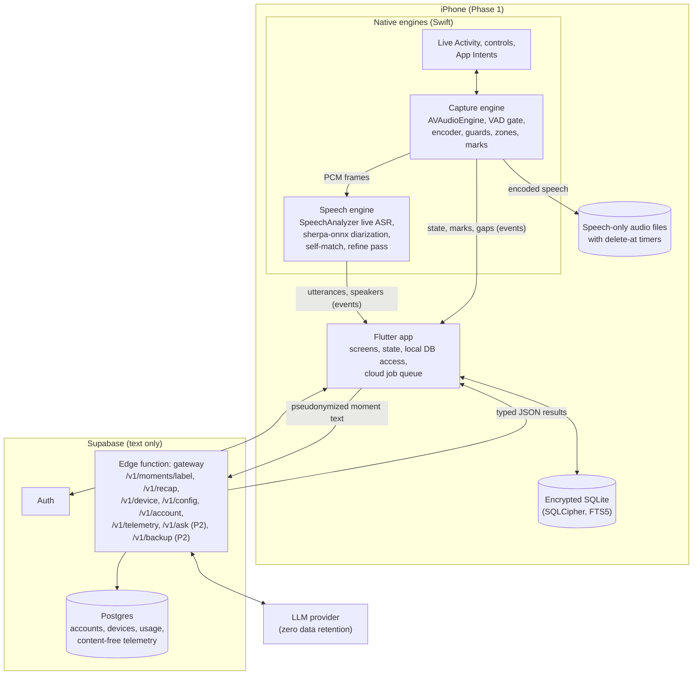
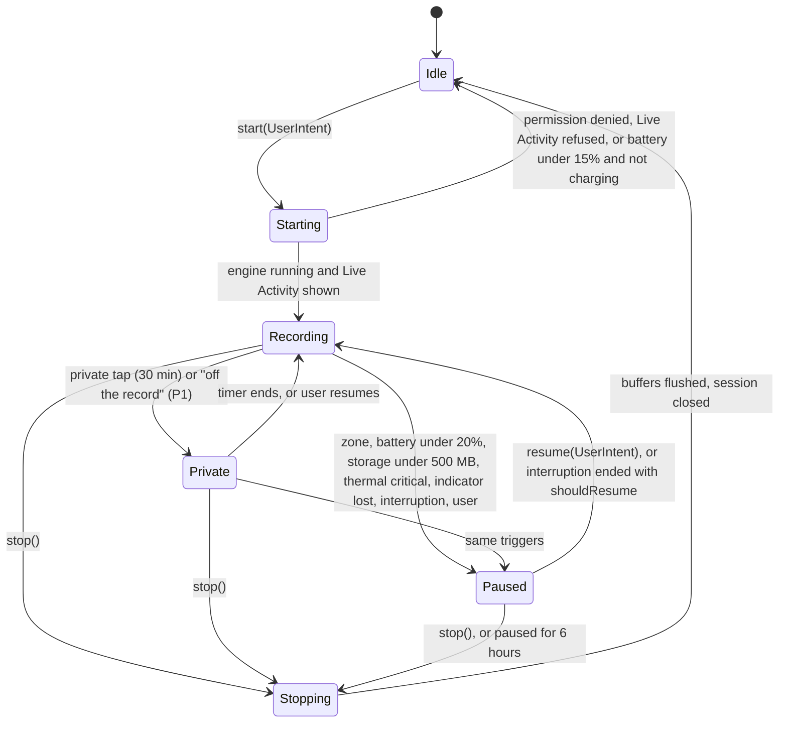

# Implementation Specification: Day Recap App (codename `mona`)

| | |
| --- | --- |
| Status | Draft v0.2, for review |
| Date | 2026-10-25 |
| Covers | Phase 0 (feasibility) and Phase 1 (MVP alpha, iOS) in build detail; Phases 2 and 3 in outline |
| Inputs | [PRD](product/prd.md) (2026-10-24), [Feature deep dive and dev plan](product/feature-deep-dive-and-dev-plan.md) (2026-10-20), [How it works and user value](product/how-it-works-and-user-value.md) (2026-10-24) |
| Changes | v0.2 is a review pass over v0.1. Every finding and what changed is in [§24 Review log](#24-review-log-v02). |

This document turns the PRD into something engineers can build from. It fixes the repository layout, the module boundaries, the on-device and cloud data contracts, the privacy rules as testable invariants, and the work plan for the first 11 weeks. Where it makes a choice the PRD leaves open, the choice is listed in [§21 Decisions](#21-decisions) so it can be challenged.

---

## Contents

1. [Scope and sources](#1-scope-and-sources)
2. [Invariants](#2-invariants)
3. [System overview](#3-system-overview)
4. [Repository layout](#4-repository-layout)
5. [Mobile app architecture](#5-mobile-app-architecture)
6. [Capture engine](#6-capture-engine)
7. [Speech engine](#7-speech-engine)
8. [Understanding pipeline](#8-understanding-pipeline)
9. [Recap and morning nudge](#9-recap-and-morning-nudge)
10. [Local data layer](#10-local-data-layer)
11. [Backend](#11-backend)
12. [Cloud API contracts](#12-cloud-api-contracts)
13. [Privacy and consent implementation](#13-privacy-and-consent-implementation)
14. [Background execution and notifications](#14-background-execution-and-notifications)
15. [Telemetry and metrics](#15-telemetry-and-metrics)
16. [Evaluation harness](#16-evaluation-harness)
17. [Testing and CI](#17-testing-and-ci)
18. [Security](#18-security)
19. [Phase 0 plan](#19-phase-0-plan)
20. [Phase 1 plan](#20-phase-1-plan)
21. [Decisions](#21-decisions)
22. [Open questions](#22-open-questions)
23. [Appendix: P0 traceability](#23-appendix-p0-traceability)
24. [Review log (v0.2)](#24-review-log-v02)

---

## 1. Scope and sources

### 1.1 What this spec covers

- **Phase 0, weeks 1 to 3:** the spikes that decide Gate A (8-hour capture, battery, speaker accuracy, Mandarin-English transcription, cost), plus the evaluation set.
- **Phase 1, weeks 4 to 11, iOS only:** Day mode, Meeting Scene, speaker separation with "You", naming and fixes, item extraction, evening recap, morning nudge, consent card, privacy center, retention, export. Ends at Gate B with 30 alpha users.
- **Phases 2 and 3** (Trip, Show, reels, Ask, Android, Lecture, launch) are outlined only far enough that Phase 1 does not paint them into a corner: data model fields, interfaces and extension points exist from day one.

### 1.2 How conflicts between the source docs were resolved

The PRD (Oct 24) is newer than the dev plan (Oct 20) and wins wherever they differ.

| Topic | Dev plan said | PRD says | This spec |
| --- | --- | --- | --- |
| App stack | Swift and SwiftUI, native iOS | Flutter with native modules for capture, speech and video | Flutter UI; capture, speech and media as native engines behind typed channels (D1, D2) |
| Android timing | From Phase 3 | Android capture service in Phase 2 | Phase 2; Phase 1 keeps the Dart engine API platform-neutral |
| Timeline | About 30 weeks, five phases | 34 weeks: Phases 0 to 3 plus v1.1, launch in week 26 | PRD timeline |
| Team | Two engineers | Flutter, native, backend/ML engineers, part-time designer, product lead | PRD team; owners in §20 use these roles |
| Backend | Postgres, object storage, queue, Python worker | Supabase auth, Postgres, edge functions as the gateway | Supabase; no server queue or worker in Phase 1 (gateway is synchronous; the retry queue lives on the phone, §8.8) |

### 1.3 Out of scope for Phases 0 and 1

Camera capture and reels, live translation, Trip and Show Scenes, Ask your day, Android, encrypted backup, remembered voices, Watch app, Lecture and Appointment Scenes, pricing and billing UI. Each still gets schema fields or an interface where noted.

---

## 2. Invariants

These are the rules every module must keep. Each has an automated check (§17); a failing check blocks release.

| ID | Invariant | Enforced by | Check |
| --- | --- | --- | --- |
| I1 | Nothing is recorded unless the user started the capture run or accepted a prompt: in the app, or through a system surface that runs one of our App Intents (Lock Screen control, Control Center, Action Button, Live Activity button). No automatic or hidden start. | Capture engine state machine (§6.2), native start gate (§5.3) | Unit test: every `start` and `resume` path requires a `UserIntent`; native `start` refuses unless the app is active or an App Intent or notification response is executing; static check that no background task calls `start` |
| I2 | While audio is captured, the recording state is visible and current: Live Activity on iOS, in-app pill, system mic indicator. | Capture engine, Live Activity (§6.6) | UI test; capture refuses to start if the Live Activity request fails; capture pauses if the activity is lost; stale-date test with a killed app |
| I3 | Raw audio, video and voice signatures never leave the phone. | Network layer only accepts typed text DTOs (§12) | Contract test: request bodies are schema-validated; no binary fields except `/v1/backup` ciphertext |
| I4 | Only text from flagged moments goes to the cloud, with speaker names and known person names replaced by tokens. | Pseudonymizer (§8.4) | Property test: no `person.display_name`, alias or generated name variant survives in any outgoing payload; measured leak rate for misspelled names on the eval set (S4) |
| I5 | Other people's voice signatures exist only in memory, only while the session runs (Day mode: until the speaker is retired, §7.3), and are never written to disk. | Speech engine (§7.5) | Integration test: no non-self embedding on disk or in the DB at any point; engine reports zero live centroids after `closeSession` |
| I6 | The user's own voice signature is created only after an explicit consent record, and is deleted when that consent is withdrawn. | Enrollment flow (§13.3), DB triggers (§10.2) | `voice_signature.consent_record_id NOT NULL`; insert trigger rejects a missing or withdrawn record; withdrawal trigger deletes signatures |
| I7 | Stretches of non-speech longer than 2 s are never stored. | VAD gate before the encoder (§6.4) | Test: a 10-minute silence fixture produces zero audio media rows; a speech fixture with a 5 s pause produces two files |
| I8 | Raw audio is deleted at the first app run at or after `delete_at` (default 7 days, user range 1 to 30), before any other work. | Retention job (§10.5) | Automated deletion test with a fake clock (PRD acceptance) |
| I9 | Every model-generated item and every recap entry links to at least one source utterance that still exists. | Gateway citation check, client check (§8.5), orphan trigger (§10.6) | Items with no valid citation are dropped, never shown; deleting an item's last source deletes the item |
| I10 | Meeting and Appointment sessions always show the consent card before capture of that session starts. | Session start flow (§13.1), Scene switch (§6.9) | `session.consent_shown_at NOT NULL` for those Scenes; telemetry metric must read 100% |
| I11 | The server never stores transcripts, item text or recap text, and never logs request or response bodies. | Gateway (§11.4) | Code review rule; validation errors log JSON paths, never values; a log-scrape test in staging that covers platform logs as well as ours |
| I12 | Low-confidence speaker attributions and items are shown with "?" and are never pushed as reminders. | Speech engine thresholds (§7.6), nudge filter (§9.4) | Unit tests on threshold gates |
| I13 | No transcript, item, summary or name text appears on the Lock Screen (Live Activity, notifications) unless the user turns on previews in settings. | Notification builders (§9.4), Live Activity content (§6.6) | Unit tests on every notification builder; snapshot tests of the Live Activity views |

---

## 3. System overview



**Runtime split.** Anything that touches raw audio runs in Swift, inside the app process, kept alive in the background by the running audio engine. Flutter owns the UI, the database and the network. The two talk through generated, typed channels (Pigeon): commands go down, events come up as a stream. If the Flutter engine is suspended or slow, the native engines keep capturing and buffer events in a small native journal (§6.8) that Dart drains on resume.

**Headless start.** The app creates its `FlutterEngine` in the app delegate, not from a view controller, so Dart runs when iOS launches the app in the background (an App Intent from the Lock Screen, a zone event, a background task). The UI attaches to the same engine when a scene connects. Capture never waits for Dart: an intent-started session begins natively and is journaled; Dart writes the rows when it is up (§6.3).

**Processing passes** (from the PRD) map to code as follows.

| Pass | Trigger | Runs in | Does | Budget |
| --- | --- | --- | --- | --- |
| 1. Live | Continuous while recording | Swift engines | VAD, streaming ASR, provisional speaker lanes, self-match | Text within 1.5 s of speech |
| 2. Session close | Meeting ends; or a Day-mode moment boundary | Swift (re-cluster) then Dart (pseudonymize, call gateway) | Re-cluster speakers, drop other-person embeddings, label moment, extract items, write minutes | Minutes within 2 min of the end (budget split in §11.4) |
| 3. Evening recap | User's recap time | Dart, gateway | Rank the day's items into at most 10 entries plus a fun line | Under 30 s |
| 4. Overnight refine | Charging, on Wi-Fi, idle (`BGProcessingTask`) | Swift, then Dart | Second ASR pass (Breeze-ASR-25 if Phase 0 shows it fits), re-run items for changed text, update morning nudge | Best effort; never on the nudge's critical path (§9.4) |

---

## 4. Repository layout

One monorepo. Each top-level folder builds and tests on its own. Only `docs/` exists today; the rest is the target layout that Phase 0 and Phase 1 fill in.

```
mona/
├── README.md
├── docs/
│   ├── implementation-spec.md        ← this file
│   ├── phase0/                       ← spike reports (§19)
│   └── product/                      ← PRD and research snapshots
├── app/                              ← Flutter application (Phase 1)
│   ├── lib/
│   │   ├── main.dart
│   │   ├── core/                     ← config, flags, logging, clock, result types
│   │   ├── data/                     ← drift database, DAOs, migrations, repositories
│   │   ├── domain/                   ← entities, services (moments, items, recap, retention,
│   │   │                               deletion, due-date parser)
│   │   ├── engines/                  ← Dart facades over the native engines (Pigeon clients)
│   │   ├── cloud/                    ← gateway client, pseudonymizer, job queue, DTOs
│   │   ├── l10n/                     ← ARB files: zh-Hant-TW, en
│   │   └── features/                 ← one folder per screen: today, live_session, recap,
│   │                                   timeline, moment, people, privacy, onboarding, settings
│   ├── ios/                          ← Runner, widget extension (Live Activity, controls),
│   │                                   PrivacyInfo.xcprivacy, entitlements
│   ├── test/                         ← unit and widget tests
│   └── integration_test/             ← on-device flows
├── packages/
│   ├── engine_api/                   ← Pigeon definitions (single source of the channel contract)
│   ├── native_core/                  ← Swift package shared by the plugins, the Runner and the
│   │                                   widget extension: ActivityAttributes, App Intents,
│   │                                   journal format, model manifest
│   ├── capture_engine/               ← Flutter plugin: Dart API + ios/ (Swift); android/ in Phase 2
│   ├── speech_engine/                ← Flutter plugin: Dart API + ios/ (Swift, sherpa-onnx, SpeechAnalyzer)
│   ├── media_engine/                 ← Phase 2: camera, reels (placeholder only)
│   └── cloud_contracts/              ← JSON Schemas for the gateway; generates Dart and TypeScript types
├── backend/
│   └── supabase/
│       ├── config.toml
│       ├── migrations/               ← SQL, RLS policies
│       ├── functions/gateway/        ← Deno/TypeScript edge function; prompts/ holds versioned prompts
│       └── tests/
├── eval/                             ← Python evaluation harness (§16); manifests only, no audio
└── .github/workflows/                ← CI (§17)
```

`packages/cloud_contracts` holds the JSON Schemas in §12. Both the Dart client and the TypeScript gateway are generated from it, so the contract cannot drift between them.

`packages/native_core` exists because three targets need the same Swift types: the capture plugin starts and updates the Live Activity, the widget extension renders it, and App Intents (Lock Screen control, Action Button, Live Activity buttons) must be compiled into both the app and the extension while running in the app process. The speech plugin reads frames from the capture plugin through a protocol defined here, so neither plugin depends on the other's implementation.

The model manifest (`native_core/models.json`) lists every model file with its version, SHA-256, size, license and whether it is bundled or downloaded (§10.4, §18).

---

## 5. Mobile app architecture

### 5.1 Platform targets

- **iOS 26 minimum** for Phase 1 (D4). SpeechAnalyzer requires it; alpha testers are recruited on supported phones. The launch minimum is an open question (§22).
- Phase 1 test devices: iPhone 15 Pro (lowest Apple Intelligence device), iPhone 16, iPhone 17. All Gate A numbers are measured on the 15 Pro as the floor. SpeechAnalyzer itself does not need Apple Intelligence; Foundation Models (S4, Phase 2) does.
- Flutter stable, pinned per repo with FVM (`.fvmrc`); Xcode version pinned in CI.

### 5.2 Layers

| Layer | Responsibility | Depends on |
| --- | --- | --- |
| `features/*` | Widgets, view models (Riverpod notifiers), navigation | `domain`, `engines` |
| `domain` | Session lifecycle, moment splitting, item rules, recap assembly, retention, deletion, export | `data`, `cloud`, `engines` |
| `data` | drift database, DAOs, migrations, file paths | SQLCipher |
| `cloud` | Supabase auth, gateway client, pseudonymizer, job queue and retries | `cloud_contracts` |
| `engines` | Dart facades for capture and speech; turns Pigeon events into typed streams | `engine_api` |

- State management: Riverpod (D10). Navigation: go_router. Models: freezed + json_serializable.
- Every time-dependent rule takes a `Clock` from `core` so retention, recap timing and due dates are testable with a fake clock.
- Feature flags live in a local `flag` table, seeded per build flavor (`dev`, `alpha`, `beta`), overridable from a hidden debug screen and, for kill switches only, from `/v1/config` (§12.5). Flags gate unfinished Phase 2 work, A/B variants (for example on-device vs cloud item extraction, §8.3) and calibrated thresholds (`τ_self`, `τ_join`, `τ_uncertain`, `τ_nudge`).

### 5.3 Native boundary (Pigeon)

`packages/engine_api/pigeons/engine.dart` defines the contract. Sketch:

```dart
@HostApi()
abstract class CaptureHostApi {
  StartResult start(StartRequest req);        // req.intent proves a user action (I1); native also gates on app state
  void switchScene(SceneSwitchRequest req);   // Day <-> Meeting inside one capture run, no gap (§6.9)
  void pause(PauseReason reason, int? minutes);
  void resume(UserIntentToken token);
  void mark(MarkSource source);
  CloseResult stop();
  CaptureStatus status();
  void ack(int upToSeq);                      // Dart committed everything up to seq; journal may truncate
  List<EngineEvent> replay(int fromSeq);      // unacknowledged events after a restart (§6.8)
  void startEval(EvalRequest req);            // dev flavor only: feed a file instead of the mic (§16.3)
}

@HostApi()
abstract class SpeechHostApi {
  EnrollResult enrollSelf(String consentRecordId, String audioPath);
  void setSessionHints(String sessionId, int? attendeeCount, List<String> locales, List<String> contextualNames);
  ReclusterResult recluster(String sessionId, int fromMs, int toMs, int? numSpeakers, ReclusterConstraints c);
  void closeSessionSignatures(String sessionId); // drops every non-self centroid of the session
  void splitSpeaker(String sessionId, String speakerId, List<String> utteranceIds);
}

@FlutterApi()
abstract class EngineEvents {
  void onSessionStarted(SessionStartedEvent e); // native-minted id, scene, trigger, tz, run id (§6.3)
  void onCaptureState(CaptureStateEvent e);     // recording, paused(reason), private, stopped
  void onUtterance(UtteranceEvent e);           // volatile or final, with speaker guess
  void onSpeakerLane(SpeakerLaneEvent e);       // new provisional speaker, self match, retirement
  void onMark(MarkEvent e);
  void onGap(GapEvent e);                       // interruption, zone, battery, playback, crash recovery
  void onMedia(MediaEvent e);                   // speech file written, with start/end
  void onHeartbeat(HeartbeatEvent e);
}
```

- All events except volatile utterances carry a monotonically increasing `seq` and go through the journal. Dart calls `ack(seq)` after committing to the DB; `replay` returns anything unacknowledged after a restart, so events survive a Flutter engine stall or an app kill. Volatile results are sent directly and may be lost; only finals matter for storage.
- **Native start gate (I1).** The `UserIntentToken` is a Dart-side discipline, not a security boundary. The real check is native: `start` and `resume` succeed only while `UIApplication.applicationState == .active`, inside an executing App Intent `perform()`, or inside a notification response handler. Anything else returns `StartResult.refused(notUserInitiated)`.
- **Threading.** The audio tap runs on a real-time thread and only copies frames into a lock-free ring buffer. VAD, encoding, ASR and embeddings run on their own serial queues. Journal writes happen on a journal queue; Pigeon calls are dispatched to the main thread, as the Flutter embedder requires. Nothing on the audio thread allocates, locks or calls Flutter.

### 5.4 Screens in Phase 1

| Screen | Phase 1 content | Notes |
| --- | --- | --- |
| Onboarding | Scenes picker, plain-language "what is recorded" screen, mic permission, "This is me" enrollment with consent, home pause zone (skippable; asks for location only if the user adds it), recap time, one-minute demo, "your data stays on this phone" note (§10.7) | J1 in the PRD |
| Today | Capture button, state pill (recording / paused / private, three colors), today's moments, a banner when Live Activities are off (capture cannot start, §6.6) | Privacy center two taps away (I2, PRD acceptance) |
| Live session | Speaker lanes with colors, "?" for uncertain lines, mark button, stop-and-make-minutes | One layout for all Scenes |
| Name speakers | "Who is Speaker B?" sheet with calendar attendees, recent names and the system contact picker | Shown after Meeting close; the picker needs no contacts permission (§14) |
| Recap | Sections in value order, three feedback buttons per item, tap to open source; offline fallback state (§9.6) | §9 |
| Timeline | Moment cards for a day | |
| Moment | Transcript by speaker, items, audio playback, fix tools (merge, split, reassign, relabel Scene), delete moment | Where corrections happen |
| People | Named people for this device; no remembered voices in Phase 1 | v1.1 adds voices |
| Privacy center | Storage summary by kind, timers, zones, permissions, notification previews, export, delete moment, delete account | §13.5 |

### 5.5 Localization and accessibility

- UI strings in ARB files from day one: `zh-Hant-TW` and `en`. The Live Activity, notifications and App Intent titles are localized in the native targets with the same keys.
- Dynamic Type: all screens are tested at the largest accessibility text size; the transcript view reflows, never truncates.
- VoiceOver: the state pill announces state changes ("Recording", "Paused, home", "Private until 14:30"); speaker lanes are announced by speaker name, not color; "?" is read as "speaker uncertain".
- Colors for the three capture states also differ in shape or label, so they never rely on color alone.

---

## 6. Capture engine

Swift package inside `packages/capture_engine/ios`, using shared types from `native_core`. Owns the microphone, the audio session, the VAD gate, encoding, guards, pause zones, marks and the Live Activity state.

### 6.1 Audio session

- `AVAudioSession` category `.playAndRecord`, mode `.default`, options `[.mixWithOthers, .defaultToSpeaker, .allowBluetoothA2DP]`, preferred input the built-in mic (D21). With A2DP the user's earbuds keep high-quality playback and the phone's mic keeps hearing the room.
- **Bluetooth mics are opt-in (P1 "External microphones").** Enabling `.allowBluetoothHFP` by default would switch connected AirPods into the hands-free profile whenever we record, dropping the user's music and podcasts to call quality all day, and earbud mics hear mostly the wearer, which hurts diarization of everyone else. External mic support adds the option only when the user picks an external mic. iOS 26 adds a high-quality recording mode for recent AirPods; S1 evaluates it for the P1 feature.
- Mode `.default` applies some system processing; `.measurement` minimizes it. S2 and S3 compare both on the eval set, because the right choice depends on what SpeechAnalyzer and the embedding model were trained on.
- `UIBackgroundModes` includes `audio`. Capture only ever begins while the app is active or through an `AudioRecordingIntent` (iOS 18+), which requires a Live Activity. This is the PRD's App Store posture: background audio only continues a session the user started.
- Input via `AVAudioEngine.inputNode` tap at the hardware rate, converted with `AVAudioConverter` to **16 kHz mono Float32** for VAD and diarization. SpeechAnalyzer gets the format it reports as best for the transcriber, converted from the same buffers.
- Interruptions (`AVAudioSession.interruptionNotification`): on `.began`, emit a `GapEvent(reason: interruption)` and keep the session object; on `.ended` with `.shouldResume`, restart the engine automatically (this continues the user's own run; S1 confirms iOS allows it from the background). Without `.shouldResume` (for example after a phone call), post a local notification "Recording paused by a call. Tap to resume." Resuming requires the user (I1).
- Route changes (earbuds in or out): rebuild the tap at the new format; no gap event unless the restart takes over 1 s.
- Media services reset: tear down and rebuild the engine; emit a gap.

### 6.2 State machine



- **Private keeps the engine running and drops frames before the VAD**, so nothing from private time reaches ASR, diarization or disk. The mic indicator stays on and the Live Activity shows "Private until 14:30". Keeping the engine is what lets the app resume by itself when the 30 minutes end: iOS does not let a backgrounded app start the microphone again once it has stopped.
- **Paused stops the engine** and deactivates the audio session (with `.notifyOthersOnDeactivation`). The mic indicator goes off (at home, nobody sees an orange dot), the battery is actually saved, the dead-man's switch is cancelled (§6.5), and iOS may suspend the app. Resume always comes from the user: the Live Activity's Resume button (an `AudioRecordingIntent`, allowed to start the mic from the background), a notification that opens the app, or the in-app button. Leaving a pause zone does **not** auto-resume; the user gets a one-tap notification (I1, D13).
- Interruption pauses are the exception: the system stopped the audio, the session object is kept, and `.ended` with `.shouldResume` restarts it.
- **Battery floor.** Under 20% and not charging, capture pauses. Resume is refused under 15% unless charging, so the PRD's "never drains the phone below 15%" holds even if the user taps Resume.
- **Paused timeout.** A run paused for 6 hours is closed, backdated to the moment it paused (nothing was recorded since, so closing late changes nothing). If the app is suspended at that time, the close happens at the next app run or background task. This stops a "paused at home since 18:30" session from staying open for days and lets the day's last moment close (§8.1).
- Every transition writes a `capture_gap` row (start, end, reason) so the timeline can show "paused 18:30 to 21:10, home".
- The heartbeat (§6.8) is expected only in `Recording` and `Private`. A paused session is never treated as crashed.

### 6.3 Start paths and the 1-second budget

| Start path | Mechanism | Scene | Phase |
| --- | --- | --- | --- |
| In-app capture button | `CaptureHostApi.start` from the button handler | Day or Meeting (with card) | 1 |
| Lock Screen control and Control Center control | `ControlWidget` running an `AudioRecordingIntent` | Day | 1 |
| Action Button | Same App Intent | Day | 1 |
| Live Activity Resume button | `AudioRecordingIntent` | The paused session's Scene | 1 |
| Notification action ("Meeting starting: take notes?") | Action with `.foreground` option; opens the consent card | Meeting | 1 |
| Apple Watch | Watch App Intent | Day | 3 |

- App Intents start Day mode only. A Meeting needs the consent card in the foreground (I10).
- **Cold start from an intent.** iOS may launch the app in the background to run the intent. `perform()` calls the Swift capture engine directly (not through Pigeon), which mints the session id (UUIDv7), starts the engine and the Live Activity, and journals `SessionStarted{id, run_id, scene, trigger, tz, started_at}`. Dart creates the `session` row when it drains the journal. The intent never waits for the Flutter engine.
- Budget: tap to first frame captured under 1 s on the 15 Pro, measured separately for the warm path (app running) and the cold path (app not running). The engine pre-warms (`AVAudioEngine.prepare()`) when the app comes to the foreground; ASR model assets are loaded lazily on a background queue, with audio buffered in memory until the transcriber is ready, so the start is never blocked by model load.

### 6.4 VAD gate and storage

1. Frames go through **Silero VAD** (sherpa-onnx), 512-sample windows at 16 kHz, threshold tuned in Phase 0 (start at 0.5), 300 ms pre-roll and 500 ms hangover.
2. Speech regions feed ASR and diarization. Non-speech frames are discarded in memory (I7).
3. Speech regions are merged when the gap is under 2 s and cut at 120 s, then encoded as **AAC-LC, 24 kbps, mono, 16 kHz** (D8). One `media` row per file with session-relative `start_ms` and `end_ms`, and `delete_at = now + retention_days`.
4. **Crash-safe container.** Files are written as an ADTS stream (`.aac`), which stays playable up to the last complete frame if the app is killed mid-file. An `.m4a` written directly is unreadable until its index is written at close, so a crash would lose up to 120 s of audio. AVFoundation plays ADTS; export can remux to `.m4a` without re-encoding if a target needs it.
5. **Timeline map.** Because only speech reaches ASR and diarization, their audio clocks run on concatenated speech, not session time. The engine keeps a piecewise map from fed-sample index to session milliseconds (one entry per speech region) and converts every timestamp it emits (word times, utterance ranges, embedding windows) through it. Between non-adjacent regions it inserts 200 ms of digital silence so the recognizer sees a boundary; the map accounts for the inserted samples. S3 tunes or drops the inserted silence. Unit-tested with synthetic gaps.
6. Files live in `Application Support/media/<session_id>/`, with `NSFileProtectionCompleteUntilFirstUserAuthentication` (capture must write while the phone is locked); the `media` directory is excluded from backup.
7. **Codec check.** The session-close re-cluster (§7.4) and the refine pass (§7.2) read these files, not the original PCM. S2 and S3 therefore score DER and MER on audio that went through the codec and back. If 24 kbps AAC costs measurable accuracy, raise the bitrate or switch to Opus (D8).

Sizing check: 2 hours of speech a day at 24 kbps is about 21.6 MB a day, about 150 MB for the default 7-day window and about 650 MB at the 30-day maximum.

### 6.5 Guards

| Guard | Rule | Source |
| --- | --- | --- |
| Battery | `isBatteryMonitoringEnabled = true`; read `UIDevice.batteryLevel` every 60 s and on change (iOS reports in 5% steps). Under 20% and not charging: pause with reason `battery`. Resume refused under 15% unless charging. A "charging, resume?" notification is best effort: it is posted only if the app is running when charging starts; otherwise the Live Activity's Resume button covers it. | PRD: pause under 20%, never below 15% |
| Storage | Check `volumeAvailableCapacityForImportantUsage` every 5 min. Under 2 GB: warning banner and notification. Under 500 MB: pause with reason `storage` (proposed, not in PRD). | PRD: warn under 2 GB |
| Thermal | `ProcessInfo.thermalState` `.serious` or worse: pause the refine pass, drop live diarization to every second segment; `.critical`: pause capture with reason `thermal` (proposed). | Battery and reliability risk |
| Dead-man's switch | While `Recording` or `Private`, keep one pending local notification 120 s in the future, rescheduled every 60 s. If iOS kills the app, it fires: "Recording stopped. Tap to resume." Cancelled on stop and on pause, so a suspended paused app does not trigger it. | Dev plan "restart nudge" |

### 6.6 Live Activity

- ActivityKit activity started in `Starting`; capture refuses to enter `Recording` if the request fails or if Live Activities are turned off for the app (`ActivityAuthorizationInfo().areActivitiesEnabled`). The Today screen then explains why and links to Settings (I2).
- Content state: `{state, scene, startedAt, pausedReason?, privateUntil?}`. Never transcript text, names or items (I13). Colors match the in-app pill.
- **Stale date.** Every update sets `staleDate = now + 3 min`, and the engine refreshes the activity every 60 s while `Recording` or `Private`. If the app dies, the activity goes stale within 3 minutes and the view renders "Not recording · Tap to resume" instead of a frozen "Recording". While `Paused`, the stale date is the 6-hour paused timeout.
- Interactive buttons: Pause, Private 30 min and Mark are `LiveActivityIntent`s; Resume is an `AudioRecordingIntent`. All run in the app process.
- **8-hour limit.** The system ends an activity after 8 hours (it may stay on the Lock Screen, frozen, for up to 4 more). ActivityKit generally refuses to start a new activity while the app is in the background, except inside an App Intent. Whether a background audio app can roll over silently is an S1 question. Until S1 shows it can: at 7 h 30 m the activity shows a "Keep recording" button (a `LiveActivityIntent` that ends the old activity and starts a new one) and the app posts one notification; if nobody taps by 7 h 55 m, the engine ends the activity with final content "Paused · Tap to resume" and pauses capture with reason `indicator` (D24).
- **Mid-session loss.** If the user turns off Live Activities or the activity ends for any other reason, capture pauses with reason `indicator` and posts a notification. Capture never continues behind an activity that is gone or stale (I2).

### 6.7 Pause zones and marks

- **Zones:** `CLMonitor` circular conditions (radius 100 to 300 m) for up to 20 zones. `CLMonitor` alone can take several minutes to report entry, so only while recording the engine also runs low-power location updates (`kCLLocationAccuracyHundredMeters`, 50 m distance filter) to meet the PRD's 1-minute target. Background location updates need the `location` background mode as well as `audio` (and show the location indicator); App Review asks why an app declares both, so S7 tests the purpose text. Phase 0 measures latency and battery cost (S1). If the extra mode is refused, zones fall back to `CLMonitor` only and the 1-minute target is recorded as missed.
- Zone **exit** is detected by `CLMonitor` alone, which wakes a suspended app; it posts "Left Home. Resume recording?" (opens the app). Always location permission is needed for that, asked only when the user adds a zone (the onboarding zone step is skippable).
- **Marks:** timestamped with `mach_continuous_time` converted to session milliseconds at the moment of the tap, before any UI work, to meet the 0.2 s target. A Live Activity button's intent runs some time after the tap; S1 measures that delay and the engine subtracts its median. Stored as `mark` rows; in Phase 1 they appear as stars on the timeline and become highlight candidates in the recap. Phase 2 attaches them to video.

### 6.8 Crash safety and the native journal

- Engine events go to an append-only native journal file (length-prefixed records, fsync every 2 s) before they are sent to Dart. Dart acknowledges by `seq`; the journal is truncated up to the acknowledged point. Volatile utterances are not journaled.
- The heartbeat is a journal record written every 30 s by the native engine (not by Dart, which may be stalled), mirrored into the session row when Dart drains it.
- On launch, any session whose last state was `Recording` or `Private` with a heartbeat older than 90 s is closed as `failed` at the last heartbeat, a `capture_gap(reason: crash)` is recorded, the journal is replayed, the partial ADTS file is kept, and the session-close pass runs on what was captured. No biometric data needs cleaning up, because other people's signatures never reach disk (I5).

### 6.9 Capture runs and Scene switches

Mia's day (user-value doc) has Day mode from 08:40 and a Meeting at 10:00. One capture engine serves both.

- A **capture run** starts with a user start and ends with a user stop or the paused timeout. It holds one or more **sessions** back to back, one per Scene, grouped by `session.run_id`.
- **Day to Meeting.** From the meeting prompt or the in-app Meeting button while Day mode records: the consent card shows in the foreground. On "Start", the engine cuts the Day session at that frame and opens the Meeting session in one journal record. The audio engine, the Live Activity and the dead-man's switch keep running; only the activity's `scene` changes. Speech before "Start" stays in the Day session (I10 applies from the card on).
- The Meeting starts fresh speaker lanes with only the self signature, so the attendee-count cap and naming work per meeting. The Day session's live centroids are dropped at the cut.
- **Meeting to Day.** "Stop and make minutes" returns to Day mode if the run began in Day mode, with a 5-second toast "Back to Day mode · Stop instead". Otherwise the run stops. The user's original start covers the continued run (D17; product and legal confirm, §22).

### 6.10 In-app playback and the chime

- When the app plays audio through the built-in speaker while capturing (Moment screen playback, the onboarding demo, the consent chime), frames captured during playback plus 300 ms are dropped before the VAD and recorded as `capture_gap(reason: playback)`. Through headphones, capture continues. Without this, the app would transcribe its own playback as new speech and attribute it to a speaker.
- Speech from other sources (a TV, a laptop call on speaker) is captured like any speech. Diarization gives it its own lane, and the user can delete the lines. A laptop call raises a consent question the card cannot answer for remote participants (§13.1).

---

## 7. Speech engine

Swift package inside `packages/speech_engine/ios`. Consumes 16 kHz speech frames from the capture engine through the `native_core` frame protocol; emits utterances and speaker lanes.

### 7.1 Live transcription

- **Primary:** `SpeechAnalyzer` with `SpeechTranscriber` (iOS 26), streaming volatile and final results with audio time ranges, converted to session time through the timeline map (§6.4). Locale from the user's language settings: `zh-TW` and `en-US` for the Taiwan alpha.
- **Locale check.** S3 confirms that `SpeechTranscriber.supportedLocales` includes Mandarin (Taiwan) with Traditional Chinese output. If only `zh-CN` is offered, the engine either converts Simplified to Traditional with Taiwan phrasing (OpenCC `s2twp`, on device) or uses `DictationTranscriber` for `zh-TW`, whichever scores better on the eval set.
- **Code-switching:** how SpeechTranscriber handles Mandarin-English in one utterance is the first question for spike S3. Mixing in Taiwan is mostly inside sentences ("我們明天要 sync 一下 spec"), so per-segment language choice only helps segment-level switches. Candidates, in order of preference: (a) one `zh-TW` transcriber if it keeps English words acceptably; (b) per-segment language ID (Whisper-tiny LID via sherpa-onnx) choosing the transcriber per VAD segment; (c) a Whisper-family model via sherpa-onnx for mixed segments.
- **Contextual names.** The transcriber's analysis context gets contextual strings: calendar attendee names for the session, `person` display names and aliases, and the user's own name (`setSessionHints`). This raises name accuracy, which the pseudonymizer depends on (§8.4). The P1 custom-vocabulary feature extends the same list.
- **Background.** S1 confirms SpeechAnalyzer keeps transcribing with the screen locked for 8 hours. The architecture depends on it; if it does not, live ASR moves to a sherpa-onnx model and SpeechAnalyzer runs on the stored audio in pass 2.
- SpeechAnalyzer's own speech-detection module is an alternative to feeding only Silero speech regions; S3 compares accuracy and battery.
- **Model assets:** installed through `AssetInventory` during onboarding on Wi-Fi; capture works without them (audio is kept and transcribed later), and the UI says so.
- Emits `UtteranceEvent{id, sessionId, startMs, endMs, text, lang, asrConfidence, isFinal, words[]}`. Volatile results update the same `id` until final. Word timings are kept in memory for speaker alignment and stored only as utterance boundaries.
- Budget: final text within 1.5 s of the end of speech (PRD). Measured as `final_emitted_at - vad_speech_end`.

### 7.2 Mandarin-English refine pass

- **Breeze-ASR-25** (Whisper-large-v2 derived, 1.55B parameters) via whisper.cpp with a Core ML encoder or the Metal backend (S3 picks), run only in pass 4 (charging, Wi-Fi, idle).
- Spike S3 decides feasibility: quantized size on disk, peak memory inside a `BGProcessingTask`, real-time factor on the 15 Pro while charging, thermal behavior, and license. Pass condition: 1 hour of speech refined within 3 hours overnight without thermal throttling, and mixed error rate at least 15% lower than the live pass on the eval set (PRD acceptance).
- **Delivery.** The model is around a gigabyte or more after quantization, so it is never bundled. It downloads on Wi-Fi after the user opts in to "better overnight transcripts", from Apple-hosted Background Assets (iOS 26) or our own CDN, verified by SHA-256 against the manifest, and stored in `Application Support/models/` (not `Caches/`, which iOS may purge mid-night).
- If it fails on device, fall back to Breeze-ASR-25's smaller distilled variant if one exists, or to Whisper-small with custom vocabulary, and record the gap against the PRD target. Cloud ASR is not an option: raw audio never leaves the phone (I3).
- **Refined text replaces live text in place** (D15). The pass groups consecutive utterances of one speaker into windows of up to 30 s (Whisper's window), transcribes each window's audio, and splits the result back onto the same utterances by word timestamps. Each utterance keeps its `id`; `text` gets the refined text, `text_live` keeps the live text (for eval and for detecting "text changed"), and `pass = 4`. Item sources, feedback, recap entries and the search index stay valid. Items whose source text changed are re-extracted (§8.7).
- The task is checkpointed per window: the expiration handler saves progress, and the next run resumes. Re-extraction calls need the network, so the task sets `requiresNetworkConnectivity` and the client uses `allowsExpensiveNetworkAccess = false`.

### 7.3 Diarization: live lanes

1. Each VAD speech region over 0.8 s goes to the **speaker embedding extractor** (sherpa-onnx, 3D-Speaker ERes2Net or NeMo TitaNet-small, chosen in S2). Regions longer than 6 s are split into 3-second windows with 1.5 s hop.
2. **Self match first:** cosine similarity to the enrolled self signature. Above `τ_self` → speaker "You".
3. **Online clustering** for the rest: compare to the running centroids of this session's provisional speakers; above `τ_join` joins the closest, otherwise a new provisional speaker (B, C, D...). If the calendar attendee count is known, cap new speakers at that count plus one.
4. Words are attached to speakers by overlap between word time ranges and embedding windows; an utterance that spans a speaker change is split at the word boundary.
5. **Retirement (Day mode).** A provisional speaker not heard for 30 minutes is retired: its centroid is deleted from memory, and a later voice that matches no live centroid gets a new letter. Over a 14-hour day this bounds clustering drift (the barista and a colleague should not merge because both were heard once) and keeps other people's signatures for minutes, not the whole day (I5).

Centroids live in memory only (D9). Thresholds `τ_self` and `τ_join` start from model defaults and are tuned on the eval set in S2.

### 7.4 Diarization: session-close re-cluster

- Runs the offline pipeline (pyannote segmentation-3.0 + the chosen embedding model, agglomerative clustering) over the stored speech audio of the window being closed. `num_clusters` = attendee count when known, else a distance threshold.
- **Window:** a whole Meeting session, or one Day-mode moment (§8.1).
- **Bounded memory.** Decoding 30 minutes of speech to Float32 is about 115 MB, too much next to live ASR in a background app. The re-cluster streams instead: decode 10-second windows, run segmentation and embedding per window, keep only the embeddings, then cluster all embeddings at the end. No chunk stitching is needed. If sherpa-onnx's one-call offline API needs the whole signal in memory, the pipeline is built from its segmentation and embedding components. Starting budget for the whole native side: 150 MB peak (S2 measures).
- **Runtime:** S2 measures it; target under 60 s for a 60-minute meeting on the 15 Pro so minutes still land within 2 minutes. Day-mode re-clusters run in the background while capture continues, so S1's battery test runs with them on.
- **User constraints.** Lines the user reassigned during the session (`speaker_locked`) keep their speaker. Two speakers the user named as different people are never merged (cannot-link); lines of one named speaker stay together unless the clustering separates them with high confidence.
- **Mapping to live speakers:** clusters are matched to provisional speakers by maximum time overlap (Hungarian assignment). Names the user already gave move with their cluster. The self signature re-labels the matching cluster "You".
- **Utterance assignment:** each utterance takes the cluster with the largest time overlap. An utterance whose speech is split between two clusters by more than 30% is marked uncertain. Word timings are not stored, so the re-cluster does not split utterances.
- Output updates `utterance.speaker_id`, `speaker_confidence` and `pass = 2` in one transaction, then emits a `ReclusterResult` so the UI refreshes. All embeddings of the window are then dropped.

### 7.5 Signature lifecycle (biometric data)

| Signature | Created | Stored | Deleted |
| --- | --- | --- | --- |
| Self | Onboarding enrollment after a consent record (I6) | `voice_signature` row, embedding BLOB inside the encrypted DB, tied to the embedding `model_id` | On user request, account deletion, or consent withdrawal (trigger, §10.2). A new embedding model invalidates it and asks the user to enroll again. |
| Other people, live | Each provisional speaker during a session | Memory only | At retirement (Day mode, §7.3), at the Day-to-Meeting cut (§6.9), or at session close after the re-cluster (I5) |
| Other people, re-cluster | During the session-close re-cluster | Memory only | When the re-cluster returns |
| Remembered voices | v1.1 only, after that person's consent | `voice_signature` with `person_id` and `consent_record_id` | On withdrawal or "forget a person" |

"Split speaker" after a session has closed recomputes embeddings on demand from the retained audio, uses them for that one operation, and discards them; it never writes them to disk. After audio expires (I8), splitting falls back to manual line selection.

### 7.6 Confidence and the "?" marker

- `speaker_confidence` per utterance = margin between the best and second-best cluster similarity, scaled to 0..1. With a single non-self cluster, the margin is taken against `τ_join`.
- Utterances under 0.8 s, utterances overlapping another speaker by more than 30%, and utterances with `speaker_confidence < τ_uncertain` render with "?" next to the speaker and are excluded from owner attribution of items unless the user confirms them (I12). Overlap is known only after the re-cluster (live lanes have no segmentation model), so the overlap rule applies from pass 2.
- Thresholds are calibrated on the eval set (S2) and stored as flags, so they can change without an app release.

### 7.7 Enrollment ("This is me")

- The user reads two short sentences (about 15 s); bilingual users read one in each language. The screen asks them to hold the phone at arm's length, closer to how it hears them at a table. The app records to a temp file, VAD-trims it, extracts embeddings from 3-second windows and stores the L2-normalized mean.
- Quality check: at least 8 s of speech and consistent windows (mean pairwise cosine above a floor); otherwise ask to retry in a quieter place.
- The temp audio is deleted right after extraction.
- Self-labeling improves over time: utterances the user confirms as theirs (or does not correct within 7 days) can refresh the self centroid with a slow moving average. Behind a flag in Phase 1 until S2 shows it helps.

---

## 8. Understanding pipeline

Dart code in `domain/` and `cloud/`, triggered at session close and at Day-mode moment boundaries.

### 8.1 Splitting the day into moments

A Meeting session is one moment. Day-mode sessions are split when any of these holds:

| Boundary signal | Rule (starting values, tuned in alpha) |
| --- | --- |
| Silence | No speech for 5 minutes |
| Place change | Significant location change of more than 300 m (only if location permission is granted) |
| Speaker set change | The set of non-self speakers in the last 5 minutes shares no one with the previous 5 minutes |
| Calendar | A calendar event starts or ends |
| Explicit | The user switches Scene, pauses or stops (closes at once) |
| Length cap | 90 minutes |

- Moment rows are created when a moment opens (`state = 'open'`), and each final utterance gets the open moment's id as it is committed, so deletion and re-analysis never have to infer membership from times.
- **Merge-back.** A non-explicit boundary is provisional for 2 minutes. If speech resumes within that time with at least one of the same non-self speakers and no place change, the boundary is withdrawn and the moment continues. Otherwise the moment closes. Closing sets `end_ms` and `state = 'closed'`, then triggers the re-cluster (§7.4) for its window, then analysis.
- **Word counts** in this spec: an English word, or two CJK characters, count as one word.

### 8.2 Which moments go to the cloud

A moment is **flagged** for cloud analysis only if all hold:

- At least 40 words or 30 seconds of speech. Solo moments count: a spoken note to self ("remind me to call the bank tomorrow") and the onboarding demo (J1 step 5) are exactly what the app should catch.
- No part falls inside private mode (already guaranteed: private frames are never transcribed).
- Its **on-device Scene hint** is not one the user excluded in settings ("commute: skip").

The cloud label does not exist yet when this decision is made, so exclusions work on hints computed on the phone:

| Hint | Rule |
| --- | --- |
| `meeting` | Meeting session, or a calendar event with two or more attendees covers the moment |
| `commute` | Core Motion reports automotive or cycling for most of the moment (only with Motion permission) |
| `solo` | Only the user speaks |
| none | Anything else |

Scenes that only the cloud can recognize (social, call, show) cannot be skipped before analysis. They can be set to **summary only** (Mia's "social: keep summary only" in the user-value doc): after analysis, if the cloud label matches, the app deletes the moment's audio and every utterance that no kept item cites. Title, summary, items and the lines those items cite stay, so I9 still holds.

Unflagged moments keep their transcript locally and get a local title from the first final utterance; they still appear on the timeline. `moment.excluded_reason` records why (`too_short`, `scene_excluded`, `analysis_disabled`).

### 8.3 MomentAnalyzer

```dart
abstract interface class MomentAnalyzer {
  Future<MomentAnalysis> analyze(MomentPayload payload); // payload is already pseudonymized
}
```

- **Phase 1 default: `CloudMomentAnalyzer`** calling `POST /v1/moments/label` (D5). Reason: one model for every alpha user makes Gate B accuracy numbers comparable, and it keeps the on-device LLM bridge out of the critical path.
- **`OnDeviceMomentAnalyzer`** (Apple Foundation Models through a native `@Generable` bridge, 4,096-token context) is built behind a flag after spike S4 compares it with the cloud on the eval set. If quality is close, Phase 2 moves routine labeling on device and keeps the cloud for minutes and recaps, which also lowers unit cost.
- S4 also checks two constraints on the on-device path: the framework may rate-limit apps in the background (Day-mode moments close in the background), and its quality in Traditional Chinese.
- **Phase 2 dependency.** The PRD says the Trip Scene "works offline except recap generation". Labeling a moment abroad without a network needs the on-device analyzer, so S4's result is a Phase 2 prerequisite, not an optimization.

### 8.4 Pseudonymizer

Runs on the phone before anything leaves it (I4).

1. **Scope.** Tokens are scoped to one request. The same person can be `S1` in one moment's label request and `S3` in that evening's recap request. Nothing stores tokens; responses are mapped back while the request's mapping is still in memory.
2. **Ids.** Utterance, moment and item ids are replaced by short aliases (`u1`, `m1`, `i1`). A UUID costs about 20 tokens, and aliases leak no stable identifier. The citation check works on aliases.
3. **Speakers:** the user becomes `ME`; other session speakers become `S1`, `S2`... in order of first appearance. People who are mentioned but not speaking get `P1`, `P2`... A named speaker's name in the text maps to that speaker's `S` token.
4. **Known names in text.** Candidates are the self person, named speakers, calendar attendees for the session and all `person` rows. For each, the matcher uses the display name, aliases and generated variants, longest match first:
   - Latin names: whole word, case-insensitive, with possessives.
   - CJK names: the full name (陳怡君), the given name (怡君), the family name plus a title from a fixed list (陳經理, 陳小姐, 陳先生, 陳老師), and homophones by toneless pinyin over the same spans, so an ASR spelling like 陳宜君 still matches. A family name alone is never replaced (陳 also appears in 陳述).
5. **Patterns:** emails, phone numbers (Taiwan mobile `09\d{2}[- ]?\d{3}[- ]?\d{3}`, `+886` forms, landlines), Taiwan national ID and resident certificate numbers (`[A-Z][12A-D89]\d{8}`), and payment card numbers (13 to 19 digits passing Luhn) become numbered tokens: `<EMAIL_1>`, `<PHONE_1>`, `<ID_1>`, `<CARD_1>`. Numbering lets the client restore each one in the response.
6. **Storage.** The gateway response comes back with tokens. Item text and minutes are stored with `{{spk:<speaker_id>}}` for speakers and `{{per:<person_id>}}` for non-speaking people, rendered with current names at display time; pattern tokens are restored to the original text. Renaming or fixing a speaker therefore updates every transcript line, item and recap entry without re-calling the cloud (PRD: "a fix updates the transcript and the recap").
7. **Not sent:** calendar event titles, place labels, coordinates, contact details.

**Limits, stated in the privacy center.** Names the app never learned (people never named in the app) can remain in the text. Numbers spoken as Chinese numerals can escape the patterns. The gateway still neither stores nor logs bodies (I11), and the provider must be zero-retention.

**What the I4 test proves, and what it does not.** The property test proves that exact names, aliases and generated variants never leave the phone. It cannot prove that every ASR misspelling is caught. S4 therefore measures the real leak rate: the share of person-name mentions in the eval set's reference transcripts that reach the outgoing payload (proposed target: under 2%). An on-device name recognizer (Apple NaturalLanguage) is evaluated in S4 as an extra pass for unknown names.

### 8.5 Items

Item types follow the PRD: `promise`, `decision`, `fact` (shown as "things to remember"), `question`.

| Field | Meaning |
| --- | --- |
| `owner_speaker_id` or `owner_person_id` | Who made the promise or decision: a speaker in the moment, or a person mentioned but not speaking ("Alex will send it"). At most one is set. |
| `counterpart_speaker_id` or `counterpart_person_id` | To whom; both null for decisions of the group |
| direction | `by_user`, `to_user` or `other`. Computed at read time (`item_view`, §10.2) from whether the owner or counterpart is the user, so a speaker fix cannot leave it stale. |
| `due_date`, `due_phrase`, `due_check` | ISO date resolved by the model against the moment's local date and time zone, the original phrase ("by Thursday"), and the client's check (below) |
| `sources` | One or more utterance ids (I9) |
| `confidence` | Composite: model confidence × min(speaker confidence of sources) × mean ASR confidence of sources |
| `status` | `open`, `done`, `dismissed`, `wrong` |
| `origin` | `model` or `user` (manually added promises feed the "promise coverage" metric) |

**Due-date check.** The client re-resolves `due_phrase` with its own rule-based parser for zh-TW and English (weekdays as 禮拜四, 週四, 星期四 or Thursday, with 這 and 下 prefixes; 明天, 後天, tomorrow; 月底, end of month; explicit dates; EOD). Outcomes:

| Parser result | `due_check` | Effect |
| --- | --- | --- |
| Same date as the model | `match` | Shown as is |
| Different date | `mismatch` | Date shown with "?"; confidence capped below `τ_nudge`, so it is never pushed (I12) |
| Phrase not understood | `unparsed` | Model's date kept and shown; nudged only if confidence ≥ `τ_nudge` |

Conventions such as 下週四 (Thursday of the next calendar week, weeks starting Monday) are pinned by tests.

**Citation check (I9).** The gateway rejects any item whose `sources` are not ids present in the request, then the client checks again against its DB. Items failing either check are dropped and counted in telemetry (`item_dropped_no_source`). Items the user adds (`origin = 'user'`) may have no source; I9 covers model output. When the user adds an item from a transcript line, that line becomes its source.

**Owner rule.** `owner` comes from the model as a token, mapped back to a speaker or person. When the owner token equals the speaker token of one of the item's sources (a first-person promise such as "I'll send it"), the client stores that line as `owner_from_utterance_id`; if the line is later reassigned to another speaker, the owner follows it, without a new cloud call. A third-person owner ("Alex will send it") is a person and does not follow speaker fixes.

**Calibration.** Model-reported confidence is poorly calibrated. `τ_uncertain` and `τ_nudge` are set on the eval set (S4) and stored as flags.

### 8.6 Meeting minutes

`/v1/moments/label` with `options.purpose = "minutes"` also returns `minutes {decisions[], promises[], open_questions[], follow_up_draft}`. The response's items carry response-local ids (`i1`, `i2`...) and minutes reference them; the client maps them to stored item ids. Minutes are rendered from items plus the draft, so they also follow speaker fixes. Sharing exports Markdown or plain text through the share sheet (PRD J2 step 6).

### 8.7 Re-analysis

A moment is re-analyzed when its text changes in the refine pass or the user relabels its Scene. Re-analysis replaces model items but keeps any item the user edited, marked done, or gave feedback on, and keeps their ids so feedback history survives.

Speaker fixes (merge, split, reassign, name) do **not** trigger re-analysis (D20). Ownership already follows utterances (§8.5) and names render from placeholders (§8.4), so the items stay right without spending a cloud call or replacing items the user has already seen. A merge moves the id columns (`utterance.speaker_id`, item owner and counterpart) to the surviving speaker in one transaction and sets `speaker.merged_into` on the other; text placeholders resolve through `merged_into`, so no stored text is rewritten.

### 8.8 Cloud job queue

The phone, not the server, holds the retry queue (`cloud_job`, §10.2).

- One job per target and kind (`label` for a moment, `recap` for a day). States: `queued`, `in_flight`, `done`, `failed`, `blocked` (quota or kill switch).
- The pseudonymized payload is rebuilt at each attempt, never stored, so the latest names and fixes apply and nothing sensitive sits in the queue.
- At most one request in flight per moment; up to 4 concurrent requests per device.
- Backoff: 10 s, 1 min, 5 min, 30 min, then hourly; `Retry-After` from the gateway overrides it. Error codes (§12.7) decide whether to retry. After 5 failures the moment shows "Couldn't analyze · Retry".
- The queue runs whenever the app runs: in the foreground, while capture keeps the app alive, and in background tasks.
- There is no server-side idempotency: the server keeps no response it could replay (I11), so a retry after a lost response is billed again. The client limits that by never retrying a job that returned a valid response.

---

## 9. Recap and morning nudge

### 9.1 What a recap covers

The recap for a given evening covers moments that ended after the previous recap's cutoff and before the current one. Moments after the cutoff (a late concert, a late call) roll into the next recap. The day key is the local date of the cutoff.

A moment that ended inside the window but is still pending analysis when the recap is built (offline, retrying) is included when its analysis lands, if the recap has not been opened yet; otherwise it rolls into the next recap.

### 9.2 When it is generated

iOS gives no guaranteed background start at a fixed time, so generation uses three paths, first one wins:

1. **Capture is running at recap time** (the app is alive): generate in-process at the cutoff.
2. **Background refresh:** a `BGAppRefreshTask` requested for 30 minutes before the cutoff; if it runs, generate early with the cutoff set to recap time, and top up with anything after.
3. **On open:** a local notification fires at recap time ("Your day is ready"). If no recap exists when the user opens it, generate on the spot with a skeleton UI; the budget is under 30 s end to end (PRD).

- The recap notification for a day is scheduled when that day's first moment closes. A day with nothing captured gets no notification (PRD: calm by default).
- **Top-up.** While a recap is unopened, it is regenerated when new items arrive for its window. Once opened, it is never changed under the user; later items roll forward.

### 9.3 Ranking

- **Input to `/v1/recap`:** pseudonymized moment titles and summaries, candidate items (alias, type, text, direction, due date, confidence, Scene), simple stats computed on the phone (longest moment, meeting time), marks, and a compact preference profile derived from feedback. Tokens are day-scoped for this request (§8.4).
- **Exclusion first.** Moments whose label response marked `tone` as `negative` or `conflict` are not sent at all unless the user opted in (user-value doc, rumination research). The rule is enforced on the phone, not left to the prompt.
- **Preference profile (Phase 1, deterministic):** counts of `right`, `wrong` and `not_important` per item type, per Scene and per counterpart person over the last 30 days. Counterparts are counted by `person_id` and sent under the request's tokens. Sent as hints, and also applied after the model responds: any item type + Scene pair with three or more `not_important` and no `right` in 30 days is demoted below the cut. This guarantees the PRD acceptance "feedback changes the next day's ranking" even if the model ignores the hint. Acceptance test: mark three `fact` items from `social` moments "not important"; the next recap ranks no `fact|social` item above the cut.
- **The model ranks; the phone builds sections.** The response is an ordered list of item aliases, an optional highlight moment and a fun line. The client assigns each item to its section from its type and direction, in this order: promises by you, promises to you, decisions, things to remember, open questions, highlight (a marked moment), fun line. Within a section, items keep the model's order. The client drops unknown ids and truncates to 10. A model cannot put a decision under "promises".
- A quiet day returns `quiet_day: true` with fewer entries rather than padding.

### 9.4 Morning nudge

- Scheduled independently of the recap: whenever items with a due date are created or change (analysis, refine pass, user edits, feedback), the client reschedules one local notification per affected day, identifier `nudge-YYYY-MM-DD`, at the user's nudge time (default 08:30, proposed). If the recap or the refine pass never runs, the nudge still fires.
- Contents: promises by the user with `due_date` = that day, `status = open`, `due_check != 'mismatch'` and `confidence ≥ τ_nudge` (I12). If nothing is due, the notification is removed.
- **Lock Screen text** is generic: "2 promises due today". The item text shows only after unlock, using the category's hidden-preview placeholder and the in-app view, unless the user turns on "Show details in notifications" (I13).
- iOS keeps at most 64 pending local notifications per app, so nudges are scheduled for the next 14 days only.

### 9.5 Feedback

Each recap entry has right, wrong, not important. Feedback writes a `feedback` row, updates the item (`wrong` hides it everywhere and sets `status = wrong`), and emits a content-free telemetry event (§15). "Wrong" also offers "wrong speaker" as a shortcut into the speaker fix tools.

### 9.6 Offline fallback recap

If the gateway cannot be reached (offline, quota, kill switch) when the recap is due, the phone builds a local recap from the day's analyzed items: sections as in §9.3, items ordered by confidence then time, at most 10, no fun line, marked "Basic recap: offline". It is replaced by the cloud recap when the network returns, if the user has not opened it yet. Moments that never got analyzed are listed by their local titles at the end.

---

## 10. Local data layer

### 10.1 Engine

- SQLite through **drift**, with **SQLCipher** (D7). Only one SQLite library may be linked into the app (the SQLCipher build); at startup the app runs `PRAGMA cipher_version` and refuses to open the database if it returns nothing, so a build that silently linked plain SQLite fails closed.
- Database key: 256-bit random, generated on first launch, stored in the iOS Keychain with `kSecAttrAccessibleAfterFirstUnlockThisDeviceOnly`, so capture can write while the phone is locked and the key never syncs to other devices. If the Keychain still holds a key from a previous install but the database file is gone, a new key is generated.
- WAL mode; the native engines never open the DB directly. They write to their journal; Dart is the single writer.
- **Deletion is real.** `PRAGMA secure_delete = ON` overwrites deleted content, and after user-initiated deletions (§10.6) the app runs `PRAGMA wal_checkpoint(TRUNCATE)` so deleted rows do not linger in the WAL.
- **Full-text search:** FTS5 with the **trigram** tokenizer, because unicode61 does not segment Chinese. Used for the Moment screen's find and as the base for Ask (Phase 2 adds a vector index, likely sqlite-vec).
  - The index is an external-content table keyed on `utterance.seq`, an explicit `INTEGER PRIMARY KEY`. Without it, FTS5 would key on the implicit rowid, which `VACUUM` may renumber.
  - Insert, update and delete triggers keep it in sync, and the table's `secure-delete` option is on (needs SQLite 3.44+; check the bundled SQLCipher version).
  - Trigram matching needs at least 3 characters. Many Chinese queries are 2 characters (a given name, 會議), so shorter queries fall back to a `LIKE` scan over the user's own transcripts, which is fast enough at Phase 1 data sizes (a year at 2 hours of speech a day is a few million characters).

### 10.2 Schema (Phase 1)

Ids are UUIDv7 strings. Times are UTC epoch milliseconds unless the column name ends in `_ms` (session-relative milliseconds, derived from the monotonic clock so wall-clock changes cannot skew them).

```sql
CREATE TABLE session (
  id                  TEXT PRIMARY KEY,
  run_id              TEXT NOT NULL,          -- capture run (§6.9); sessions of one run are back to back
  scene               TEXT NOT NULL CHECK (scene IN ('day','meeting','trip','show','lecture','appointment')),
  start_trigger       TEXT NOT NULL,          -- in_app | control | action_button | live_activity | notification | scene_switch | watch
  started_at          INTEGER NOT NULL,
  ended_at            INTEGER,
  end_reason          TEXT CHECK (end_reason IN ('user','scene_switch','paused_timeout','crash','account_deleted')),
  tz                  TEXT NOT NULL,          -- IANA zone at start
  status              TEXT NOT NULL CHECK (status IN ('recording','paused','closing','closed','failed')),
  last_heartbeat_at   INTEGER,
  place_label         TEXT,
  lat_coarse          REAL,                   -- rounded to about 100 m; null without permission
  lng_coarse          REAL,
  calendar_event_id   TEXT,
  attendee_count_hint INTEGER,
  consent_shown_at    INTEGER,
  consent_mode        TEXT CHECK (consent_mode IN ('card','card_and_chime')),
  CHECK (scene NOT IN ('meeting','appointment') OR consent_shown_at IS NOT NULL)   -- I10
);
CREATE INDEX session_run ON session(run_id, started_at);

CREATE TABLE capture_gap (
  id         TEXT PRIMARY KEY,
  session_id TEXT NOT NULL REFERENCES session(id) ON DELETE CASCADE,
  start_ms   INTEGER NOT NULL,
  end_ms     INTEGER,
  reason     TEXT NOT NULL CHECK (reason IN ('zone','private','battery','storage','thermal','interruption',
                                             'indicator','playback','crash','user'))
);

CREATE TABLE person (
  id           TEXT PRIMARY KEY,
  display_name TEXT NOT NULL,
  aliases      TEXT,                          -- JSON array: given name, English name, nicknames (§8.4)
  is_self      INTEGER NOT NULL DEFAULT 0,    -- the user's own row, so the pseudonymizer knows their name
  contact_ref  TEXT,                          -- identifier from the system contact picker
  created_at   INTEGER NOT NULL
);
CREATE UNIQUE INDEX person_one_self ON person(is_self) WHERE is_self = 1;

CREATE TABLE speaker (
  id           TEXT PRIMARY KEY,
  session_id   TEXT NOT NULL REFERENCES session(id) ON DELETE CASCADE,
  label        TEXT NOT NULL,                 -- 'You', 'B', 'C' ...
  is_self      INTEGER NOT NULL DEFAULT 0,
  person_id    TEXT REFERENCES person(id) ON DELETE SET NULL,
  merged_into  TEXT REFERENCES speaker(id),   -- set by "merge"; placeholders resolve through it (§8.7)
  color_index  INTEGER NOT NULL
);

CREATE TABLE consent_record (
  id              TEXT PRIMARY KEY,
  kind            TEXT NOT NULL CHECK (kind IN ('self_voice','remembered_voice','analytics')),
  subject_person  TEXT REFERENCES person(id),
  text_version    TEXT NOT NULL,              -- which consent wording was shown
  granted_at      INTEGER NOT NULL,
  withdrawn_at    INTEGER
);

CREATE TABLE voice_signature (
  id                TEXT PRIMARY KEY,
  is_self           INTEGER NOT NULL,
  person_id         TEXT REFERENCES person(id) ON DELETE CASCADE,
  model_id          TEXT NOT NULL,            -- embedding model and version
  embedding         BLOB NOT NULL,
  consent_record_id TEXT NOT NULL REFERENCES consent_record(id),   -- I6
  created_at        INTEGER NOT NULL
);

-- I6: a foreign key cannot check that the record is granted, so triggers do.
CREATE TRIGGER voice_signature_needs_consent BEFORE INSERT ON voice_signature
WHEN NOT EXISTS (
  SELECT 1 FROM consent_record c
  WHERE c.id = NEW.consent_record_id AND c.withdrawn_at IS NULL
    AND c.kind = CASE WHEN NEW.is_self = 1 THEN 'self_voice' ELSE 'remembered_voice' END)
BEGIN SELECT RAISE(ABORT, 'I6: no granted consent record'); END;

CREATE TRIGGER consent_withdrawn_deletes_signatures AFTER UPDATE OF withdrawn_at ON consent_record
WHEN NEW.withdrawn_at IS NOT NULL
BEGIN DELETE FROM voice_signature WHERE consent_record_id = NEW.id; END;

CREATE TABLE moment (
  id                 TEXT PRIMARY KEY,
  session_id         TEXT NOT NULL REFERENCES session(id) ON DELETE CASCADE,
  state              TEXT NOT NULL DEFAULT 'open' CHECK (state IN ('open','closed')),
  start_ms           INTEGER NOT NULL,
  end_ms             INTEGER,                   -- null while open
  tz                 TEXT NOT NULL,             -- zone at the moment's start (Trip crosses zones in Phase 2)
  scene_hint         TEXT CHECK (scene_hint IN ('meeting','commute','solo')),   -- on-device (§8.2)
  scene_label        TEXT,
  label_confidence   REAL,
  label_by_user      INTEGER NOT NULL DEFAULT 0,
  title              TEXT,
  summary            TEXT,                      -- with {{spk:id}} / {{per:id}} placeholders
  tone               TEXT CHECK (tone IN ('neutral','positive','negative','conflict')),
  flagged            INTEGER NOT NULL DEFAULT 0,
  excluded_reason    TEXT,                      -- too_short | scene_excluded | analysis_disabled
  retention_mode     TEXT NOT NULL DEFAULT 'full' CHECK (retention_mode IN ('full','summary_only')),
  analysis_status    TEXT NOT NULL DEFAULT 'pending' CHECK (analysis_status IN ('pending','running','done','failed','skipped')),
  analyzer_version   TEXT
);

CREATE TABLE utterance (
  seq                INTEGER PRIMARY KEY,           -- stable rowid for the FTS index (§10.1)
  id                 TEXT NOT NULL UNIQUE,
  session_id         TEXT NOT NULL REFERENCES session(id) ON DELETE CASCADE,
  moment_id          TEXT REFERENCES moment(id) ON DELETE CASCADE,
  speaker_id         TEXT REFERENCES speaker(id) ON DELETE SET NULL,
  speaker_locked     INTEGER NOT NULL DEFAULT 0,    -- the user reassigned it; re-cluster keeps it (§7.4)
  start_ms           INTEGER NOT NULL,
  end_ms             INTEGER NOT NULL,
  text               TEXT NOT NULL,
  text_live          TEXT,                          -- live text, kept when the refine pass replaces it (§7.2)
  lang               TEXT,
  asr_confidence     REAL,
  speaker_confidence REAL,
  pass               INTEGER NOT NULL DEFAULT 1,    -- 1 live, 2 speakers re-clustered, 4 text refined
  translation        TEXT,                          -- Phase 2
  translation_lang   TEXT
);
CREATE INDEX utterance_session_time ON utterance(session_id, start_ms);
CREATE INDEX utterance_moment ON utterance(moment_id, start_ms);

CREATE VIRTUAL TABLE utterance_fts USING fts5(text, content='utterance', content_rowid='seq', tokenize='trigram');
-- after creation: INSERT INTO utterance_fts(utterance_fts, rank) VALUES ('secure-delete', 1);
CREATE TRIGGER utterance_fts_ai AFTER INSERT ON utterance BEGIN
  INSERT INTO utterance_fts(rowid, text) VALUES (NEW.seq, NEW.text);
END;
CREATE TRIGGER utterance_fts_ad AFTER DELETE ON utterance BEGIN
  INSERT INTO utterance_fts(utterance_fts, rowid, text) VALUES ('delete', OLD.seq, OLD.text);
END;
CREATE TRIGGER utterance_fts_au AFTER UPDATE OF text ON utterance BEGIN
  INSERT INTO utterance_fts(utterance_fts, rowid, text) VALUES ('delete', OLD.seq, OLD.text);
  INSERT INTO utterance_fts(rowid, text) VALUES (NEW.seq, NEW.text);
END;

CREATE TABLE item (
  id                      TEXT PRIMARY KEY,
  moment_id               TEXT NOT NULL REFERENCES moment(id) ON DELETE CASCADE,
  type                    TEXT NOT NULL CHECK (type IN ('promise','decision','fact','question')),
  text                    TEXT NOT NULL,        -- with {{spk:id}} / {{per:id}} placeholders
  owner_speaker_id        TEXT REFERENCES speaker(id),
  owner_person_id         TEXT REFERENCES person(id) ON DELETE SET NULL,
  owner_from_utterance_id TEXT REFERENCES utterance(id) ON DELETE SET NULL,
  counterpart_speaker_id  TEXT REFERENCES speaker(id),
  counterpart_person_id   TEXT REFERENCES person(id) ON DELETE SET NULL,
  due_date                TEXT,                 -- YYYY-MM-DD in the moment's zone
  due_phrase              TEXT,
  due_check               TEXT CHECK (due_check IN ('match','mismatch','unparsed')),
  confidence              REAL NOT NULL,        -- 1.0 for user items
  status                  TEXT NOT NULL DEFAULT 'open' CHECK (status IN ('open','done','dismissed','wrong')),
  origin                  TEXT NOT NULL CHECK (origin IN ('model','user')),
  user_edited             INTEGER NOT NULL DEFAULT 0,
  created_at              INTEGER NOT NULL,
  updated_at              INTEGER NOT NULL,
  CHECK (owner_speaker_id IS NULL OR owner_person_id IS NULL),
  CHECK (counterpart_speaker_id IS NULL OR counterpart_person_id IS NULL)
);

-- direction is derived, never stored (§8.5). Merges move id columns to the surviving speaker (§8.7), so no merged_into lookup is needed here.
CREATE VIEW item_view AS
SELECT i.*,
  CASE
    WHEN COALESCE(os.is_self, op.is_self, 0) = 1 THEN 'by_user'
    WHEN COALESCE(cs.is_self, cp.is_self, 0) = 1 THEN 'to_user'
    ELSE 'other'
  END AS direction
FROM item i
LEFT JOIN speaker os ON os.id = i.owner_speaker_id
LEFT JOIN person  op ON op.id = i.owner_person_id
LEFT JOIN speaker cs ON cs.id = i.counterpart_speaker_id
LEFT JOIN person  cp ON cp.id = i.counterpart_person_id;

CREATE TABLE item_source (
  item_id      TEXT NOT NULL REFERENCES item(id) ON DELETE CASCADE,
  utterance_id TEXT NOT NULL REFERENCES utterance(id) ON DELETE CASCADE,
  PRIMARY KEY (item_id, utterance_id)
);

-- I9: a model item whose last source is deleted goes too (§10.6).
CREATE TRIGGER item_source_orphan AFTER DELETE ON item_source
WHEN NOT EXISTS (SELECT 1 FROM item_source WHERE item_id = OLD.item_id)
BEGIN DELETE FROM item WHERE id = OLD.item_id AND origin = 'model'; END;

CREATE TABLE media (
  id          TEXT PRIMARY KEY,
  session_id  TEXT NOT NULL REFERENCES session(id) ON DELETE CASCADE,
  kind        TEXT NOT NULL CHECK (kind IN ('audio','video','photo')),
  rel_path    TEXT NOT NULL,
  start_ms    INTEGER NOT NULL,
  end_ms      INTEGER NOT NULL,
  bytes       INTEGER NOT NULL,
  codec       TEXT NOT NULL,                    -- aac-adts-24k (D8)
  delete_at   INTEGER NOT NULL,                 -- I8
  deleted_at  INTEGER
);
CREATE INDEX media_delete_at ON media(delete_at) WHERE deleted_at IS NULL;

CREATE TABLE mark (
  id         TEXT PRIMARY KEY,
  session_id TEXT NOT NULL REFERENCES session(id) ON DELETE CASCADE,
  at_ms      INTEGER NOT NULL,
  source     TEXT NOT NULL CHECK (source IN ('button','live_activity','voice','watch'))
);

CREATE TABLE recap (
  id             TEXT PRIMARY KEY,
  day            TEXT NOT NULL UNIQUE,          -- YYYY-MM-DD local
  cutoff_at      INTEGER NOT NULL,
  generated_at   INTEGER NOT NULL,
  model_version  TEXT NOT NULL,                 -- 'local-fallback' for §9.6
  quiet_day      INTEGER NOT NULL DEFAULT 0,
  fun_line       TEXT,                          -- with placeholders
  opened_at      INTEGER
);

CREATE TABLE recap_entry (
  recap_id  TEXT NOT NULL REFERENCES recap(id) ON DELETE CASCADE,
  position  INTEGER NOT NULL,
  section   TEXT NOT NULL CHECK (section IN ('promise_by_you','promise_to_you','decision','remember','question','highlight')),
  item_id   TEXT REFERENCES item(id) ON DELETE CASCADE,
  moment_id TEXT REFERENCES moment(id) ON DELETE CASCADE,
  PRIMARY KEY (recap_id, position),
  CHECK (item_id IS NOT NULL OR moment_id IS NOT NULL)   -- I9
);

CREATE TABLE feedback (
  id       TEXT PRIMARY KEY,
  item_id  TEXT NOT NULL REFERENCES item(id) ON DELETE CASCADE,
  recap_id TEXT REFERENCES recap(id) ON DELETE SET NULL,
  verdict  TEXT NOT NULL CHECK (verdict IN ('right','wrong','not_important')),
  at       INTEGER NOT NULL
);

CREATE TABLE pause_zone (
  id        TEXT PRIMARY KEY,
  name      TEXT NOT NULL,
  lat       REAL NOT NULL,
  lng       REAL NOT NULL,
  radius_m  INTEGER NOT NULL CHECK (radius_m BETWEEN 100 AND 300)
);

CREATE TABLE cloud_job (
  id              TEXT PRIMARY KEY,
  kind            TEXT NOT NULL CHECK (kind IN ('label','recap')),
  target_id       TEXT NOT NULL,                -- moment id, or recap day
  status          TEXT NOT NULL CHECK (status IN ('queued','in_flight','done','failed','blocked')),
  attempts        INTEGER NOT NULL DEFAULT 0,
  next_attempt_at INTEGER NOT NULL,
  last_error      TEXT,                         -- error code only (§12.7), never content
  UNIQUE (kind, target_id)                      -- re-analysis resets the row
);

CREATE TABLE telemetry_outbox (
  seq         INTEGER PRIMARY KEY,
  name        TEXT NOT NULL,
  props       TEXT NOT NULL,                    -- JSON, whitelisted keys only (§15)
  occurred_at INTEGER NOT NULL
);

CREATE TABLE setting (key TEXT PRIMARY KEY, value TEXT NOT NULL);
CREATE TABLE flag    (key TEXT PRIMARY KEY, value TEXT NOT NULL);
```

Phase 2 adds `clip`, `trip`, translation fields in use, and the vector index; those migrations must not rewrite Phase 1 tables.

### 10.3 Migrations

drift schema versions with generated step-by-step migrations and a migration test per version (`drift_dev schema steps` plus tests on saved schema snapshots). Migrations never drop user data without an export path. Triggers and the FTS table are part of the schema snapshot, so a migration that forgets them fails its test.

### 10.4 Files

| Path | Contents | Protection |
| --- | --- | --- |
| `Application Support/db/` | Encrypted database plus its `-wal` and `-shm` files | SQLCipher + `CompleteUntilFirstUserAuthentication`; the directory is excluded from backup so the WAL files are covered too |
| `Application Support/media/<session>/` | Speech-only `.aac` files | Same file protection, excluded from backup |
| `Application Support/journal/` | Native event journal | Same |
| App bundle `models/` | Models capture cannot run without: Silero VAD, segmentation, embedding, LID if used | Read-only, verified against the manifest at build time |
| `Application Support/models/` | Large optional models (Breeze-ASR-25) | Excluded from backup; verified by SHA-256 before load; re-downloaded if missing. Not in `Caches/`, which iOS may purge. |
| `tmp/export/` | Export zip while it is built | Deleted after sharing or after 24 h |

There is no file for other people's signatures (D9).

### 10.5 Retention job

- Runs first thing at every app launch (before any other work, I8), on every session close, in a daily `BGAppRefreshTask`, and in the nightly `BGProcessingTask`.
- Deletes `media` files with `delete_at <= now`, sets `deleted_at`, and keeps transcripts (PRD: transcripts, summaries and items stay until the user deletes them).
- iOS does not guarantee the app runs at `delete_at`; the guarantee is deletion at the first run at or after it. The privacy center shows audio past its date as "deleting".
- Changing the retention setting recomputes `delete_at` for existing files (shortening applies immediately; lengthening applies only to files not yet deleted).
- The automated test (PRD acceptance) seeds media across a 40-day fake-clock range, runs the job at several retention settings, and asserts the file system and DB match exactly.

### 10.6 Deletion semantics

User-initiated deletions run in `domain/deletion.dart`, one transaction each, then a WAL checkpoint (§10.1).

| Action | Deletes | Notes |
| --- | --- | --- |
| Delete moment | The moment, its utterances (by `moment_id`), its items, recap entries pointing at them, and every audio file that overlaps the moment's time range | A 120-s file can straddle a boundary, so a few seconds of the neighboring moment's audio may go too; the transcript of the neighbor stays. The app says so. |
| Delete session or day | All of the above for each moment, plus the sessions | |
| Delete all audio now | Every `media` file; transcripts stay | |
| Summary only (§8.2) | Audio and every utterance no kept item cites | |
| Forget a person (P1) | The person's lines (utterances of speakers linked to them), their `person` row, any signature | Mentions by name in other people's lines stay; the UI says so |

Items whose last model source disappears are deleted by the `item_source_orphan` trigger (I9); user items stay. The FTS delete trigger removes the text from the index, and `secure_delete` overwrites the pages.

### 10.7 A new phone

In Phase 1 the data does not move to a new iPhone: the database, media and journal are excluded from backups, and the Keychain key is `ThisDeviceOnly`. This is the price of keeping everything on one device until encrypted backup ships (P1). Onboarding and the privacy center say it in one sentence, and "Export everything" (§13.6) is the way to keep a copy. Alpha testers are told before they join.

---

## 11. Backend

Supabase project in a region close to Taiwan (proposed `ap-northeast-1` Tokyo; open question on data residency, §22).

### 11.1 What the server holds

Accounts, devices, plan and quota state, usage counters, rate-limit windows, content-free telemetry, deletion requests, the Sign in with Apple refresh token needed to revoke it at account deletion (§11.3), and in Phase 2 opt-in backup ciphertext. Nothing else (I11).

### 11.2 Schema

```sql
create table public.profile (
  user_id     uuid primary key references auth.users on delete cascade,
  created_at  timestamptz not null default now(),
  locale      text,
  region      text,                 -- market, from the App Store storefront at sign-up (§13.2)
  plan        text not null default 'alpha' check (plan in ('alpha','free','plus'))
);
-- created by a trigger on auth.users insert

create table public.device (
  id           uuid primary key default gen_random_uuid(),
  user_id      uuid not null references auth.users on delete cascade,
  install_id   uuid not null,       -- random per install, kept in the Keychain; makes registration idempotent
  platform     text not null check (platform in ('ios','android')),
  app_version  text not null,
  os_version   text not null,
  model        text,
  created_at   timestamptz not null default now(),
  last_seen_at timestamptz not null default now(),
  unique (user_id, install_id)
);

create table public.usage_daily (
  user_id        uuid not null references auth.users on delete cascade,
  day            date not null,
  endpoint       text not null,
  calls          int  not null default 0,
  input_tokens   bigint not null default 0,
  cached_tokens  bigint not null default 0,
  output_tokens  bigint not null default 0,
  refusals       int  not null default 0,
  cost_micros    bigint not null default 0,   -- unit-cost metric (PRD)
  primary key (user_id, day, endpoint)
);

create unlogged table public.rate_window (
  user_id      uuid not null,
  window_start timestamptz not null,          -- truncated to the minute
  calls        int not null default 0,
  primary key (user_id, window_start)
);                                            -- pruned hourly by pg_cron

create table public.apple_credential (
  user_id                 uuid primary key references auth.users on delete cascade,
  refresh_token_secret_id uuid not null       -- Supabase Vault secret; used only to revoke at deletion
);

create table public.telemetry_event (
  id          bigint generated always as identity primary key,
  user_id     uuid references auth.users on delete cascade,
  device_id   uuid,
  name        text not null,
  props       jsonb not null default '{}',   -- whitelisted keys only, validated in the function
  occurred_at timestamptz not null,
  received_at timestamptz not null default now()
);

create table public.deletion_request (
  user_id      uuid primary key,
  requested_at timestamptz not null default now(),
  completed_at timestamptz
);
```

Row-level security on every table: a user can read their own `profile`, `device` and `usage_daily` rows; all writes go through the gateway using the service role. A `consume_quota(user_id, endpoint)` SQL function increments `rate_window` and checks the daily caps in one round trip, so rate limiting needs no extra service.

### 11.3 Auth

- Supabase Auth with Sign in with Apple and email magic link for alpha testers. App Store guideline 4.8 requires a privacy-preserving login option only when the app offers third-party logins; Sign in with Apple is offered because it is the lowest-friction option on iOS, not because email requires it.
- JWTs are refreshed by `supabase_flutter`. After sign-in the app calls `POST /v1/device` (§12.4); the gateway rejects requests without a valid JWT and a known `device` row (header `X-Device-Id`).
- **Apple token revocation.** Account deletion must revoke the user's Sign in with Apple tokens (App Store requirement for apps that offer account deletion). With native sign-in, the app receives an authorization code; the gateway exchanges it once for a refresh token, stores it in Vault (`apple_credential`), and calls Apple's revoke endpoint at deletion. Supabase does not do this for native sign-in at the time of writing; verify before building.

### 11.4 Gateway edge function

One Deno/TypeScript function, `gateway`, with internal routing (D6). Public base: `https://<project>.supabase.co/functions/v1/gateway`, so a route's full URL is, for example, `.../functions/v1/gateway/v1/moments/label`. Routes: `/v1/moments/label`, `/v1/recap`, `/v1/device`, `/v1/config`, `/v1/account` (delete), `/v1/telemetry`; Phase 2 adds `/v1/ask` and `/v1/backup`.

For every request:

1. Verify JWT and the device; load plan and today's usage.
2. Enforce quotas through `consume_quota`: per-plan daily call and token caps (alpha: generous, for measurement), and a per-user rate limit (proposed 30 requests a minute). Over the limit: `429` with `Retry-After`.
3. Validate the body against the JSON Schema from `cloud_contracts`; reject unknown fields and any field that looks like binary or base64 audio (I3). Maximum body 256 KB. Validation errors are logged as JSON paths and keywords, never the offending values (validators include instance data in their error objects by default).
4. Second-pass scrub: the same email, phone, ID and card patterns as the phone (§8.4), in case the client missed one.
5. **Choose the tier on the server.** The route and `options.purpose` decide it: `minutes` and recaps use the large tier, routine labels the small tier. The client cannot ask for a more expensive model.
6. Render the request into the compact prompt format (§11.5) and call the LLM through the provider adapter with structured output.
7. Validate the model output against the response schema; on failure retry once with the validation error appended, then return `502 model_output_invalid`. A refusal returns `422 model_refused` and is not retried.
8. Citation check (I9): drop items whose `sources` are not in the request.
9. Record usage (tokens, cached tokens, cost in micros, latency, refusals) in `usage_daily`. **Never** persist or log request or response bodies (I11). Logs carry: route, status, latency, token counts, model id, a request id. The staging log-scrape test also reads the platform's own function logs, not only ours.
10. **Timeouts per route:** routine labels 25 s; minutes 90 s; recap 25 s. The client keeps the moment `pending` while offline and retries per §8.8. The edge runtime's CPU limit counts compute, not time spent waiting on the provider; check the current wall-clock limit before raising the minutes timeout.

**Minutes within 2 minutes, by the numbers.** Re-cluster up to 60 s (§7.4), then one large-tier call. A 60-minute meeting is roughly 15k to 25k input tokens and 2k to 3k output tokens (items, minutes, follow-up draft), which can take tens of seconds. If S2 and S5 show the sum exceeding 2 minutes, start the label call on live lanes at close and apply the re-cluster afterwards: owners follow utterances (§8.5) and names render from placeholders, so the result stays correct.

### 11.5 LLM provider adapter

```ts
interface LlmProvider {
  complete<T>(req: {
    tier: ModelTier;            // 'large' (recap, minutes, Ask) | 'small' (routine labels); chosen by the gateway
    system: string;             // versioned prompt file; stable prefix, cacheable
    input: string;              // compact rendering of the pseudonymized request
    schema: JSONSchema;         // structured output
    effort: 'low' | 'medium' | 'high';
    maxOutputTokens: number;
    timeoutMs: number;
  }): Promise<
    | { kind: 'ok'; output: T; usage: Usage; modelId: string }
    | { kind: 'refused'; category: string | null; usage: Usage; modelId: string }
  >;
}
```

- The PRD leaves the provider open; it must offer zero data retention and no training in our markets. The adapter keeps that decision cheap to change.
- Proposed starting candidate, to be confirmed against the ZDR requirement: Anthropic Claude, with `claude-sonnet-5-5` for the large tier and `claude-haiku-5-5` for the small tier. Routine Day-mode moments use the small tier; Meeting minutes and recaps use the large tier.
- Prompts live in `backend/supabase/functions/gateway/prompts/` as versioned files. `model_version` stored on the phone is `<prompt version>/<model id>`, so accuracy can be compared across changes.
- Prompt rules common to all routes: answer only from the given lines, cite utterance ids for every item, use speaker tokens as given, return `null` rather than guess a due date, never give medical, legal or financial advice (PRD non-goal).

**Compact prompt format.** The client sends validated JSON; the gateway renders utterances one per line for the model, which cuts per-line overhead from about 15 tokens to about 5:

```
u1|S1|0|Can we lock the spec by Friday?
u2|ME|4|I'll send the draft to P1 by Thursday.
u7|S2?|31|好，那我們禮拜五前定案
```

A `?` after the speaker token marks an uncertain line (§7.6).

**Provider specifics if Claude is chosen** (as of October 2026; re-check at the provider decision):

| Topic | Rule for the adapter |
| --- | --- |
| No sampling parameters | Do not send `temperature`, `top_p` or `top_k`. Sonnet 5.5 and Haiku 5.5 accept only default sampling, and from API version `2026-10-21` any of these fields returns a 400 on every model. v0.1's "temperature 0 for labels" is therefore not available: consistency comes from structured outputs, fixed prompts and `effort`. Outputs are not deterministic, so the eval runs each item suite several times (§16.2). The adapter pins the API version header. |
| Structured output | `output_config.format` with the response JSON Schema. The gateway still validates semantically (ids, enums, dates). |
| Thinking and effort | Sonnet 5.5 rejects `thinking: {type: "disabled"}`; `{type: "between_tools"}` (at effort `high` or below) turns thinking off for these single-call routes, or adaptive thinking at `low` effort keeps it short. Haiku 5.5 defaults to `medium` effort, so set it explicitly. Thinking tokens are billed as output. S4 and S5 decide per route whether thinking improves items enough to pay for it. |
| Refusals | A refusal is HTTP 200 with `stop_reason: "refusal"`. Real conversations (a doctor's visit, an argument) can trigger safety classifiers, so the adapter returns `refused`, the gateway returns `422 model_refused`, and `usage_daily.refusals` tracks the rate. The provider's server-side fallback to other models may be enabled only if those models are covered by the same ZDR terms. |
| Prompt caching | Put the system prompt and schema first, then mark a cache breakpoint. The minimum cacheable prefix on these models is 512 tokens. Verify with `cache_read_input_tokens` in staging. |
| Zero data retention | ZDR is an arrangement with Anthropic. Confirm in writing that it covers the chosen models; some models (the Fable tier) are not offered under ZDR at all. The adapter only calls models on the agreement's list. |
| Data residency | The Claude API's `inference_geo` offers `global` (default) or `us`; there is no Asia-only option. If Taiwan counsel requires processing in Asia, Claude on Amazon Bedrock or Google Vertex AI in an Asian region is the path, and the adapter supports both. Model availability per region must be checked. |

**Back-of-envelope cost** at list prices in October 2026 (Sonnet 5.5: $2 input, $10 output per million tokens, cache reads $0.20; Haiku 5.5: $0.10 input, $0.50 output for prompts up to 100K tokens). Illustrative, for a heavy user on a workday with 1 hour of meetings, 1 hour of other conversation and one recap; S5 replaces it with measurements.

| Call | Tier | Input tokens | Output tokens | Cost |
| --- | --- | --- | --- | --- |
| Meeting minutes (1 h) | Large | ~20k | ~3k | ~$0.07 |
| Day-mode labels (~10 moments, 1 h) | Small | ~40k incl. system prompts | ~5k | ~$0.01 |
| Evening recap | Large | ~6k | ~1k | ~$0.02 |
| **Workday total** | | | | **~$0.10** |

That is about $2.20 for 22 workdays, or about $3 with thinking, retries and refine-pass re-analysis added. At a $7.99 price that is 25% to 40%, against the PRD's unit-cost targets of under 30% (beta) and under 20% (launch). The large tier on every meeting is the line to watch; S5 compares minutes quality on Haiku 5.5 and on Sonnet 5.5 at low effort.

### 11.6 Account deletion

`DELETE /v1/account`:

1. Creates a `deletion_request`.
2. Revokes the Apple token if one is stored (before the cascade deletes it).
3. Deletes the auth user, cascading all rows, immediately.
4. A scheduled job (pg_cron) confirms completion and sets `completed_at`.

Phase 2 backups are purged by the same job within the PRD's 30 days. The phone wipes the local DB, key and media after the server confirms, or immediately if the user chooses "delete local data only". With ZDR, the provider holds nothing to delete.

---

## 12. Cloud API contracts

The schemas live in `packages/cloud_contracts/schemas/` and are the source of truth; the examples below are illustrative. All requests carry `schema_version`, and all ids in requests are per-request aliases (§8.4).

### 12.1 POST /v1/moments/label

Request:

```json
{
  "schema_version": 1,
  "moment": {
    "ref": "m1",
    "scene_hint": "meeting",
    "local_date": "2026-10-27",
    "local_start": "10:00",
    "tz": "Asia/Taipei",
    "duration_s": 1260,
    "languages": ["zh-TW", "en"]
  },
  "participants": ["ME", "S1", "S2", "S3"],
  "mentioned": ["P1"],
  "utterances": [
    { "id": "u1", "speaker": "S1", "t": 0,  "text": "Can we lock the spec by Friday?", "uncertain": false },
    { "id": "u2", "speaker": "ME", "t": 4,  "text": "I'll send the draft to P1 by Thursday.", "uncertain": false }
  ],
  "options": { "purpose": "minutes", "want_title": true }
}
```

`purpose` is `label` (routine) or `minutes` (Meeting sessions); the gateway maps it to a tier (§11.4).

Response:

```json
{
  "scene": { "label": "meeting", "confidence": 0.93 },
  "tone": "neutral",
  "title": "Spec lock for the Q4 vendor build",
  "summary": "S1 asked to lock the spec by Friday; ME will send the draft to P1 by Thursday.",
  "items": [
    {
      "id": "i1",
      "type": "promise",
      "text": "Send the spec draft to P1",
      "owner": "ME",
      "counterpart": "P1",
      "due": { "phrase": "by Thursday", "date": "2026-10-29" },
      "sources": ["u2"],
      "confidence": 0.88
    },
    {
      "id": "i2",
      "type": "question",
      "text": "Can the spec be locked by Friday?",
      "owner": "S1",
      "counterpart": null,
      "due": null,
      "sources": ["u1"],
      "confidence": 0.71
    }
  ],
  "minutes": {
    "decisions": [],
    "promises": ["i1"],
    "open_questions": ["i2"],
    "follow_up_draft": "Hi all, ..."
  },
  "model_version": "label-v3/claude-sonnet-5-5"
}
```

Rules:

- `uncertain: true` lines (the "?" lines, §7.6) are sent but the prompt forbids using them as the sole source for an owner.
- `tone` drives the recap exclusion (§9.3); `conflict` means an argument.
- Moments longer than the 256 KB body limit are split by the client into windows with 2-minute overlap; items are merged by identical type and overlapping sources. At the compact sizes above, a 90-minute moment fits in one request.

### 12.2 POST /v1/recap

Request (tokens are day-scoped for this request):

```json
{
  "schema_version": 1,
  "day": "2026-10-27",
  "tz": "Asia/Taipei",
  "moments": [
    { "ref": "m1", "scene": "meeting", "local_start": "10:00", "duration_s": 1260, "title": "...", "summary": "..." }
  ],
  "items": [
    { "ref": "i1", "moment": "m1", "type": "promise", "direction": "by_user", "text": "Send the spec draft to P1", "due_date": "2026-10-29", "confidence": 0.88 }
  ],
  "marks": [ { "moment": "m5", "local_time": "20:41" } ],
  "stats": { "moments": 9, "longest_moment_s": 2820, "meeting_s": 5400 },
  "preferences": {
    "not_important": { "fact|social": 4 },
    "right":         { "promise|meeting": 12 },
    "counterpart_right": { "P1": 3 }
  },
  "max_entries": 10
}
```

Response:

```json
{
  "quiet_day": false,
  "ranked": ["i1", "i4", "i2"],
  "highlight": "m5",
  "fun_line": "Longest conversation: 47 minutes, standup to lunch.",
  "model_version": "recap-v2/claude-sonnet-5-5"
}
```

The client drops any id it does not hold, assigns sections (§9.3), applies the deterministic demotion rule, and truncates to 10. Negative and conflict moments are never in the request unless the user opted in.

### 12.3 POST /v1/telemetry

Batch of up to 100 content-free events (§15). Property keys are whitelisted per event name in the function; anything else is dropped.

### 12.4 POST /v1/device

Registers or refreshes this install. Request: `{schema_version, install_id, platform, app_version, os_version, model}`. Response: `{device_id}`. Idempotent per `(user, install_id)`; called after sign-in and on app version change. Phase 2 adds the App Attest key here (§18).

### 12.5 GET /v1/config

Response: `{min_app_version, analysis_enabled, recap_enabled, prompt_versions: {label, recap}, max_body_kb}`. Fetched at launch and every 6 hours. `analysis_enabled: false` is the kill switch for a provider incident or a bad prompt: the client queues jobs as `blocked` and the UI says analysis is paused. An app below `min_app_version` gets `426` on every route.

### 12.6 DELETE /v1/account

No body. Response `202 {deletion_requested_at}`. Flow in §11.6.

### 12.7 Errors

Every error response is `{"error": {"code": "...", "retryable": true|false, "request_id": "..."}}` and never contains request content.

| HTTP | Code | Client action |
| --- | --- | --- |
| 400 | `invalid_request` | Do not retry; log the code; a contract test should have caught it |
| 401 | `unauthorized` | Refresh the JWT, retry once |
| 403 | `device_unknown` | Call `/v1/device`, retry once |
| 413 | `body_too_large` | Split into windows (§12.1) |
| 422 | `model_refused` | Do not retry; moment shows "Couldn't analyze"; counted |
| 426 | `upgrade_required` | Block cloud features; prompt to update |
| 429 | `rate_limited`, `quota_exceeded` | Honor `Retry-After`; quota jobs become `blocked` until the next day |
| 502 | `model_output_invalid` | Retry with backoff, at most 3 times |
| 503 | `analysis_disabled` | Mark jobs `blocked`; re-check `/v1/config` |
| 504 | `upstream_timeout` | Retry with backoff |

### 12.8 Phase 2 placeholders

- `POST /v1/ask`: question plus top-k snippets found on the phone (FTS and vectors), pseudonymized; returns an answer citing snippet ids. The server never holds a searchable copy (PRD).
- `POST /v1/backup`: client-side encrypted blobs (key never leaves the device's Keychain or the user's recovery phrase); returns a receipt.

---

## 13. Privacy and consent implementation

### 13.1 Consent card and chime

- Starting a Meeting session (or an Appointment session in v1.1) shows a full-screen card before capture of that session begins: "Taking notes for this meeting; it stays on my phone." The card can be turned toward the room. Capture of the Meeting session starts only after the user taps "Start" on the card; `consent_shown_at` is set in the same transaction as the session row (I10). If Day mode was already recording, the switch follows §6.9.
- The chime is a short audible tone played at start. It is always routed to the built-in speaker (temporary output override), so the room hears it even when the user wears earbuds, and its frames are dropped from capture (§6.10). Default on in markets flagged as all-party consent in a `market_rules` table shipped with the app; off by default elsewhere but available. The final default is a PRD open question (§22).
- The Day-mode onboarding screen explains, in plain words, that recording others may need consent where the user lives, with a link to local guidance per market.
- **What the card does not cover.** Day mode records conversations without a card, by design (the PRD shows a card only for Meeting and Appointment sessions). A Day-mode moment the cloud labels "meeting" stays a Day session and does not count toward the consent metric. Remote participants heard through a laptop speaker cannot see the card. Both are on the legal list (§22).

### 13.2 Market rules

A small bundled JSON (`market_rules.json`) keyed by region: `all_party_consent`, `remembered_voices_allowed`, `chime_default`, `guidance_url`. Region comes from the account's market, set from the App Store storefront country at sign-up (StoreKit), not from GPS or the device locale. Legal review in each market signs off the file's contents (Gate D).

### 13.3 Self-voice enrollment consent

Shown in onboarding before the "This is me" recording: what is stored (a numeric voice signature, not the recording), where (this phone only), what it is used for (labeling the user's own lines), how to delete it (Privacy center). Accepting creates a `consent_record(kind='self_voice', text_version=...)`; declining skips enrollment and the app labels the user as a normal speaker the user can name "You" by hand.

### 13.4 Children

No voice signatures for children, ever (PRD). In Phase 1 only the self signature is stored, and the app requires an 18+ account (age gate at sign-up; App Store age rating to match). v1.1's remembered-voices consent screen must ask the subject to confirm they are 18 or older.

Live diarization computes short-lived embeddings for every voice in the room, including children's, because the app cannot know anyone's age. They are memory-only and dropped within minutes (§7.3) or at session close. This spec reads the PRD rule as "no stored signatures"; legal confirms that reading (§22).

### 13.5 Privacy center

| Section | Shows | Actions |
| --- | --- | --- |
| Stored now | Counts and sizes: audio (by days left), transcripts, items, voice signatures | Delete by moment, by day, by session, or all audio now (§10.6) |
| Timers | Audio retention (1 to 30 days, default 7) | Change; applies as in §10.5 |
| Pause zones | List and map | Add, edit, remove |
| Permissions | Mic, location, calendar, motion, notifications, Live Activities | Deep link to Settings |
| Notifications | Whether item text may show on the Lock Screen (default off, I13) | Toggle |
| What leaves the phone | Plain explanation of flagged text and tokens, the limits of name replacement (§8.4), provider and retention terms | Toggle "keep summary only" per Scene; skip per hint (§8.2) |
| This phone only | Data does not move to a new phone in Phase 1 (§10.7) | Link to export |
| Export everything | §13.6 | Start export |
| Delete account | §11.6 | Delete |

Reachable in two taps from Today (PRD acceptance), tested by a widget test.

### 13.6 Export everything

- Produces a zip: one Markdown file per day (moments, transcript by speaker with names, items with status, recap), one Markdown per Meeting with minutes, PDFs of the same, the audio files that still exist, and a `manifest.json`.
- **PDFs:** one per month, not per day. Chinese text needs an embedded CJK font (Noto Sans TC, several MB); one per day would repeat it 365 times. Use a subset font if the PDF library supports subsetting.
- Streams into the zip without loading everything in memory; runs in a background isolate with progress. The export is a user-started long task, so it runs under a `BGContinuedProcessingTask` (iOS 26) and keeps going, with system progress UI, if the user leaves the app.
- Checks free space first (estimate: Markdown size plus about 2x for PDFs, plus audio) and refuses with a clear message if there is not enough.
- Performance test: a synthetic year (365 days, 2 hours of speech a day) exports in under 10 minutes on the 15 Pro (PRD acceptance). Audio is bounded by retention, so the PDFs dominate the time; measure them first.

### 13.7 Published policies

Before the external alpha (week 9): a public privacy policy (also required by TestFlight external testing) and a voice-data retention and deletion policy, as the PRD requires following BIPA's model. Both state what §7.5, §10.5 and §11.1 implement. Legal signs off.

---

## 14. Background execution and notifications

| Mechanism | Used for | Notes |
| --- | --- | --- |
| Background audio (`UIBackgroundModes: audio`) | Keeping a user-started session alive with the screen off | Only while the engine runs (`Recording`, `Private`) |
| Background location (`UIBackgroundModes: location`) | Fast pause-zone entry while recording (§6.7) | Only while recording; App Review justification tested in S7 |
| `AudioRecordingIntent` + Live Activity | Starting capture from Lock Screen, Control Center, Action Button; Resume button | Requires the activity (I2) |
| `BGAppRefreshTask` `mona.recap.prepare` | Early recap generation (§9.2) | Best effort |
| `BGAppRefreshTask` `mona.retention.daily` | Retention job, paused-timeout close, job queue | Best effort |
| `BGProcessingTask` `mona.refine.overnight` | Refine pass, retention job | `requiresExternalPower = true`, `requiresNetworkConnectivity = true`; checkpointed |
| `BGContinuedProcessingTask` | Export everything (§13.6) | User-started, shows progress |
| Local notifications | Recap ready, morning nudge, meeting prompt, dead-man's switch, resume prompts, 8-hour prompt | Calm by default: one evening, one morning; the rest opt-in or event-driven. Lock Screen text is generic (I13). |
| Push (APNs) | Not used in Phase 1 | The server has nothing to push |

**Meeting prompt.** With calendar permission, the app schedules a local notification at each event start that has two or more attendees and a physical or no location: "Meeting starting: take notes?" Accepting opens the consent card (§13.1). The attendee list preloads the naming sheet and the transcriber's contextual names. Prompts are scheduled for the next 48 hours only (iOS allows 64 pending local notifications per app) and rescheduled at launch, on foreground, while recording, and on calendar change notifications.

**Info.plist and manifest.**

- Usage strings: `NSMicrophoneUsageDescription`, `NSSpeechRecognitionUsageDescription` (if the speech APIs used require it), `NSLocationWhenInUseUsageDescription`, `NSLocationAlwaysAndWhenInUseUsageDescription`, `NSCalendarsFullAccessUsageDescription`, `NSMotionUsageDescription` (commute hint, §8.2).
- No `NSContactsUsageDescription`: naming uses the system contact picker, which needs no permission and shares only the contact the user picks (D23).
- Also: `NSSupportsLiveActivities`, `UIBackgroundModes` (`audio`, `location`), `BGTaskSchedulerPermittedIdentifiers`, `ITSAppUsesNonExemptEncryption` answered for SQLCipher.
- `PrivacyInfo.xcprivacy` declares the required-reason APIs the app and its packages use (disk space for the storage guard, system boot time if `mach_absolute_time`-family APIs are used for marks, file timestamps, `UserDefaults`) and the data collected (diagnostics and usage for telemetry). App Store Connect rejects uploads without it.
- Purpose strings are honest and specific; they are part of the App Store risk mitigation in the PRD.

---

## 15. Telemetry and metrics

Telemetry is content-free: no text, no names, no audio, no locations beyond the market. Events queue in `telemetry_outbox` and batch to `/v1/telemetry` hourly and on app background.

**Consent and Gate B.** Analytics is opt-in (`consent_record(kind='analytics')`). Gate B is read from telemetry, so for the alpha, sharing analytics is a condition of joining, stated in the alpha agreement; testers who later withdraw are excluded from Gate B and counted separately. From the beta on, it is a normal opt-in.

| PRD metric | Computed from |
| --- | --- |
| Recap habit (5+ days a week) | `recap_opened{day}` per user per ISO week |
| Item accuracy (share marked wrong) | `recap_item_feedback{verdict, item_type}` over `recap_item_shown{item_type}` |
| Speaker accuracy (DER) | Eval harness (§16), not telemetry; field proxy: `speaker_fix{kind}` per hour of speech |
| Self-labeling | Eval harness; field proxy: `speaker_fix{kind}` with kind `reassign_from_self` or `reassign_to_self` |
| Owner-aware items (owner correct on 90%) | Eval harness; field proxy: `item_owner_changed` over promises shown |
| Moments and Scenes (users correct under 10% of labels) | `moment_relabeled{from, to}` over `moment_labeled` |
| Promise coverage | `item_added_manually{type:'promise'}` per user per week |
| One-tap start within 1 s | `capture_start_latency_ms{path, cold}` |
| Mark within 0.2 s | `mark_latency_ms{source}` |
| Zone pause within 1 minute | `zone_pause_latency_s` (from the location fix inside the zone to the pause) |
| Battery (8 hours of Day mode) | `battery_sample{level, charging, thermal}` every 30 min during sessions, aggregated per session hour; MetricKit daily energy and CPU metrics as a second source |
| Unit cost | `usage_daily.cost_micros` per active user per month |
| Consent card shown | `session_started{scene}` vs `consent_card_shown{scene}` for meeting and appointment (must be 100%) |
| Capture reliability | `capture_gap{reason, duration_bucket}`, `capture_recovered{reason}`, `live_activity_rollover{outcome}` |
| Latency budgets | `asr_final_latency_ms` (p50, p95 buckets), `minutes_ready_s`, `recap_generated_s` |
| Cloud health | `cloud_job_failed{code}`, `model_refused`, `item_dropped_no_source` |

A Supabase SQL view per metric feeds a simple internal dashboard; Gate B is read from these views.

**Crashes and diagnostics.** No third-party crash SDK. MetricKit delivers crash, hang, CPU and disk-write diagnostics as content-free payloads; the app forwards their summaries through `/v1/telemetry`, and Xcode Organizer covers TestFlight crashes. Dart errors are reported as exception type and stack frames only, never the message, because messages can contain transcript text (a `FormatException` quotes its input).

---

## 16. Evaluation harness

`eval/`, Python 3.12, managed with uv. It turns "Gate A" and "Gate B" into commands.

### 16.1 Evaluation set

- About 20 hours of real audio (PRD): meetings of 2 to 6 people, restaurants, lectures, Mandarin-English code-switching, plus far-field and earbuds variants. Recorded on the target phones in realistic placements (on the table, in a pocket, in hand), not on studio mics.
- **Staged.** Hand-labeling 20 hours (verbatim transcripts, speaker turns, items) takes far more than three weeks of the team's time. Stage 1, by the end of week 3: about 5 hours that Gate A needs (2 to 4 person quiet rooms, code-switching, enrollment clips of the "users"). Stage 2, by week 7: the remaining 15 hours, transcribed by a vendor under NDA and reviewed internally.
- Every participant signs a written recording and research consent; this matters because the eval set itself contains other people's voices (BIPA-style concerns apply to us too). The consent also covers sending pseudonymized transcripts to the LLM provider during item evaluation.
- Audio is stored in a private, access-controlled bucket outside git. Git holds only `eval/manifests/*.jsonl` (file id, duration, scenario tags, number of speakers, languages) and the reference labels.
- Reference labels: RTTM for speakers, verbatim transcripts with speaker turns, hand-labeled items (type, owner, counterpart, due date, source span), Scene labels per moment, and every person-name mention (for the pseudonymizer leak rate).

### 16.2 Metrics

| Metric | Tool | Notes |
| --- | --- | --- |
| Diarization error rate (DER) | `pyannote.metrics`, 250 ms collar, overlap scored | Gate A: under 20% on 2 to 4 person quiet rooms; scored on codec round-tripped audio too (§6.4) |
| Self-label accuracy | Custom: share of reference user frames labeled "You" | Target 90% beta, 95% launch |
| Mixed error rate (MER) | `jiwer` on mixed tokens: CJK characters plus English words | For code-switching; CER for pure Mandarin, WER for pure English |
| Live latency | From app debug logs | p95 under 1.5 s |
| Item precision and recall | Match on type + owner + overlapping source span; text equivalence judged by a reviewer with tool assistance | Feeds the "under 8% wrong" target. Model outputs are not deterministic (§11.5), so each run is repeated 3 times and the spread reported. |
| Owner accuracy | Share of promises with the correct owner | PRD: 90% |
| Scene label accuracy | Share of moments with the reference Scene | PRD proxy: users correct under 10% |
| Due-date accuracy | Exact date match | |
| Pseudonymizer leak rate | Share of reference name mentions present in outgoing payloads | Proposed target under 2% (§8.4) |

### 16.3 How the app feeds it

The dev build has an "eval mode": it replays an audio file through the real capture → speech → understanding path (bypassing the mic) and exports a JSON with utterances, speakers, items and timing. Two pacings: **real time**, for latency and battery-like behavior, and **fast**, for accuracy runs. `eval/run.py --suite gate-a --device-export <dir>` scores it and prints a pass/fail table against the targets in `eval/targets.yaml`, which mirrors the PRD metrics table. Eval mode exists only in the `dev` flavor.

---

## 17. Testing and CI

### 17.1 Test layers

| Layer | What | Where |
| --- | --- | --- |
| Dart unit | Domain rules: moment splitting and merge-back, pseudonymizer (I4 property test with CJK variants), item owner rule, due-date parser corpus, recap sections and demotion, nudge scheduling, retention (I8) with fake clock, deletion semantics and orphan trigger (I9), notification builders (I13), job queue backoff | `app/test` |
| Dart DB | Migrations, FTS sync triggers and secure delete, I6 triggers, `item_view` direction | `app/test` |
| Dart widget | Screens, two-tap privacy center, "?" rendering, consent card gating, Live Activities-off banner | `app/test` |
| Swift unit | Capture state machine (I1, native start gate), VAD gate (I7), timeline map, ADTS truncation recovery, journal replay, threshold gates (I12), Live Activity content has no text (I13) | `packages/*/ios/Tests` |
| Integration (device) | Start → speak fixture → stop → minutes; Day → Meeting → Day switch; crash and replay; no non-self signature on disk (I5); playback gap | `app/integration_test` on a device farm or a dedicated test iPhone |
| Contract | Gateway schemas: requests and responses generated from `cloud_contracts`, fuzzed; binary rejection (I3); citation check (I9); error contract; tier chosen by the server | `backend/supabase/tests` (Deno) |
| Soak | 8-hour locked-screen capture with scripted interruptions (call, Siri, music app, route changes), the 8-hour Live Activity limit, background re-clusters | Manual-triggered, weekly in Phase 1 |
| Eval | Gate suites on the evaluation set | `eval/`, on demand and before each gate |

### 17.2 CI (GitHub Actions)

| Workflow | Runs on | Steps |
| --- | --- | --- |
| `app.yml` | ubuntu | `flutter analyze`, `dart format --set-exit-if-changed`, `flutter test`, drift migration tests |
| `ios.yml` | macos | Build the app, Swift unit tests for the plugins and `native_core`, widget extension build, privacy manifest present |
| `backend.yml` | ubuntu | `deno lint`, `deno test`, `supabase db lint`, migrations applied to a local Supabase |
| `contracts.yml` | ubuntu | Regenerate Dart and TS types from schemas; fail if the generated code differs from what is committed |
| `eval.yml` | ubuntu | `ruff`, `pytest` on the harness with tiny synthetic fixtures (no real audio in CI) |

Release builds (TestFlight) are cut from tags by a separate manual workflow with signing secrets held in GitHub environments.

---

## 18. Security

| Threat | Mitigation |
| --- | --- |
| Lost or stolen phone | SQLCipher DB, Keychain key bound to this device, iOS file protection, app lock with Face ID (Phase 1 setting, default off) |
| App switcher snapshot | With app lock on, a privacy overlay covers the screen before iOS takes the switcher snapshot, so transcript text is not stored in it |
| Device backup leaking data | DB, media and journal directories excluded from backup; Keychain item is `ThisDeviceOnly` |
| Server breach | Server holds no content (I11); usage and telemetry are content-free |
| Gateway abuse or cost attack | JWT plus device registration, per-user rate limits, plan quotas, body size limits, server-chosen tier; App Attest on device registration before public launch (Phase 3), so a script with a stolen JWT cannot use the gateway as a free LLM |
| Prompt injection through transcribed speech | Model output is schema-validated, ids are checked against the request (I9), the model has no tools and no access beyond the request, and outputs are only ever displayed, never executed |
| Provider retention | Zero-retention agreement required before alpha; provider and terms shown in the privacy center; fallback models only within the agreement (§11.5) |
| Supply chain (model files) | Model files pinned by SHA-256 in the manifest; downloads verified before load; each model's license recorded and reviewed (S9) |
| Logs leaking content | Structured logging with an allowlist of fields on both client and gateway; validation errors log paths, not values; Dart errors drop messages; a staging test scans our logs and the platform's for transcript fixtures |

---

## 19. Phase 0 plan

Weeks 1 to 3. Each spike has an owner role, a deliverable and an exit criterion that feeds Gate A. Results go into `docs/phase0/` as short reports.

| Spike | Owner | Question | Exit criterion |
| --- | --- | --- | --- |
| S1 Capture soak | Native | Does a user-started session survive 8 hours locked, with interruptions, at acceptable battery, with everything Phase 1 runs in the background (live ASR, live diarization, Day-mode re-clusters, gateway calls)? Does SpeechAnalyzer keep running locked? Do zones trigger within 1 minute? What happens at the Live Activity's 8-hour limit, and can the app restart the activity from the background? Can it resume after a `.shouldResume` interruption from the background? What are the warm and cold start latencies from the Lock Screen control, and the delay of a Live Activity button? | Total unplanned gaps under 1% of 8 hours; auto-resume after `.shouldResume` interruptions; drain under 20% for 8 hours on the 15 Pro; zone entry detected within 60 s in 9 of 10 trials; start under 1 s warm and cold; a documented 8-hour rollover behavior (D24) |
| S2 Diarization | Backend/ML + Native | Which embedding model and thresholds meet the targets on device? How long does re-clustering take, and at what peak memory? Does the 24 kbps codec or the audio session mode cost accuracy? | DER under 20% on 2 to 4 person quiet rooms, on codec round-tripped audio; self-label at least 90%; 60-minute re-cluster under 60 s within the memory budget (§7.4) |
| S3 Transcription | Native + Backend/ML | Does SpeechTranscriber support zh-TW with Traditional output? How does it handle Mandarin-English? Do contextual names help? Does Breeze-ASR-25 fit the overnight pass (size, memory, time, thermal, license)? | Live final latency p95 under 1.5 s; a chosen locale and code-switching strategy; Breeze MER at least 15% better than live, 1 hour refined within 3 hours without thermal throttling (or a documented fallback) |
| S4 On-device vs cloud items | Backend/ML | Is Foundation Models close enough to the cloud for routine labeling, including in the background and in Traditional Chinese? How much do names leak past the pseudonymizer, and does an on-device name recognizer help? Where should `τ_uncertain` and `τ_nudge` sit? | Precision and recall side by side on labeled moments; pseudonymizer leak rate; calibrated thresholds; a recommendation for Phase 2 (a prerequisite for offline Trip, §8.3) |
| S5 Cost | Backend/ML | What does a typical and a heavy user cost per month? Does thinking pay for itself? Is the small tier good enough for minutes? | Tokens and cost per day from concierge data; within the PRD unit-cost target or a plan to get there (§11.5) |
| S6 Concierge recap and hand-made reels | Product lead | Do people open the recap and share reels? | Gate A habit criterion: half of concierge users open the recap 5+ days a week. Concierge audio is deleted after the study. |
| S7 App Store posture | Native + Product | Will review accept background audio and background location as designed? | An external TestFlight build with the real purpose strings, both background modes, the Live Activity and the privacy manifest passes beta review |
| S8 Evaluation set | Backend/ML + Product | Record and label the Stage 1 set (§16.1) | Stage 1 manifests and labels committed; audio in the private bucket; harness scores a baseline; Stage 2 vendor contracted |
| S9 Legal kickoff | Product lead | Taiwan consent and biometric review started; model licenses reviewed | Counsel engaged; questions in §22 sent; every model in the manifest has a license that allows commercial use on device |

Gate A passes when S1, S2 and S6 meet their criteria. S3's code-switching result decides whether Breeze is in Phase 1 or deferred with a documented accuracy gap.

**Load on the native engineer.** S1, S2, S3 and S7 all need native work in three weeks. To keep S1 on track, S2 and S3 start on a Mac (sherpa-onnx and whisper.cpp run there) with the Backend/ML engineer and move to the phone in week 3, and the Flutter engineer builds the eval-mode export and the S7 TestFlight shell.

---

## 20. Phase 1 plan

Weeks 4 to 11, iOS only. Ends with 30 alpha users and Gate B (half open the recap 5+ days a week; under 8% of items wrong). To have two full weeks of alpha data by week 11, internal dogfooding starts in week 8 and the external alpha in week 9. Everything the alpha needs to produce Gate B data (the recap, feedback, the nudge) and everything trust requires (privacy center, retention, delete account) is in by week 8.

| Weeks | Flutter engineer | Native engineer | Backend/ML engineer | Designer and product |
| --- | --- | --- | --- | --- |
| 4 to 5 | App skeleton with headless engine boot, layers, drift schema v1 with triggers and migrations, Today screen, onboarding shell, flags | Capture engine to production quality from the S1 spike (state machine, guards, journal, Live Activity with stale handling, App Intents, Scene switch), `native_core` | Supabase project, auth (Apple and email), device registration, schema and RLS, gateway skeleton with schema validation and the error contract, `cloud_contracts` codegen | Final Phase 1 screens; onboarding copy; consent card wording for legal; privacy policy draft |
| 6 to 7 | Live session screen with lanes and "?", Meeting start flow with consent card, naming sheet; moment splitter; cloud job queue | Speech engine: live ASR with contextual names, live diarization with retirement, self-match, enrollment, session-close re-cluster | Pseudonymizer (Dart, with shared test vectors); `/v1/moments/label` with prompts v1, citation check, usage metering, refusal handling; `/v1/recap` v1 | Usability test of onboarding and meeting flow with 5 people |
| 8 | Moment screen (transcript, items, playback), recap screen with feedback, morning nudge, retention job, privacy center core, delete account | Refine pass (if S3 passed), thermal handling, battery sampling, eval mode export | Telemetry endpoint and metric views, `/v1/config`, provider ZDR confirmed in writing | Internal dogfood; legal clearance for the external alpha; published policies (§13.7); alpha recruitment |
| 9 | Timeline, fix tools (merge, split, reassign, relabel), minutes share | Soak test; crash and replay hardening | Prompt iteration from dogfood | External alpha opens |
| 10 to 11 | Export everything, privacy center complete, offline recap, polish | Soak test each week; Live Activity edge cases | Prompt iteration from wrong-item feedback; cost report; eval suite run for Gate B | Weekly alpha interviews; Gate B readout |

**If the Flutter engineer falls behind** (the column carries the most), cut in this order: PDF in the export (Markdown and audio are enough for the alpha; PDF is required by launch), relabel Scene, offline recap. The recap, feedback, nudge, privacy center and delete account do not move.

**Phase 1 definition of done:** every Phase 1 row in the appendix table is implemented with its acceptance test, invariants I1 to I13 have passing automated checks, the 8-hour soak passes on the 15 Pro, and the eval harness reports DER, self-label accuracy, item precision and the pseudonymizer leak rate on the current build.

**Phase 2 preview (weeks 12 to 19):** Android capture service (foreground service of microphone type) behind the same Dart engine API; media engine for Moment mode, marks on video, beat-matched reels and templates; Trip with offline translation and on-device labeling (§8.3); Show detection; Ask your day with on-phone vector search; 200-user beta in Taiwan.

---

## 21. Decisions

Choices this spec makes that the source docs leave open or that resolve a conflict between them. Each can be revisited; changing one updates this table.

| ID | Decision | Why | Revisit when |
| --- | --- | --- | --- |
| D1 | Flutter app with native engines | PRD supersedes the earlier Swift-only plan; 70 to 80% shared code for Android in Phase 2 | Never for v1 |
| D2 | The whole audio path (capture, VAD, ASR, diarization) runs in Swift; Dart only receives events | Background reliability and latency; the Flutter engine may be throttled in the background | Android port reuses the same split in Kotlin (see the shared-core question, §22) |
| D3 | Pigeon for typed channels, with `seq` acknowledgements and a native journal | Type safety; no lost events across stalls or kills | — |
| D4 | iOS 26 minimum for Phase 1 | SpeechAnalyzer requires it | Launch minimum decided in Phase 3 |
| D5 | Cloud item extraction is the Phase 1 default; on-device behind a flag | Comparable alpha accuracy; smaller critical path | S4 results, Phase 2 cost review |
| D6 | One `gateway` edge function with internal routing | One place for auth, quotas, validation and the no-logging rule | If a route needs different scaling |
| D7 | drift + SQLCipher, FTS5 trigram; vectors in Phase 2 | Encrypted local store with Chinese-capable search | Ask in Phase 2 |
| D8 | Speech-only AAC-LC 24 kbps mono in ADTS files of up to 120 s | Cross-platform playback, matches the dev plan's 24 kbps sizing; ADTS survives a crash mid-file | If S2 or S3 show accuracy loss on round-tripped audio, or Opus proves meaningfully better at equal size |
| D9 | Other-person signatures live in memory only, retired after 30 minutes unheard in Day mode and dropped at session close; post-close splits recompute and discard | PRD biometric rule; the re-cluster recomputes from audio, so a crash-recovery file is not needed (and `Complete` protection would have blocked writes while locked) | v1.1 remembered voices |
| D10 | Riverpod and go_router | Common, testable Flutter defaults | — |
| D11 | Provider-agnostic LLM adapter; Claude as the proposed starting candidate, subject to ZDR confirmation | PRD leaves the provider open; ZDR is mandatory | Provider decision (§22) |
| D12 | Content-free telemetry into Supabase, opt-in (a condition of the alpha) | Needed to read Gate B; no third-party analytics SDK touches the app | Beta scale |
| D13 | Leaving a pause zone never auto-resumes recording | Keeps I1 strict: recording follows a user action | If alpha users strongly prefer auto-resume and legal agrees |
| D14 | Recap items store speaker and person placeholders, rendered with current names | Speaker fixes update transcript, items and recap without new cloud calls | — |
| D15 | The refine pass replaces utterance text in place, keeping ids and the live text | Item sources, feedback, recap entries and the search index stay valid | If refined segmentation must differ from live segmentation |
| D16 | Paused stops the audio engine; Private keeps it running and drops frames | Mic indicator off and battery saved while paused; Private can resume itself after 30 minutes because iOS will not restart a stopped mic from the background | If S1 shows background restart is allowed |
| D17 | Capture runs hold back-to-back sessions; Day → Meeting → Day switches without a gap, returning to Day after a meeting | Mia's day needs both on one engine; the user's original start covers the run | Product or legal objects to the automatic return (§22) |
| D18 | Tokens and ids are scoped to one request; ids sent as short aliases | Recaps aggregate moments; aliases save tokens and leak no stable ids | — |
| D19 | The model ranks recap items; the phone assigns sections | Removes a class of model errors; sections follow types deterministically | — |
| D20 | Speaker fixes do not trigger cloud re-analysis | Owners follow utterances and names follow placeholders; saves cost and avoids replacing items the user has seen | If alpha shows fixes leave items wrong |
| D21 | Built-in mic by default; Bluetooth mic only when the user picks it | Hands-free profile would degrade the user's music all day and hear mostly the wearer | P1 external microphones |
| D22 | No sampling parameters; consistency from structured outputs, prompts and effort | The candidate models and current API version reject them | Provider change |
| D23 | System contact picker instead of contacts permission | One fewer permission; shares only the chosen contact | — |
| D24 | Live Activity 8-hour rollover needs a tap; otherwise capture pauses | ActivityKit generally refuses background starts; a stale indicator would break I2 | S1 shows a silent background rollover works |

---

## 22. Open questions

From the PRD (product decisions):

- [ ] Product name; `mona` is the repository codename only.
- [ ] Taiwan as first market, and which languages beyond Traditional Chinese and English must work at launch.
- [ ] Trip Scene in v1 or v1.1 if the team is smaller.
- [ ] Pricing test range.
- [ ] Chime default where all-party consent applies.
- [ ] Cloud LLM provider and zero-retention availability in our markets.

Raised by this spec (engineering decisions needing an owner):

- [ ] How SpeechTranscriber handles zh-TW and Mandarin-English in one utterance (S3 answers).
- [ ] Whether Breeze-ASR-25 fits the overnight pass on the 15 Pro (S3 answers).
- [ ] Whether the Live Activity can roll over at 8 hours from the background (S1 answers; D24).
- [ ] iOS minimum version for the public launch, given SpeechAnalyzer and the Taiwan install base.
- [ ] Supabase region and data residency requirements for Taiwan users (proposed Tokyo), and whether LLM processing must stay in Asia (§11.5).
- [ ] Morning nudge default time (proposed 08:30) and whether it is opt-in.
- [ ] Storage hard stop at 500 MB, thermal pause and the 6-hour paused timeout: confirm as product rules.
- [ ] Whether alpha accounts need Sign in with Apple only, or email too; whether anonymous sign-in would be enough for the alpha.
- [ ] Automatic return to Day mode after a Meeting (D17): product and legal confirm.
- [ ] Shared C++ core for the platform-neutral audio logic (VAD gating, segment merging, timeline map, online clustering, journal format) before the Android port, instead of writing it twice in Swift and Kotlin. Decide by week 11.

For legal (S9):

- [ ] Whether Taiwan rules treat the self voice signature or session-only embeddings as personal data needing extra notice.
- [ ] Day mode records conversations, including meetings, without a consent card (§13.1): acceptable in Taiwan and in each launch market?
- [ ] Remote participants heard through a laptop speaker during a Meeting session.
- [ ] Session-only embeddings of children's voices (§13.4): does "no voice signatures for children" cover them?
- [ ] Cross-border transfer of pseudonymized text to a provider processing outside Taiwan.

---

## 23. Appendix: P0 traceability

All 28 P0 features from the PRD, where they are specified, and when they ship.

| Area | P0 feature | Spec section | Phase |
| --- | --- | --- | --- |
| Capture | Day mode, one-tap start | §6.1 to §6.3, §6.6, §6.9 | 1 (Watch start in 3) |
| Capture | Moment mode with "mark" | §6.7 (audio marks) | Audio marks 1; camera 2 |
| Capture | Pause zones and private mode | §6.2, §6.7 | 1 |
| Capture | Battery and storage guard | §6.2, §6.5 | 1 |
| Speakers | Speaker separation | §7.3, §7.4 | 1 |
| Speakers | "This is me" | §7.7, §13.3 | 1 |
| Speakers | Name speakers | §5.4, §14 (attendees) | 1 |
| Speakers | Fix speakers | §5.4, §7.5, §8.4, §8.7 | 1 |
| Speakers | Owner-aware items | §8.5 | 1 |
| Transcription | On-device long-form transcription | §7.1 | 1 |
| Transcription | Mandarin-English mixing | §7.1, §7.2 | 1 if S3 passes, else 2 with a documented gap |
| Transcription | Live translation | Outline in §20 | 2 |
| Understanding | Moments and Scenes | §8.1 to §8.3 | 1 |
| Understanding | Item extraction | §8.5, §12.1 | 1 |
| Understanding | Evening recap | §9.1 to §9.3, §9.6, §12.2 | 1 |
| Understanding | Feedback buttons | §9.5 | 1 |
| Understanding | Morning nudge | §9.4 | 1 |
| Scenes | Meeting | §6.9, §8.6, §13.1 | 1 |
| Scenes | Trip | Outline in §20; on-device labeling §8.3 | 2 |
| Scenes | Show | Outline in §20 | 2 |
| Clips | Beat-matched montage | Outline in §20 | 2 |
| Clips | Templates | Outline in §20 | 2 |
| Clips | Vertical crop and captions | Outline in §20 | 2 |
| Clips | Music-rights guard | Outline in §20 | 2 |
| Privacy | Privacy center | §13.5 | 1 |
| Privacy | Consent card and chime | §13.1, §13.2 | 1 |
| Privacy | Auto-delete timers | §10.5, §10.6 | 1 |
| Privacy | Export everything | §13.6 | 1 |

---

## 24. Review log (v0.2)

What a fresh review of v0.1 found and what changed. Severity: **High** would have broken a PRD requirement, an invariant or the plan; **Medium** would have caused a defect or rework; **Low** is a gap or inconsistency.

| # | Severity | Where | Finding in v0.1 | Change in v0.2 |
| --- | --- | --- | --- | --- |
| R1 | High | §6.2 | Paused kept the engine running "to keep background runtime": the mic indicator stayed on in pause zones (at home), the battery pause saved little, and the app can't restart a stopped mic from the background anyway | Paused stops the engine; Resume comes from the Live Activity's `AudioRecordingIntent`, a notification or the app; Private keeps the engine so it can resume itself; 15% hard floor; 6-hour paused timeout (D16) |
| R2 | High | §6.6 | Assumed the engine can end and restart the Live Activity at 8 hours while backgrounded; ActivityKit generally refuses background starts. A killed app also left the activity showing "Recording". | Stale date refreshed every minute; "Keep recording" prompt at 7 h 30 m, otherwise pause with reason `indicator`; S1 verifies (D24) |
| R3 | High | §6.9 | No rule for a Meeting while Day mode records (Mia's 10:00 standup); one capture engine, two session types | Capture runs with back-to-back sessions, gapless Scene switch, `session.run_id` (D17) |
| R4 | High | §20 | Recap screen, feedback and nudge were scheduled for weeks 10 to 11, after the alpha opens in week 9; Gate B measures recap opens. Pseudonymizer and moment splitter came after dogfood started. | Plan reordered: everything Gate B and trust need lands by week 8; cut order if the Flutter column slips |
| R5 | High | §11.5 | "Temperature 0 for labels, low for recaps": the candidate models accept only default sampling, and API version `2026-10-21` rejects the parameter outright | No sampling parameters; structured outputs, prompts and effort; eval repeats runs (D22) |
| R6 | High | §8.4, §8.5, §12.2 | Tokens were per request, but the recap aggregates many moments; person tokens (`P2`) had no stored form, and `counterpart_speaker_id` could not hold a person | Request-scoped tokens with short id aliases, `{{per:id}}` placeholders, owner and counterpart person columns, day-scoped recap tokens (D18) |
| R7 | High | §8.2 | Scene exclusion used the Scene label, which only the cloud produces, after the moment was sent; "summary only" would delete the lines items cite (I9) | On-device Scene hints for exclusion; summary-only keeps cited lines |
| R8 | Medium | §8.2 | Moments with only the user speaking were never analyzed, which breaks the onboarding demo (J1 step 5) and spoken notes to self | Rule removed; CJK word counting defined |
| R9 | Medium | §7.2, §10.2 | The refine pass inserted new utterance rows with `superseded_by`, breaking item sources, feedback, recap entries and the search index | Text replaced in place; `text_live` keeps the live text (D15) |
| R10 | Medium | §10.1, §10.2 | FTS5 external content was keyed on the implicit rowid, which `VACUUM` can renumber; no sync triggers; trigram cannot match 2-character Chinese queries | `seq INTEGER PRIMARY KEY`, sync triggers, FTS secure-delete, `LIKE` fallback |
| R11 | Medium | §6.4 | `.m4a` files are unreadable until closed, so a crash loses up to 120 s | ADTS while writing (D8) |
| R12 | Medium | §6.4, §7.1 | ASR and diarization see only concatenated speech, so their timestamps don't match session time | Piecewise timeline map |
| R13 | Medium | §6.1 | `.allowBluetoothHFP` from day one would drop connected AirPods to call quality all day and capture mostly the wearer | Built-in mic by default; HFP only when the user picks an external mic (D21) |
| R14 | Medium | §6.10 | In-app playback through the speaker would be re-transcribed as new speech | Frames dropped during speaker playback and the chime |
| R15 | Medium | §7.5, §10.4 | Other-person signatures in `tmp/sig` with `Complete` protection can't be written while the phone is locked; the re-cluster doesn't need them | Memory only; no biometric file on disk (D9) |
| R16 | Medium | §7.3 | Day-mode online clustering ran over a 14-hour day: centroid drift, and others' signatures kept all day | Speakers retired after 30 minutes unheard |
| R17 | Medium | §9.4 | The nudge was scheduled only after a recap was generated; no recap meant no nudge | Scheduled whenever dated items change, one notification per day |
| R18 | Medium | I13, §6.6, §9.4 | Nothing stopped item text from appearing on the Lock Screen | New invariant I13; generic notification text |
| R19 | Medium | §9.2, §9.6 | Recap notification fired on days with nothing captured; no recap when offline | Scheduled on the day's first closed moment; offline fallback recap |
| R20 | Medium | §11.4 | A 25 s timeout is too short for a 1-hour meeting's minutes; the client chose the model tier | Per-route timeouts; the server chooses the tier; the 2-minute budget worked through |
| R21 | Medium | §12.1 | Minutes referenced item ids that the response did not carry | Response-local item ids |
| R22 | Medium | §11.3, §11.6, §12.4 | No endpoint to register the device the gateway requires; Sign in with Apple tokens not revoked at account deletion | `/v1/device`; Apple token revocation |
| R23 | Medium | §12.5, §12.7 | No error contract, no kill switch or minimum version | Error table, `/v1/config` |
| R24 | Medium | §6.7, §14 | Background location updates need the `location` background mode, which was not declared (App Review risk) | Declared, justified in S7, with a fallback |
| R25 | Medium | §10.4 | Models in `Caches/` can be purged by iOS | Required models bundled; large models in Application Support |
| R26 | Medium | §13.6 | A year of PDFs with an embedded CJK font per day; export stops when the user leaves the app | Monthly PDFs, `BGContinuedProcessingTask`, free-space check |
| R27 | Medium | §10.7 | Data cannot move to a new phone in Phase 1 (backup exclusion, device-only key), and users were not told | Stated in onboarding and the privacy center |
| R28 | Medium | §8.4 | Exact-match name replacement misses ASR homophones, given names and titles in Chinese | Generated variants, pinyin matching, measured leak rate |
| R29 | Medium | §16.1, §19 | 20 hours of hand labels in three weeks is not feasible with this team | Staged eval set; vendor for Stage 2 |
| R30 | Medium | §11.5 | No handling of model refusals; fallback models could fall outside ZDR; no data-residency path; no cost check | Provider specifics table and cost estimate |
| R31 | Low | I4 | Referred to `speaker.display_name`, which does not exist | Fixed |
| R32 | Low | I6 | A foreign key cannot check that consent is granted | Insert and withdrawal triggers |
| R33 | Low | I9, §10.6 | User-added items have no source; deleting lines could leave items pointing at nothing | User items exempt; orphan trigger; deletion semantics |
| R34 | Low | §14 | Contacts permission not needed; privacy manifest, motion usage and encryption export answers missing | Contact picker (D23); manifest and keys listed |
| R35 | Low | §15 | Several PRD acceptance metrics had no telemetry (Scene corrections, start, mark and zone latency); no crash reporting; opt-in telemetry could leave Gate B unmeasured | Metrics added; MetricKit; analytics a condition of the alpha |
| R36 | Low | §8.7 | Speaker fixes triggered cloud re-analysis that the placeholder design makes unnecessary | Not re-analyzed (D20) |
| R37 | Low | §5.3 | Pigeon sketch lacked acknowledgement and replay calls; no threading rule; the intent token was not enforceable | `ack`, `replay`, native start gate, threading rule |
| R38 | Low | §3, §6.3 | Lock Screen cold start path undefined; Dart is the single writer but may not be running | Headless engine; native-minted session ids; App Intents start Day only |
| R39 | Low | §9.3 | The model placed items into sections; negative-moment exclusion left to the prompt | Model ranks, phone assigns sections; exclusion enforced on the phone (D19) |
| R40 | Low | §13.1 | Chime went to earbuds when connected; Day-mode meetings and remote participants not addressed | Chime forced to speaker; limits stated and sent to legal |
| R41 | Low | §5.5 | No localization or accessibility plan, though the PRD requires large text and the market is zh-Hant | Section added |
| R42 | Low | §13.7 | The PRD's published voice-data policy had no owner or date | Due before the external alpha |
| R43 | Low | §8.3 | The PRD's offline Trip makes on-device labeling a Phase 2 prerequisite; Foundation Models may be limited in the background | Stated; S4 measures both |
| R44 | Low | §7.2 | Breeze-ASR-25 delivery, storage, memory, license and checkpointing unspecified | Delivery and checkpointing specified; S3 and S9 cover the rest |
