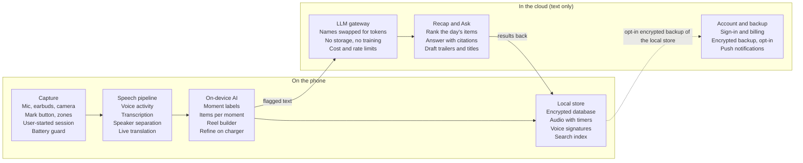

# PRD: Day Recap App (working name)

Oct 24, 2026 · YW

> Repository snapshot of the Claude Docs PRD, exported 2026-10-25.
> Canonical, editable source: https://claude.ai/artifact/YQ9ysRc7qxkbo6W1c3Z7qn
> Embedded diagrams are rendered here as tables or Mermaid; the wireframes are not reproduced.

## Pitch and positioning

**Be there. Your phone remembers.** We are not a casual always-on diary or a travel-only app. We are a companion for the moments where too much is said to remember, where you cannot take notes, or where you would rather be present than film.

**What it is.** A phone app that listens (and films when you ask), knows who said what, and turns each moment into the right output: minutes for a meeting, care notes for a doctor's visit, a bilingual journal for a trip, a reel for a show. At night it hands back one short recap.

**Why not "casual daily diary".** Always-on diaries such as Bee produce lots of data with uneven returns, and people push back on being recorded everywhere. A diary alone is a nice-to-have.

**Why not "travel only".** Trips create the most emotion and the most sharing, but most people travel a few times a year. That wins downloads, not a daily habit.

**The positioning that works: one engine, many "Scenes".** Each Scene is a type of moment with its own output.

| Role in the business | Scenes | Why |
| --- | --- | --- |
| Daily habit (retention) | Conversations and meetings | Happens every workday; promises and decisions are the daily reward |
| High-stakes moments (willingness to pay) | Appointments (doctor, lawyer, bank, landlord) | Patients forget 40 to 80% of what clinicians tell them right away. Getting it right matters a lot. |
| Wow moments (growth) | Trips abroad, shows and events | Bilingual conversations and reels are shareable and bring in new users |

**Launch recommendation:** lead with Conversations plus Trips. Conversations give a reason to open the app every day. Trips give the demo, the word of mouth and a strong first market: people in Taiwan, Japan and Korea travel often between countries where language is a barrier. Appointments follow next, once the consent and privacy features are proven.

**Why now.** Phones can now transcribe long, distant, multi-speaker audio on the device. Apple's iOS 26 speech model is built for meetings and conversations and runs without a server. Open-source tools can also separate speakers on the phone. A year or two ago, this needed a server and a dedicated device.

## Standout scenarios

The app is outstanding, not just helpful, where four things meet: a lot is said fast, you cannot take notes, more than one person or language is involved, and getting it wrong costs something. Ten scenarios scored on those terms; the first four ship in v1.

| Scenario | What makes it hard today | What the app hands back | Pain | Frequency | Shareable | Ship |
| --- | --- | --- | --- | --- | --- | --- |
| **Meetings and work conversations** | Note-taking splits attention; promises get lost | Speaker-labeled minutes, decisions, promises with due dates, a follow-up draft | High | Daily | Low | v1 |
| **Trip abroad** | Language barrier, too much to remember, no time to edit video | A bilingual conversation log with live subtitles, a day map, places and food mentioned, a trip reel | Medium | A few times a year, intense | High | v1 |
| **Shows and events** | Filming means missing the show; footage goes unwatched | Mark-a-moment, a beat-matched reel with captions, ready before you get home | Medium | Monthly | High | v1 |
| **Lectures and classes** | Fast talkers, slides, jargon | Notes by topic, glossary, flashcards, slide photos linked to the moment they were shown | High | Daily for students | Medium | v1 |
| **Doctor and care appointments** | Patients forget much of what they hear; stress | Care notes: what was said, next steps, questions to ask next time, shareable with family | Very high | Monthly | Family only | v1.1 |
| **Contractor, landlord, bank, legal** | "Who said what" disputes; lots of numbers | A plain record of terms, numbers and promises, with timestamps | High | Occasional | Low | v1.1 |
| **Conferences and networking** | Many names in a short time | People cards: name, company, what you talked about, follow-ups | Medium | Occasional, intense | Low | v1.1 |
| **Live captions for hard of hearing** | In-person group talk is hard to follow | Real-time captions with speaker labels on screen | Very high | Daily for those users | Low | v1.1 |
| **Language learning in real life** | No feedback on real conversations | Your own sentences with corrections and new words to review | Medium | Weekly | Medium | v2 |
| **Family moments** | Kids' firsts happen when nobody is filming | Weekly family reel and a quotes diary | Medium | Weekly | Family only | v2 |

Two scenarios deserve special mention. **Live captions** could make the app essential for people who are deaf or hard of hearing, using the same speaker-labeling engine. **Care appointments** carry the highest stakes: research finds patients forget 40 to 80% of medical information immediately, and nearly half of what they recall is wrong. Both wait for v1.1 because they need extra accuracy and privacy work.

## Goals, non-goals and success metrics

Version 1 succeeds if half of active users open the recap five days a week, users trust what it says, and trips and shows produce clips people share.

**Goals for v1**

1. **Habit:** the evening recap becomes a daily routine for people with conversation-heavy days.
2. **Trust:** transcripts say who said what, and every recap item can be checked against its source.
3. **Wow:** a trip or a show produces something worth sharing without any editing.
4. **Viable:** server cost per user stays a small share of the price.

**Non-goals for v1**

- Continuous background video (phones do not allow it).
- Recording phone calls (platform limits and consent law).
- Secret recording of any kind.
- Storing raw audio in the cloud by default.
- Team admin, enterprise features and a desktop app.
- Medical, legal or financial advice. Appointment notes record what was said; they never interpret it.
- A social feed. Sharing goes out to existing apps.

**Success metrics.** Targets are proposals to confirm in Phase 0.

| Metric | Definition | Beta target | Launch target |
| --- | --- | --- | --- |
| Recap habit | Share of weekly actives who open the recap 5+ days a week | 50% | 50% |
| Item accuracy | Share of recap items marked "wrong" | Under 8% | Under 5% |
| Speaker accuracy | Diarization error rate in 2 to 4 person, quiet rooms | Under 20% | Under 15% |
| Self-labeling | Share of the user's own lines correctly labeled "You" | 90% | 95% |
| Promise coverage | Promises users add by hand that the app missed, per week | Under 2 | Under 1 |
| Reel sharing | Share of exported reels that get shared | 25% | 33% |
| Battery | Battery used by 8 hours of Day mode | Under 20% | Under 15% |
| Unit cost | Server cost per paying user as a share of price | Under 30% | Under 20% |
| Consent | Meeting and Appointment sessions that showed the consent card | 100% | 100% |

## User journeys

Five journeys cover the launch Scenes. Each ends with the moment the user feels the value.

### J1. First ten minutes (onboarding)

1. The user installs the app and picks the Scenes they care about: Work, Trips, Shows, Classes.
2. A plain-language screen explains what is recorded, what stays on the phone, and how to pause. Then the app asks for microphone access.
3. **"This is me":** the user reads two sentences aloud (about 15 seconds). The app learns their voice so their lines are labeled "You". This voice sample stays on the phone.
4. The user sets home as a pause zone and picks a recap time (default 9 pm).
5. A one-minute demo: the user talks to the app about tomorrow's plans and sees a mini recap with one promise pulled out.

**Value moment:** "It caught what I said I'd do."

### J2. In-person meeting with four people

1. A calendar event starts. The app offers Meeting mode with the attendee names already loaded.
2. The user accepts. A consent card shows on screen ("Taking notes for this meeting; it stays on my phone") and an optional chime plays.
3. The live view shows text in speaker lanes: You, Speaker B, Speaker C, Speaker D.
4. After the meeting the app asks "Who is Speaker B?" and suggests attendee names. One tap per speaker names them for the whole session.
5. Minutes appear within two minutes: decisions, promises with owners and dates, open questions, and a draft follow-up message.
6. The user edits one line and shares the minutes to the team chat.

**Value moment:** minutes with correct names, without taking a single note.

### J3. Trip to Tokyo

1. Before leaving, the user creates a Trip with dates and the language pair (Japanese and Traditional Chinese). The app downloads offline language packs.
2. At a restaurant, the user opens Conversation mode and lays the phone on the table. The screen splits: Japanese subtitles face the server, Chinese face the user.
3. During the day the user snaps photos and taps "mark" at a street performance.
4. That night, the day journal shows a map of places visited, food and shops mentioned, translated conversations, photos and a short reel.
5. At the end of the trip, the app builds a trip reel and a journal the user can share with travel companions.

**Value moment:** "I talked to people I couldn't have talked to, and I have the whole trip without editing anything."

### J4. Concert

1. Music and crowd noise near a known venue trigger "Sounds like a show. Open the camera?"
2. The user films three short bursts and taps "mark" during the best song, then puts the phone away.
3. Walking out, the user gets three reel options in the Concert template, cut on the beat with captions.
4. Before export, a note warns that concert music may be muted on social platforms and offers a version with a royalty-free track.

**Value moment:** a post-ready reel, and most of the show watched with their own eyes.

### J5. Doctor's appointment (v1.1)

1. The night before, the user lists questions for the doctor in the app.
2. In the room, the user shows a consent card to the doctor. If the doctor says no, the user switches to typed notes.
3. Appointment mode records and labels "You" and "Doctor".
4. Afterwards, care notes list what was said, the next steps, the date of the next visit, and which of the user's questions were answered. Each line links to the audio.
5. The user shares the notes with a family member.

**Value moment:** the family knows exactly what the doctor said. The app records; it never interprets or advises.

## Feature requirements

Fifty-one features in seven areas; 28 are needed for launch. P0 means required for the public launch, P1 ships at launch if ready and otherwise in v1.1, P2 comes later. Acceptance targets are proposals to confirm in Phase 0.

### Capture

| Feature | What it does | Acceptance | Priority |
| --- | --- | --- | --- |
| Day mode, one-tap start | Starts from the Lock Screen widget, Action Button, Watch or a notification. Recording state stays visible (Live Activity on iOS, a foreground notification on Android). | Starts within 1 s; status visible from the Lock Screen | P0 · Launch |
| Moment mode with "mark" | Foreground camera with a large mark button. Marks also work during audio-only capture. | A mark lands within 0.2 s of the tap | P0 · Launch |
| Pause zones and private mode | Auto-pause at chosen places; one tap pauses for 30 minutes | Stops within 1 minute of entering a zone | P0 · Launch |
| Battery and storage guard | Pauses below 20% battery; warns below 2 GB free | Never drains the phone below 15% | P0 · Launch |
| Smart start suggestions | Suggests starting at calendar events, venues and airports | Accepted at least 30% of the time | P1 · Launch or v1.1 |
| Voice commands | On-device keyword spotting for "remember this" and "off the record" | Under 1 false trigger per 8 hours | P1 · Launch or v1.1 |
| External microphones | Uses Bluetooth earbuds or a clip-on mic when connected | Switches automatically | P1 · Launch or v1.1 |

### Speakers: who said what

This is the feature that makes transcripts trustworthy. Without it, everyone's words run together and the app cannot tell who promised what.

| Feature | What it does | Acceptance | Priority |
| --- | --- | --- | --- |
| Speaker separation | Splits a session into Speaker A, B, C, including overlapping speech | Diarization error under 15% for 2 to 4 people in a quiet room | P0 · Launch |
| "This is me" | The user's enrolled voice labels their lines as "You" | 95% of the user's lines labeled correctly | P0 · Launch |
| Name speakers | Tap a speaker and pick from calendar attendees or contacts; the name applies to the whole session | One tap per speaker | P0 · Launch |
| Fix speakers | Merge two speakers, split one, or reassign a single line | A fix updates the transcript and the recap | P0 · Launch |
| Owner-aware items | Promises and decisions record who said them and to whom | Owner correct on 90% of promises | P0 · Launch |
| Uncertain-speaker marker | Short or overlapping lines with low confidence show "?" instead of a guess | No low-confidence line is attributed silently | P1 · Launch or v1.1 |
| Remembered voices | Recognizes a named person in later sessions, only with that person's consent | Consent recorded before any voice is saved; revocable | P1 · Launch or v1.1 |

**How speaker identification works**

1. **Find speech.** A voice-activity detector drops silence and noise.
2. **Find speaker changes.** A segmentation model marks where the speaker changes and where two people overlap.
3. **Make a voice signature per segment.** A speaker-embedding model turns each stretch of speech into a short numeric vector.
4. **Group the segments.** Clustering puts similar vectors together; each group is one speaker. The calendar's attendee count is used as a hint.
5. **Attach words to speakers.** Word timestamps from transcription are matched to the speaker segments.
6. **Label known voices.** Groups that match the user's enrolled voice become "You". Groups that match a consented, remembered voice get that name. The rest stay "Speaker B", "Speaker C" until the user names them.
7. **Refine later.** Live lanes are a fast guess. When the session ends, the app re-clusters the whole recording for a better result.

**What helps accuracy:** placing the phone in the middle of the table, wearing earbuds (the user's mic hears them best), and telling the app how many people are present.

**Known limits:** far-away speakers, people talking over each other, similar voices, and very short replies such as "yes". These are shown with a "?" rather than guessed.

**Legal rule we design to:** a stored voice signature counts as a biometric identifier under laws such as Illinois's BIPA, and Fireflies was sued in December 2025 for creating voiceprints of meeting participants without their written consent. So voice signatures of other people are kept only for the session and deleted when it ends, unless that person consents. The user's own voice sample needs explicit consent. All signatures stay on the phone.

### Transcription and languages

| Feature | What it does | Acceptance | Priority |
| --- | --- | --- | --- |
| On-device long-form transcription | Platform speech models first, open models as fallback | Live text within 1.5 s of speech | P0 · Launch |
| Mandarin-English mixing | A model tuned for Taiwan's code-switching, such as Breeze-ASR-25 | Error rate at least 15% lower than the platform model on our test set | P0 · Launch |
| Live translation | Two-way subtitles for a conversation, offline once language packs are downloaded | Subtitle within 2 s of a sentence ending | P0 · Launch |
| Two-pass accuracy | Fast pass live; a slower, better pass while the phone charges | Morning transcripts show the improved pass | P1 · Launch or v1.1 |
| Custom vocabulary | The user adds names and jargon to bias recognition | Added words recognized in 90% of mentions | P1 · Launch or v1.1 |
| Language per segment | Detects each segment's language automatically | Correct on 95% of segments | P1 · Launch or v1.1 |

### Understanding and recap

| Feature | What it does | Acceptance | Priority |
| --- | --- | --- | --- |
| Moments and Scenes | Splits the day into moments and labels each with a Scene | Users correct under 10% of labels | P0 · Launch |
| Item extraction | Promises (both directions, with dates), decisions, facts and open questions | Every item links to its source lines | P0 · Launch |
| Evening recap | Ranked by value, at most 10 items, readable in about a minute | Opened 5+ days a week by half of actives | P0 · Launch |
| Feedback buttons | Right, wrong and not important on every item | Feedback changes the next day's ranking | P0 · Launch |
| Morning nudge | Reminds the user of promises due today | Only items above the confidence bar | P0 · Launch |
| Ask your day | Plain questions across all transcripts; answers cite and play the source | Every answer cites at least one source line | P1 · Launch or v1.1 |
| Weekly recap and trailer | Sunday summary plus a 30-second reel | Opened by 40% of weekly actives | P1 · Launch or v1.1 |
| Context from other apps | Calendar, location and the day's photos help label moments | Photos land in the right moment | P1 · Launch or v1.1 |
| Export to tasks | Promises go to Apple Reminders, Google Tasks or the calendar | One tap per item | P1 · Launch or v1.1 |

### Scenes

| Feature | What it does | Acceptance | Priority |
| --- | --- | --- | --- |
| Meeting | Minutes, decisions, promises and a follow-up draft | Ready within 2 minutes of the end | P0 · Launch |
| Trip | Trip container, offline language packs, bilingual log, day map, places and food mentioned, trip reel | Works offline except recap generation | P0 · Launch |
| Show | Detects shows, prompts the camera, builds reels | Prompt within 5 minutes of the show starting | P0 · Launch |
| Lecture | Topic notes, glossary, flashcards, slide photos linked to the moment they were shown | Flashcards from every lecture over 20 minutes | P1 · Launch or v1.1 |
| Appointment | Question prep, care notes, family sharing; records only, never advises | Consent card shown every time | P1 · Launch or v1.1 |
| Live captions | Large, speaker-colored captions in real time, for people who are hard of hearing | Caption delay under 1 s | P1 · Launch or v1.1 |
| Language practice | The user's own sentences in a foreign language, with corrections and words to review | Defined in v2 planning | P2 · Later |
| Family | Weekly family reel and a quotes diary | Defined in v2 planning | P2 · Later |

### Clips and reels

| Feature | What it does | Acceptance | Priority |
| --- | --- | --- | --- |
| Beat-matched montage | Three options from marked shots, cut on the beat | Ready within 3 minutes of the show ending | P0 · Launch |
| Templates | Concert, Night out, Trip and Food; each sets pace, captions, transitions and color | 4 templates at launch | P0 · Launch |
| Vertical crop and captions | Keeps the performer or speaker in frame; word-by-word captions | Subject in frame 90% of the time | P0 · Launch |
| Music-rights guard | Warning before export and a royalty-free track option | Shown on every export with detected music | P0 · Launch |
| Day and trip trailers | 30 to 60 second reels from a day or a trip | Built with no user editing | P1 · Launch or v1.1 |
| Bystander blur | Blurs faces other than the user's on export | On by default in Family | P1 · Launch or v1.1 |

### Sharing and privacy

| Feature | What it does | Acceptance | Priority |
| --- | --- | --- | --- |
| Privacy center | Shows everything stored, timers, zones and permissions | Two taps from Today | P0 · Launch |
| Consent card and chime | Shown at the start of Meeting and Appointment sessions | Every such session | P0 · Launch |
| Auto-delete timers | Raw audio kept 7 days by default (1 to 30); video until the reel is made or 7 days | Deletion checked by an automated test | P0 · Launch |
| Export everything | Markdown, PDF and audio files | A year of data exports in under 10 minutes | P0 · Launch |
| Forget a person | Removes a named person's lines and any saved voice | One action | P1 · Launch or v1.1 |
| Share notes and journals | Minutes or a trip journal as text, PDF or a private link | Links can be revoked | P1 · Launch or v1.1 |
| Encrypted backup | Optional end-to-end encrypted cloud backup | The server cannot read backups | P1 · Launch or v1.1 |
| Shared trip | Travel companions merge photos and reels into one trip | Defined in v2 planning | P2 · Later |

## Basic design

The design has one job: make it effortless to start, obvious when it is listening, and fast to check what it heard. Three screens carry the daily loop: Today, the live meeting, and the evening recap (wireframes live in the source doc).

In the live meeting, each speaker gets a color lane. An unknown voice shows "Speaker C ?" until the user taps a name. The recap shows promises first, and every line opens the moment it came from.

**Design principles**

- **Recording state is never ambiguous.** A colored pill on Today, a Live Activity on the Lock Screen, and a different color for private mode.
- **One main action per screen.** Pause on Today, stop-and-make-minutes in a meeting, open-the-moment in the recap.
- **Sources everywhere.** Any line in a recap, journal or answer opens its transcript and audio.
- **Guess quietly, ask lightly.** Low-confidence speakers and labels show "?" and offer a one-tap fix.
- **Calm by default.** One evening notification, one morning nudge; everything else is opt-in.
- **Readable anywhere.** Dark mode, large-text support, and a captions view legible at arm's length.

**Screen map**

| Screen | What is on it | Notes |
| --- | --- | --- |
| Today | Capture button, status, today's moments | Home screen |
| Live session | Speaker lanes, mark button, translation subtitles in Trip | One layout for all Scenes |
| Conversation (Trip) | Split screen: the other person's language faces them, yours faces you | Phone lies flat between two people |
| Recap | Promises, decisions, things to remember, reel, fun line | Opens from the evening notification |
| Timeline | The day as moment cards | Tap to open a moment |
| Moment | Transcript by speaker, items, audio, fix tools | Where corrections happen |
| Trip | Day map, journal, photos, places and food, trip reel | One per trip |
| Clips | Reel options, templates, export | Opens after a show |
| Ask | Questions across all days, answers with sources | Search box plus suggestions |
| People | Named speakers, remembered voices and consent status | Opt-in |
| Privacy | What is stored, timers, zones, export, forget a person | Two taps from Today |

## Technical design

The app is Flutter with native modules for capture, speech and video. Audio, video and voice signatures never leave the phone; only text from flagged moments goes to the cloud, through one gateway that swaps names for tokens.

On-device models handle anything that touches raw audio. The cloud handles the jobs that need a large model and the whole day's context: ranking the recap and answering questions.

### Component choices

| Layer | iOS | Android | Notes |
| --- | --- | --- | --- |
| App and UI | Flutter | Flutter | About 70 to 80% of the code |
| Audio capture | AVAudioEngine; session started in the foreground keeps running in the background | Foreground service of microphone type with a visible notification | Native modules |
| Voice activity and keyword spotting | sherpa-onnx (Silero VAD, keyword spotter) | Same | One open-source library on both platforms |
| Transcription | [SpeechAnalyzer](https://developer.apple.com/videos/play/wwdc2025/277/) (iOS 26+), built for long-form, distant, multi-speaker audio | [ML Kit GenAI Speech Recognition](https://developers.google.com/ml-kit/genai/speech-recognition/android) (basic mode on API 31+, advanced mode on recent Pixels) | Open Whisper-family models as fallback |
| Taiwan Mandarin-English mixing | [Breeze-ASR-25](https://huggingface.co/MediaTek-Research/Breeze-ASR-25) via whisper.cpp | Same | 1.55B parameters, so test running it only in the charging pass |
| Speaker separation and identity | [sherpa-onnx diarization](https://k2-fsa.github.io/sherpa/onnx/speaker-diarization/index.html): pyannote segmentation plus 3D-Speaker or NeMo embeddings | Same | Has Dart, Swift and Kotlin APIs |
| Translation | Apple Translation framework, on-device | ML Kit on-device translation | Language packs downloaded before a trip |
| On-device language model | [Foundation Models](https://www.infoq.com/news/2026/03/apple-foundation-models-context/), about 3B parameters, 4,096-token context, typed outputs | Gemini Nano through ML Kit's Prompt API with structured output | Per-moment work only; cloud fallback on older phones |
| Video and reels | AVFoundation, Vision for person tracking | Media3 Transformer, ML Kit face detection | Rendered on the phone |
| Local data | SQLite with SQLCipher encryption; full-text plus vector search for Ask | Same | Through a Flutter database layer |
| Backend | Supabase: auth, Postgres for accounts and billing, edge functions as the gateway | Same | No transcripts stored on the server |
| Cloud language model | A large model for recaps and Ask; a small one for routine labels | Same | Provider with zero data retention |

### Processing passes

| Pass | When | Where | Budget |
| --- | --- | --- | --- |
| 1. Live | While recording | Phone | Text within 1.5 s; provisional speaker lanes |
| 2. Session close | Within 2 minutes of a session ending | Phone, plus cloud for labels | Re-cluster speakers, extract items, write minutes |
| 3. Evening recap | At the user's recap time | Cloud, over a text digest of the day | Under 30 s |
| 4. Overnight refine | While charging on Wi-Fi | Phone | Better transcription pass, re-run items, update the morning nudge |

### Data model

| Entity | Key fields | Where it lives |
| --- | --- | --- |
| Session | Scene, start, end, place, consent shown, attendee count | Phone |
| Utterance | Session, speaker, start, end, text, language, confidence, translation | Phone |
| Speaker | Display name, is-self, signature reference, consent date, expiry | Phone; signature never synced |
| Moment | Session, label, start, end, short summary | Phone |
| Item | Type (promise, decision, fact, question), owner, counterpart, due date, source utterances, confidence, status | Phone |
| Media | Kind (audio, video, photo), path, marks, delete-at | Phone |
| Clip | Template, source media, marks used, export path | Phone |
| Recap | Day, ordered items, model version, user feedback | Phone |
| Account | Plan, devices, backup key metadata | Server |

### Cloud API (text only)

| Endpoint | Sends | Returns |
| --- | --- | --- |
| POST /v1/moments/label | One moment's text with speakers as tokens (S1, S2) | Scene label, summary, items as typed JSON |
| POST /v1/recap | The day's moment summaries and items | Ranked recap, fun line |
| POST /v1/ask | The question plus top matching snippets found on the phone | Answer with snippet citations |
| POST /v1/backup | Encrypted blobs, opt-in only | Receipt |

The phone does the search for Ask and sends only the matching snippets, so the server never holds a searchable copy of anyone's life.

## Privacy, consent and compliance

Trust is a launch requirement, not a setting: every rule below must pass before release, and a legal review in each launch market (Taiwan first) signs them off.

**Consent**

- Meeting and Appointment sessions always show a consent card; an audible chime is on by default where local law requires all-party consent.
- The app never records unless the user started a session or accepted a prompt. No hidden or automatic background start.
- Setup explains, in plain words, that recording others may need their consent where the user lives, and links to local guidance.

**Voice signatures (biometric data)**

- The user's own voice sample is collected only after explicit consent and stays on the phone.
- Other people's signatures exist only for the length of a session and are deleted when it ends.
- A person's voice is remembered across sessions only after that person agrees, in a consent screen on the user's phone, with the date recorded and a way to withdraw.
- A published retention and deletion policy for voice data, as Illinois's BIPA requires; remembered voices are off in regions with strict biometric laws until legal review clears them.
- No voice signatures for children, ever.

**Data minimization**

- Silence and background noise are never stored.
- Raw audio auto-deletes after 7 days by default; video is kept only until its reel is made or 7 days pass.
- Only text from flagged moments goes to the cloud, with names replaced by tokens. The language-model provider must agree to zero retention and no training.
- The phone searches; the server never holds a searchable archive.

**User controls**

- Privacy center, pause zones, private mode, forget a person, export everything, delete account.
- Deleting the account removes server-side data within 30 days.

**Bystanders**

- Reels blur faces other than the user's when Family or bystander mode is on, and can mute other voices.

**App stores**

- Background audio is used only to continue a session the user started in the foreground, with the system recording indicator visible. Apple has rejected apps that use the background audio mode for other purposes.

## Release plan

Public launch in Taiwan lands in week 26, with v1.1 eight weeks later. Gate A is the one that matters most: it proves the phone can capture all day and tell speakers apart before any feature work starts.

| Phase | Weeks | Scope | Gate to pass before the next phase |
| --- | --- | --- | --- |
| Phase 0 · Feasibility | 1 to 3 | 8-hour capture, battery, speaker accuracy, Mandarin-English test set. Concierge recap and hand-made reel tests with 15 users. | **Gate A (the one that matters most):** capture holds 8 hours; speaker error under 20%; recap opened 5+ days by half |
| Phase 1 · MVP alpha | 4 to 11, iOS | Day mode, Meeting Scene, speaker separation, You, naming and fixes. Evening recap, morning nudge, consent card, privacy center. | **Gate B:** half of 30 alpha users open the recap 5+ days; under 8% of items wrong |
| Phase 2 · Beta | 12 to 19 | Trip Scene with live translation, Show Scene with reels, Ask your day. Android capture service; 200-user beta in Taiwan. | **Gate C:** a quarter of reels shared; battery under 20%; cost per user inside budget |
| Phase 3 · Launch | 20 to 26 | Lecture Scene, pricing, legal review, App Store and Play review. Public launch in Taiwan on iOS and Android. | **Gate D:** store approval and legal sign-off before release |
| v1.1 | 27 to 34 | Appointment Scene, live captions, remembered voices with consent. Export to tasks, weekly trailer, people cards. | — |

Missing a gate means fixing or narrowing the product, not starting the next phase.

**Team.** One Flutter engineer, one native engineer (Swift and Kotlin) for capture, speech and video, one backend and ML engineer for the gateway, prompts and evaluation, a part-time designer, and a product lead who runs user tests. A smaller team should cut the Show Scene from v1 and keep Meetings plus Trips.

**Evaluation set.** Before Phase 1, record and hand-label about 20 hours of real audio: meetings of 2 to 6 people, restaurants, lectures and Mandarin-English mixing. Every speech, speaker and item change is scored against it.

## Risks, open questions and sources

The biggest risks are speaker accuracy in real rooms and consent law; both are tested in Phase 0 before feature work begins.

| Risk | Impact | Mitigation | Early sign |
| --- | --- | --- | --- |
| Speaker separation fails in noisy rooms | High | Phone placement tips, earbuds mic, attendee-count hint, "?" instead of guessing | Error over 20% on the evaluation set |
| Mandarin-English mixing is mis-transcribed | High | Breeze-ASR-25 in the charging pass; custom vocabulary | Error rate above the platform model's |
| Voiceprint and consent law | High | Session-only signatures for others, consent flows, legal review per market | Legal review flags, user complaints |
| iOS stops background capture or rejects the app | High | User-started sessions, visible indicator, honest purpose text | Drops in the 8-hour test |
| Recap invents details | High | Source links, confidence gating, typed outputs | Over 8% of items marked wrong |
| Battery drain | Medium | Voice-activity gating, heavy passes only on the charger | Over 20% per 8 hours |
| Apple or Google ship similar built-in features | Medium | Compete on Scenes, speaker-labeled outputs, cross-platform, reels | Platform announcements |
| Concert audio muted on social platforms | Medium | Rights warning, royalty-free track option | Muted exports |

**Open questions**

- [ ] Product name. "Day Recap App" is a placeholder.
- [ ] Confirm Taiwan as the first market, and which languages besides Traditional Chinese and English must work at launch.
- [ ] Is the Trip Scene in v1, or v1.1 if the team is smaller than planned?
- [ ] Pricing: test $7.99 to $9.99 a month or $79 to $99 a year.
- [ ] Our stance where all-party consent applies: chime on by default, or consent card only?
- [ ] Which cloud language model provider, and does it offer zero retention in our markets?

This PRD builds on the earlier research and feature doc: [Day Recap App: Feature Deep Dive and Dev Plan](feature-deep-dive-and-dev-plan.md).

**Sources**

- [Kessels 2003: patients' memory for medical information](https://pmc.ncbi.nlm.nih.gov/articles/PMC539473/)
- [HealthDay: patients forget up to 80% of what doctors say](https://www.healthday.com/health-news/general-health/don-t-forget-what-the-doctor-tells-you-512961.html)
- [Apple WWDC25: SpeechAnalyzer](https://developer.apple.com/videos/play/wwdc2025/277/)
- [Add Pipe: SpeechAnalyzer languages and platforms](https://blog.addpipe.com/apple-speechanalyzer-api/)
- [InfoQ: Foundation Models context window](https://www.infoq.com/news/2026/03/apple-foundation-models-context/)
- [Apple: TranslationSession](https://developer.apple.com/documentation/translation/translationsession/configuration)
- [Google: ML Kit GenAI Speech Recognition](https://developers.google.com/ml-kit/genai/speech-recognition/android)
- [Android Developers: Gemini Nano](https://developer.android.com/ai/gemini-nano)
- [sherpa-onnx: speaker diarization](https://k2-fsa.github.io/sherpa/onnx/speaker-diarization/index.html)
- [Hugging Face: Breeze-ASR-25](https://huggingface.co/MediaTek-Research/Breeze-ASR-25)
- [DIGITIMES: MediaTek releases Breeze ASR 25](https://www.digitimes.com/news/a20250701PD240.html)
- [Epstein Becker Green: Fireflies BIPA lawsuit](https://www.ebglaw.com/insights/publications/ai-meeting-assistants-and-biometric-privacy-lessons-from-the-fireflies-ai-lawsuit)
- [Data Privacy + Security Insider: Fireflies lawsuit](https://www.dataprivacyandsecurityinsider.com/2025/12/lawsuit-alleges-fireflies-ai-corp-illegally-collects-biometric-data-from-virtual-meetings/)
- [Apple Developer Forums: background audio recording](https://developer.apple.com/forums/thread/776949)
